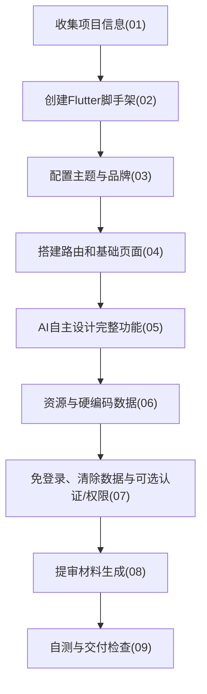

# 从0开始制作Flutter应用 - 总体思路与使用说明

## 1. 这套流程解决什么问题？

- **目标**：让你在只提供**项目名称、产品类型、配色**（可能还有一个项目模板）的情况下，通过 AI 工具从0开始快速搭建一个**完整可用的 Flutter 应用**。
- **核心特点**：
  - **AI 自主设计完整功能体系**：你只需提供产品方向（如"健康追踪应用"、"食谱管理应用"），AI 会自主设计所有必要功能、用户流程、界面和交互逻辑。
  - **真实感数据填充（Mock 方案）**：所有数据使用 Mock 方案，通过模拟请求数据展示假数据，假数据放在 `lib/{{项目名}}/data/` 文件夹里，AI 会创建真实感的示例内容和用户数据，让应用看起来像成品。
  - **统一命名规范**：所有文件名、文件夹、模块名、方法名都以项目名为前缀（如 `huddle_home_page.dart`、`huddleBuildBody`）。
  - **完整应用体验**：默认免登录，包含清除本地数据、可选认证、用户生成内容、权限管理和提审材料。
  - 每一步都配有「给AI的提示词模板」，可以直接复制到 Cursor / ChatGPT / Claude 等工具中执行。

## 2. 使用前你需要准备什么？

**极简输入**（只需以下信息）：

- **项目名称**：例如 `huddle`、`zenith` 等（将作为所有命名前缀）。
- **产品类型/方向**：例如"健康追踪应用"、"食谱管理应用"、"旅行日记应用"、"社交聊天应用"等。
- **配色方案**：主色、辅色等（可以只给颜色方向，如"蓝色系"、"绿色系"）。
- **Git 仓库链接（可选）**：如果你有现成的项目或模板，可以提供 git 链接，AI 会先分析仓库结构，用作架构参考。
- **项目模板（可选）**：如果你有一个参考项目，可以提供其架构或关键文件作为模板。
- **用户认证（可选）**：当前统一选择「不需要登录」，`{{项目名}}AuthEnabled = false`；所有模板和示例以免登录为默认，只有明确变更需求时才启用认证。

### 固定配置与验收基线

- `pubspec.yaml` 必须为 `version: 1.0.0`，`environment.sdk: ^3.10.9`，`environment.flutter: ">=3.44.0"`。
- 实际工具链满足 Dart `>=3.10.9 <4.0.0`、Flutter `>=3.44.0`；`flutter pub get` 后检查 `pubspec.lock` 的 `sdks`，目标同上，不能手工伪造锁文件（详见 02）。
- `ios/Flutter/AppFrameworkInfo.plist` 的 `MinimumOSVersion` 必须为字符串 `15.6`，Podfile 与 Runner 的 iOS 部署版本同步为 `15.6`（详见 02）。
- `ios/Runner/Assets.xcassets/AppIcon.appiconset/Contents.json` 使用普通、深色、着色三个 universal / ios / 1024x1024 项，文件依次为 `logo.png`、`logo 1.png`、`logo 2.png`，完整 JSON 与图片检查见 03。
- 当前不显示登录、退出登录、删除账号入口；设置页必须提供 **Clear Data（清除本地数据）**，二次确认后清除本应用保存的数据并同步重置页面，返回主页面，重启不能恢复已清除数据（详见 07）。

> **提示**：建议先填写 `前期信息准备.md` 文件，然后提供给 AI 工具，这样信息更完整、更规范。  
> 当 AI 拿到这份文件后，**第 0 步应该先做两件事**：  
> 1. **根据“应用名称”创建仅支持 iOS 平台的 Flutter 工程**（例如：`flutter create --project-name {{项目名}} --org com.{{项目名}} --platforms=ios {{项目名}}`），确保本项目从一开始就是 iOS-only；  
> 2. 在新工程根目录下创建 `docs/` 文件夹，并生成 3 个文档：`docs/当前项目信息.md`、`docs/步骤.md`、`docs/当前数据说明.md`，后续所有步骤都围绕这 3 个文档来读写信息。

**第一步会生成的文档**：

在 01 步骤（项目信息收集与AI功能设计）完成后，AI 会生成以下文档到项目中：

1. **`当前项目信息.md`**：
   - 存放位置：`docs/当前项目信息.md` 或项目根目录
   - 内容：详细的项目信息（功能模块、用户流程、界面结构等）
   - 用途：后续所有步骤的输入来源

2. **`步骤.md`**：
   - 存放位置：`docs/步骤.md` 或项目根目录
   - 内容：简要列出整个项目的制作步骤（00–09）和当前进度
   - 用途：快速查看项目制作进度，了解下一步要做什么

3. **`当前数据说明.md`**：
   - 存放位置：`docs/当前数据说明.md`
   - 内容：记录当前使用的 Mock 数据结构、数据源策略（如本地 JSON、内存数据）、主要资源路径（如图片目录）等
   - 用途：统一描述“这一次马甲”的数据与资源使用方案，后续可以直接对照修改以快速生成新的马甲包

> **重要**：
> - 你不需要提供详细的功能列表、用户流程、界面设计等。这些都会由 AI 根据产品类型自主设计并实现。
> - **平台要求**：本项目**仅支持 iOS 平台**，不需要支持 Android 或其他平台，创建工程时务必使用 `--platforms=ios`。
> - **参考项目使用原则**：如果你提供了参考项目（Git 链接或项目模板），AI 应该：
>   - 分析参考项目的架构和设计思路，作为**参考和启发**；
>   - **允许快速复用的部分**：对于参考项目中已经存在的**闪屏页、登录页、用户中心页、资料编辑页、设置页**等基础壳页面，可以在本项目中直接复用其功能和布局，只需：
>     - 按当前免登录配置移除登录重定向与账号操作入口；登录页仅在明确启用认证后复用；
>     - 把所有文件名、类名、方法名等统一改为当前应用的**项目名前缀**；
>     - 替换 Logo、应用名、主题色和文案等品牌元素；
>   - 除上述基础壳页面外，其余业务模块仍应避免全盘照抄，基于参考项目的架构思路，**发挥自己的想象力和创造力**，设计出符合当前产品类型的独特功能和界面。

## 3. 整体步骤一览（00–09）

整个流程按时间顺序大致分为 9 个阶段（00 为当前文档）：

- **00 - 总体思路与使用说明**（当前文档）
- **01 - 项目信息收集与AI功能设计**
- **02 - 项目脚手架创建与基础配置（命名规范）**
- **03 - 主题风格与品牌配置**
- **04 - 路由与基础页面框架搭建**
- **05 - 核心功能模块完整实现（AI自主设计）**
- **06 - 资源文件与数据管理（Mock 方案）**
- **07 - 用户认证系统与权限管理**
- **08 - 提审材料与合规文档生成**
- **09 - 自测、自动化检查与交付清单**

> **在正式进入 01–09 这些详细步骤文档之前，可以让 AI 先执行“第 0 步”：在本地通过命令创建一个仅支持 iOS 平台的 Flutter 工程（例如：`flutter create --project-name {{项目名}} --org com.{{项目名}} --platforms=ios {{项目名}}`），并在工程根目录创建 `docs/` 文件夹，生成 `当前项目信息.md`、`步骤.md`、`当前数据说明.md` 三个文档。如果你提供了 git 仓库链接，则在创建或打开工程后配置远端并切换到 `feat/v1.0.0` 分支，再按照 01–09 的顺序往下执行。**

简单关系图：



## 4. 每个步骤大概在做什么？

- **01 项目信息收集与AI功能设计**
  - 收集项目名称、产品类型、配色等基础信息。
  - **AI 自主设计完整功能体系**：基于产品类型，AI 会设计所有必要功能、用户流程、界面结构。
  - **生成两个文档到项目中**：
    - `当前项目信息.md`：详细的项目信息文档（功能列表、用户流程、界面结构等）
    - `步骤.md`：简单的步骤进度文档（用于快速查看项目制作进度）

- **02 项目脚手架创建与基础配置（命名规范）**
  - 使用 `flutter create` 创建工程，**所有命名以项目名为前缀**。
  - 配置 GetX（状态管理 + 路由）。
  - 规划模块化目录结构，确保所有文件/文件夹/模块/方法名都遵循命名规范。

- **03 主题风格与品牌配置**
  - 根据配色方案，生成主题配置（颜色、字体、组件风格）。
  - 在 Flutter 工程中接入主题，使 UI 体现品牌特征。

- **04 路由与基础页面框架搭建**
  - 使用 GetX 配置路由。
  - **实现闪屏页面**（Splash Screen）：显示 Logo 和加载动画，完成初始化后默认直接进入主页面；登录状态分流仅在明确启用认证后生效。
  - 生成应用主框架（首页、Tab、抽屉等）和所有页面骨架（**以项目名为前缀命名**）。

- **05 核心功能模块完整实现（AI自主设计）**
  - **AI 自主设计并实现所有功能模块**：包括首页浏览、内容创建、个人中心、设置管理等完整链路。
  - 每个功能模块都有对应的 UI 界面和交互逻辑。
  - **列表页面必须支持下拉刷新和上拉加载功能**（使用 `pull_to_refresh` 包），可以随机从已有数据中获取模拟，某些场景只需要下拉刷新。
  - 实现用户生成内容功能（发帖、评论等）。
  - 如有聊天功能，实现图片/文本两种消息类型。

- **06 资源文件与数据管理（Mock 方案）**
  - 在 `assets/{{项目名}}_img/` 目录下组织资源文件。
  - **重要：A面资源绝对不能放在 `assets/images` 目录**，该目录是B面专用的。
  - 创建数据管理类，**使用 Mock 方案提供假数据**（通过模拟请求数据，假数据放在 `lib/{{项目名}}/data/` 文件夹里）。
  - 头像使用 `https://i.pravatar.cc/150?img=\(Int.random(in: 0...70))`，其他封面等图片优先在 Pinterest 搜索。
  - UI 文案使用英文，代码注释使用中文。

- **07 用户认证系统与权限管理**
  - 默认免登录：闪屏后进入主页面，个人资料与行为记录独立持久化，重启后恢复。
  - 设置页必须提供 Clear Data 按钮及二次确认，同步清除持久化数据、内存与页面状态，成功后返回主页面。
  - 当前不显示登录、退出登录、删除账号；可选认证只有明确启用后才实现完整流程。
  - 权限管理：处理相机 / 相册 / 麦克风权限请求，在 `Info.plist` 中添加说明文案。

- **08 提审材料与合规文档生成**
  - 在 `/audit/` 目录下创建 `agreement/` 文件夹。
  - 生成英文 HTML 文件（保存在 `/audit/agreement/` 目录下）：
    - `Terms&Conditions.html`（用户协议，必须）
    - `PrivacyPolicy.html`（隐私政策，必须，支持邮箱：support@[AppName].com）
    - `index.html`（关于我们，可选）
    - `Support.html`（支持页面，可选）
    - `logo.png`（应用 Logo 图片）
  - 创建协议管理类（`lib/{{项目名}}/config/{{项目名}}_agreement_config.dart`），用于集中管理协议文件路径，方便后续修改替换。
  - 创建 `/audit/Intro.md`：应用介绍、关键字、类别、副标题（符合 AppStoreConnect 规范）。

- **09 自测、自动化检查与交付清单**
  - 制定基础自测用例。
  - 运行 `flutter test`（如有测试）。
  - 生成 Podfile 并运行 `pod install`。
  - 在交付前跑一遍清单，确认应用准备就绪。
  - **注意**：不需要执行 `flutter analyze` 命令，代码规范通过 IDE 自动检查。

## 5. 如何与 AI 配合使用这套流程？

整体理念：**人提供方向和约束，AI 负责写代码和生成配置。**

### 核心原则

1. **发挥 AI 的想象力和创造力**
   - 在提供产品类型和基础信息后，鼓励 AI 自主设计完整的功能体系、用户流程和界面结构。
   - 让 AI 发挥创造力，实现功能性和完整性，而不仅仅是按模板填空。
   - **重要**：如果你提供了参考项目（Git 链接或项目模板），AI 应该：
     - 分析参考项目的架构和设计思路，作为**参考和启发**；
     - **不能全盘照抄**参考项目的代码、功能或设计；
     - 基于参考项目的架构思路，**发挥自己的想象力和创造力**，设计出符合当前产品类型的独特功能和界面。

2. **分模块生成，避免上下文过多**
   - 涉及到模块代码生成时，**可以一个个模块生成**，避免一次性生成所有模块导致上下文过多而中断。
   - 例如：先完成首页模块，再完成个人中心和设置模块，以此类推；当前不需要登录模块。

3. **记录完成的工作，保持上下文连续性**
   - **完成每一步时，可以简单列出完成的工作**，好接入上下文，避免断层问题。
   - 建议在每次与 AI 对话时，先简要说明已完成的内容，再提出新的需求。

在每个步骤文档中，你都会看到三块固定结构：

- **前置输入**：  
  - 人需要提前准备 / 决策的信息。  
  - 建议你把这些信息整理成一个 Markdown 或 JSON 片段，然后在提示词里一起发给 AI。

- **给AI的提示词模板**：  
  - 可直接复制到 AI 对话框的提示文本。  
  - 里面会留出 `{{占位符}}`，由你用自己的项目信息替换。

- **执行步骤与注意事项**：  
  - 说明 AI 返回结果后，应该放到项目里的哪个文件、哪个目录。  
  - 标记哪些地方需要你手动检查或调整。

### 一个典型的使用循环

以「03 主题风格与品牌配置」为例，你的工作流程大致是：

1. 打开 `03-主题风格与品牌配置（A面特征）.md`。
2. 在「前置输入」里，把你已经确定的品牌/颜色信息补充完整。
3. 复制「给AI的提示词模板」，把其中的 `{{占位符}}` 换成你的内容，发给 AI。
4. 拿到 AI 返回的 Dart 代码/配置后，根据「执行步骤」说明，粘贴到对应文件中。
5. 按「注意事项」检查一下（编译是否通过、主题是否生效等）。

其他步骤（01–09）也都遵循类似的使用节奏。

## 6. 推荐的执行策略

- **策略A：自上而下，一次完整走完 01–10**
  - 适合第一次从0搭建这类 App。
  - 好处是结构清晰，后续再复制马甲时，几乎可以「照着做」。

- **策略B：先跑通主流程，再补充细节**
  - 优先完成 01 → 02 → 04 → 05 → 08（主流程闭环）。
  - 之后再强化 03（视觉）、06（资源文案）、07（免登录、清除数据与权限）。

- **策略C：结合你现有的「代码特征修改方案」**
  - 如果你已经有一个旧项目，可以：  
    - 用本流程从0搭一个「干净模板项目」。  
    - 同时沿用《代码特征修改方案》去改旧项目，看差异和优化空间。  
  - 最终可以把旧项目逐步迁移到这套从0设计的结构上。

## 7. 与现有文档体系的衔接方式

这套《从0开始制作马甲包》与当前的：

- 《代码特征修改方案》
- 《文案修改方案》
- 《资源替换指南》

之间的关系可以简单理解为：

- **旧文档**：在「既有项目」上做特征修改和克隆。
- **新文档（本文件夹）**：指导你「从0搭一个更适合做马甲的项目骨架」。

未来你可以：

- 继续使用旧文档做已有项目的变体。
- 用新文档来创建新项目（每一个新A面），然后再基于这个新项目继续做马甲扩展。

## 8. 建议的文件结构示例（Flutter 工程内）

当你执行完 02–06 步骤后，一个完整的 Flutter 项目，大致会长成这样（以项目名 `huddle` 为例）：

```text
lib/
  core/
    theme/
    routing/
  shared/
    widgets/
    utils/
  modules/
    {{项目名}}_settings/      # 例如：huddle_settings，包含 Clear Data
    {{项目名}}_home/          # 例如：huddle_home
    {{项目名}}_profile/       # 例如：huddle_profile
    {{项目名}}_chat/          # 例如：huddle_chat（如有）
  data/
    models/                   # 数据模型定义
    images/                   # 图片数组配置（每个模块独立的图片数组）
    repositories/       # 数据管理类，使用 Mock 方案提供假数据（所有数据文件尽量放在 data/ 文件夹里）
  config/                     # 配置管理（包括协议配置等）
main.dart

assets/
  {{项目名}}_img/             # 例如：huddle_img/（A面资源目录）
    icons/
    # 注意：A面资源绝对不能放在 assets/images 目录，该目录是B面专用的

audit/
  Intro.md
  agreement/
    Terms&Conditions.html    # 用户协议
    PrivacyPolicy.html        # 隐私政策
    index.html               # 关于我们（可选）
    Support.html             # 支持页面（可选）
    logo.png                 # 应用 Logo 图片

lib/{{项目名}}/config/
  {{项目名}}_agreement_config.dart  # 协议管理类
```

**命名规范示例**（其中 page/controller 等后缀须与该项目选定的「模块架构命名方案」一致，见第 9 节）：
- 文件名：`huddle_home_page.dart`、`huddle_profile_controller.dart`、`huddle_card.dart`（组件）
- 模块名：`huddle_home`、`huddle_auth`
- 组件类名：`HuddleCard`、`HuddleButton`（通用组件）
- 方法名：`huddleBuildBody()`、`huddleNavigateToDetail()`
- 文件内的函数（私有函数或工具函数）：`_huddleCalculateTotal()`、`_huddleFormatDate()`（避免多个文件之间的函数名冲突）

这里的 `core/`、`modules/`、`data/` 目录，都会在后续步骤文档中被详细说明如何通过 AI 来生成初版代码。

## 9. 核心规范与要求总结

### 命名规范（严格执行）
- **文件名和文件夹**：以项目名为前缀，如 `huddle_home_page.dart`、`huddle_settings/`
- **模块名**：以项目名为前缀，如 `huddle_home`、`huddle_auth`
- **方法名**：以项目名为前缀，如 `huddleBuildBody()`、`huddleNavigateToDetail()`
- **文件内的函数（私有函数或工具函数）**：以 `_{{项目名}}` 为前缀，如 `_huddleCalculateTotal()`、`_huddleFormatDate()`，避免多个文件之间的函数名冲突问题

### 模块架构命名变化规则（严格执行）
- **每次从 0 创建一个新项目时，必须选用一套与以往项目不同的「模块层命名方案」**，避免所有马甲项目使用同一套目录/文件命名，增加可辨识差异。
- 模块层命名指：**页面/界面、组件、控制器、业务逻辑层、服务层、展示层**等对应的文件夹名与文件后缀（如 `_page`、`_controller`）。
- 可从以下示例中**任选一套**作为当前项目的唯一方案，或自行组合成一套新方案（保持项目内统一即可）：
  - **方案 A**：`page`（页面）、`component`（组件）、`controller`（控制器）、`service`（服务）、`widget`（通用控件）
  - **方案 B**：`presentation`（展示页）、`widget`（组件）、`controller`（控制器）、`service`（服务）
  - **方案 C**：`screen`（界面）、`component`（组件）、`controller`（控制器）、`widget`（控件）、`service`（服务）
- 选定方案后，**整个项目内**的目录名、文件后缀、类名后缀均按该方案统一使用；**下一个从 0 创建的项目**须换用另一套方案（例如上一项目用方案 A，本项目用方案 B 或 C）。
- 所选方案须在 **02 步骤** 确定，并写入 `当前项目信息.md` 的「模块架构命名方案」中，供后续 04、05 等步骤一致引用。

### 技术栈要求
- **状态管理**：GetX
  - 多个页面的状态管理：使用 GetX Controller
  - 简单页面：使用 Flutter 原生状态管理
- **路由**：GetX 路由
- **数据模型**：定义数据模型类

### 代码规范要求（严格执行）
- **导包规范**：**Flutter 的导包必须使用绝对路径**，不能使用相对路径（如 `../`、`../../` 等）。
  - ✅ 正确示例：`import 'package:项目名/模块名/文件名.dart';`
  - ❌ 错误示例：`import '../shared/widgets/button.dart';`
- **代码检查**：**不需要执行 `flutter analyze` 命令**。

### 主界面设计规范（严格执行）
- **底部 Tab 数量**：
  - **尽量设计 3、4 个 Tab**，根据产品类型和功能需求，发挥创造力和想象力自主决定
  - **如果中间是发布按钮**，则可能是 5 个 Tab（例如：首页、发现、发布、消息、我的）
  - 根据产品类型和功能需求，发挥创造力和想象力自主决定 Tab 数量
- **前两个 Tab 布局要求**：
  - **第一个 Tab（通常是首页）**：主要以**大图展示**为主，发挥想象力设计布局（如：轮播大图、瀑布流、卡片式大图等）。
  - **第二个 Tab**：主要以**九宫格**或类似网格布局为主，发挥想象力设计布局（如：3x3 网格、2x4 网格、不规则网格等）。
  - 布局设计要**有创意、有视觉冲击力**，不能只是简单的列表或单一布局。
- **其他 Tab**：根据产品类型和功能需求，AI 自主设计布局和交互方式，充分发挥创造力和想象力。

### 数据管理
- **数据使用 Mock 方案**：
  - **通过模拟请求数据**：使用 `Future.delayed` 模拟网络请求延迟
  - **展示假数据**：所有数据都是假数据，不依赖外部接口
  - **假数据存放位置**：**所有数据文件尽量放在 `lib/{{项目名}}/data/` 文件夹里**，方便后续数据替换
  - 数据管理类在 `lib/{{项目名}}/data/repositories/` 目录下，提供假数据
- **图片展示策略（严格执行）**：
  - **图片不重复展示**：使用的图片展示策略尽量不重复展示，确保不同模块、不同页面使用的图片尽量不重复
  - **图片数组配置**：
    - **每个模块之间留出独立的图片数组配置**，可以放置本地图片路径或网络图片 URL
    - 图片数组放在 `lib/{{项目名}}/data/` 文件夹下，按模块分类（例如：`lib/{{项目名}}/data/images/home_images.dart`、`lib/{{项目名}}/data/images/explore_images.dart`）
    - 图片数组使用 `List<String>` 类型，支持本地图片路径（如 `'assets/{{项目名}}_img/home/home_01.png'`）和网络图片 URL（如 `'https://...'`）
    - **修改图片数组即可生效**：只需要修改对应的图片数组文件，重新运行应用即可看到新的图片
  - **头像数据**：使用 `https://i.pravatar.cc/150?img=\(Int.random(in: 0...70))`（随机数范围 0-70）
  - **其他封面等图片**：
    - 优先在 `https://www.pinterest.com/` 中搜索真实图片 URL
    - **如果没有找到合适的图片**，可以使用以下 Unsplash 图片 URL：
      - `https://images.unsplash.com/photo-1522771739844-6a9f6d5f14af?w=500`
      - `https://images.unsplash.com/photo-1512436991641-6745cdb1723f?w=500`
      - `https://images.unsplash.com/photo-1506905925346-21bda4d32df4?w=500`
      - `https://images.unsplash.com/photo-1519681393784-d120267933ba?w=500`
      - `https://images.unsplash.com/photo-1534270804882-6b5048b1c1fc?w=500`
    - **默认图片**：如果没有找到合适的图片，也可以使用默认图片 `default_1.png` 和 `default_2.png` 代替
      - 默认图片需要放在 `assets/` 目录下，按模块分类存放
      - 图片命名格式：`模块名_01.png`、`模块名_02.png`（例如：`home_01.png`、`explore_01.png`）
      - 方便后续快速替换本地图片
- **UI 文案**：使用英文
- **代码注释**：使用中文

#### 禁用词（强制）
- **禁用词列表**：`mock`、`local`、`offline`、`device storage`、`local data`、`mock data`、`local storage`、`offline only`
- **禁用原因**：App Store 审核要求应用不能暴露"本地模拟数据"的技术实现细节，必须呈现为"真实应用"
- **适用范围**：所有用户可见的 UI 文案（按钮文字、提示信息、页面标题、空态文案）
- **不适用范围**：代码注释、变量名、开发文档

### 组件封装规范（严格执行）
- **通用组件封装**：
  - **项目里用到的通用组件必须封装起来**，比如卡片组件、按钮组件、输入框组件等
  - **页面上的子组件也需要封装出来**，避免页面代码过于臃肿
  - **组件存放位置**：所有通用组件和子组件都放在 `lib/{{项目名}}/shared/widgets/` 文件夹下
  - **组件命名规范**：组件文件名和类名必须以项目名为前缀（例如：`{{项目名}}_card.dart`、`{{项目名首字母大写}}Card`）
  - **组件复用**：确保通用组件可以在多个页面中复用，提高代码复用性和维护性

### 目录与文件结构要求（参考 Zorion）
- **lib 目录结构**：
  - 在 `lib/` 下新增一个以项目名命名的文件夹（例如 `lib/huddle/`），**所有项目代码都放在该目录下**；
  - 在该目录内再按功能划分子目录（modules、ux、services、utils 等）。
  - **shared/widgets/**：存放所有通用组件和子组件（如卡片组件、按钮组件等）
- **入口文件 `main.dart`**：
  - 入口结构参考 `Zorion` 的 `lib/main.dart`：使用 `ScreenUtilInit` + `GetMaterialApp`；
  - 在 `main()` 中完成本地缓存初始化、数据服务初始化、状态栏样式设置后再 `runApp`。

### 第三方库基线
- **推荐且默认集成的库**（除非有特别原因不使用）：
  - `get`：状态管理、路由、依赖注入
  - `flutter_screenutil`：屏幕适配
  - `pull_to_refresh`：下拉刷新/上拉加载
  - `image_picker`：图片选择
  - `permission_handler`：权限管理
  - `cached_network_image`：网络图片缓存
  - `shared_preferences`：本地存储
  - `event_bus` 或 `flutter_event_bus`：**如果项目有点赞、收藏、分享等操作，必须使用 EventBus 进行联动**（用于跨页面状态同步）

### 颜色与 UX 配置
- 在 `lib/{{项目名}}/ux/` 下创建颜色配置文件：`{{项目名}}_colors.dart`；
- 颜色配置可参考 `Zorion/lib/app/ux/pi_colors.dart` 的写法，但类名与文件名都要以项目名为前缀。

### 资源与 audit 结构（与 Zorion 对齐）
- **assets 目录**：
  - 放置一个 logo 文件（例如 `assets/{{项目名}}_logo.png`）；
  - 新建 `assets/{{项目名}}_img/` 文件夹，用于存放A面业务相关图片资源
  - **重要：A面资源绝对不能放在 `assets/images` 目录**，该目录是B面专用的
  - 所有A面资源都应该放在 `assets/{{项目名}}_img/` 目录下
- **audit 目录**：
  - 在项目根目录下创建 `audit/` 文件夹；
  - 其中至少包含：
    - `audit/agreement/`：存放合规文档和 Logo
      - `Terms&Conditions.html`（用户协议）
      - `PrivacyPolicy.html`（隐私政策）
      - `index.html`（关于我们，可选）
      - `Support.html`（支持页面，可选）
      - `logo.png`（应用 Logo 图片）
    - `audit/Intro.md`：提审材料（应用介绍、关键字、类别、副标题）
    - `audit/img/`：放审核用截图（可选，参考 Zorion 的 `audit/img`）

### 功能要求（必备功能）
- **AI 自主设计完整功能体系**：基于产品类型，设计所有必要功能、用户流程、界面
- **功能闭环与用户交互**：
  - **保持整个项目的功能闭环**：所有功能都能与用户交互，形成完整的操作流程
  - **用户行为记录**：使用缓存数据（SharedPreferences 或 GetStorage）记录用户的行为（如：浏览记录、收藏、点赞、评论、分享等）
  - **分享功能实现方式**：
    - 使用系统原生的分享功能（如 `share_plus` 包），调用系统分享面板，不需要自定义分享界面
    - **必须记录分享内容**：记录用户分享的内容ID和分享时间
    - **必须记录分享数**：统计用户的总分享次数
    - **在"我的"页面展示**：显示分享数量和分享内容列表
  - **行为展示**：
    - **个人中心必须显示**：收藏数量、点赞数量、分享数量（如有）等统计数据，并提供点击入口
    - **内容列表页面**：实现"我的收藏"、"我的点赞"、"我的分享"（如有）等页面，展示对应的内容列表
    - **联动交互（严格执行）**：
      - **如果项目有点赞、收藏、分享等操作，必须使用 EventBus 方案进行联动**
      - 使用 EventBus 发送事件（如：点赞事件、收藏事件、分享事件），确保所有相关页面的数量和状态都能实时同步更新
      - 在发现页/作品详情页点赞/收藏/分享后，通过 EventBus 通知个人中心更新统计数据
      - 在"我的收藏"/"我的点赞"页面取消操作后，通过 EventBus 通知个人中心更新统计数据
      - 所有操作都要持久化到本地缓存，确保数据一致性
    - 在相关页面（如个人中心、历史记录、收藏页面等）展示用户的行为数据
- **免登录与可选认证**：
  - **当前必备**：`{{项目名}}AuthEnabled = false`，无需登录即可使用全部功能，启动后直接进入主页面。
  - **可选认证**：仅在明确要求并启用后增加登录、退出登录和删除账号，按 07 步骤实现；AI 不能根据参考模板自动启用。
- **设置页面（必备）**：
  - **必须包含**：Clear Data 按钮、二次确认、执行状态和失败提示；清除本应用保存的数据与缓存，同步重置内存和页面，成功后返回主页面。
  - **当前隐藏**：登录、退出登录、删除账号入口。
  - **底部显示**：项目名和 Version 1.0.0。
- **个人信息编辑（必备）**：
  - **支持修改**：头像、昵称、个人简介等用户信息
  - **同步展示**：修改后的信息在"我的"页面**实时同步展示**（使用 GetX 的响应式更新）
  - **状态管理**：使用 GetX Controller 控制个人信息的状态和更新逻辑
  - **数据持久化**：
    - 修改后的信息保存到本地缓存（SharedPreferences 或 GetStorage）
    - **重启应用时恢复完整信息**（包括头像、昵称、简介等），不依赖登录状态或 AuthController。
    - **确认 Clear Data 后清除资料与行为数据并恢复初始状态**；可选认证启用后的账号删除遵循 07 步骤。
- **核心功能**：根据产品类型，AI 自主设计并实现核心业务功能
- **资讯列表功能（如有资讯类内容）**：
  - **举报功能**：资讯列表中的每条内容都可以举报
  - **不感兴趣功能**：资讯列表中的每条内容都可以标记为"不感兴趣"，标记后该内容不再显示
  - 举报和不感兴趣的数据需要记录到本地缓存，并在查询时过滤
- **用户生成内容**：发帖、评论功能（如有相关需求）
- **聊天功能（如有）**：图片/语音/文本三种消息类型，不同消息使用不同 cell
- **权限管理**：相机/相册/麦克风使用前请求权限，info.plist 添加说明文案
- **启动流程**：当前为「闪屏 → 主页面」，清除数据后也进入主页面；只有明确启用认证后才增加登录分流。

### 设计与实现原则
- **保证主题功能的完整性**：确保每个功能模块都有完整的 UI 界面和交互逻辑，让应用看起来像成品
- **保证设计的统一性**：所有页面和组件遵循统一的设计风格和交互模式
- **避免太复杂的设计和功能**：优先实现核心功能，保持简洁实用，不要过度设计

### 重要技术注意事项
- **iPad 布局适配**：
  - **必须注意页面在 iPad 上的布局问题**
  - 使用 `flutter_screenutil` 进行屏幕适配时，需要考虑 iPad 的屏幕尺寸
  - 列表、网格等布局在 iPad 上可能需要调整列数、间距等，避免内容过于稀疏或拥挤
  - 建议在 iPad 模拟器上测试所有页面的布局效果

- **hashCode 实现问题（GetX 响应式更新）**：
  - **必须注意 hashCode 问题**：GetX 需要能够检测到对象的变化，但当前的 hashCode 实现只基于 id，这意味着相同 ID 的帖子即使内容不同也会有相同的 hashCode
  - **解决方案**：在定义数据模型时，必须重写 `hashCode` 和 `==` 方法，确保 hashCode 基于所有相关字段（不仅仅是 id）
  - **示例**：如果帖子模型包含 id、title、content、likes 等字段，hashCode 应该基于所有这些字段计算，而不仅仅是 id
  - 这样 GetX 才能正确检测到对象内容的变化，触发响应式更新

### 提审材料
- 生成英文 HTML：
  - `Terms&Conditions.html`（用户协议）
  - `PrivacyPolicy.html`（隐私政策）
  - `index.html`（关于我们，可选）
  - `Support.html`（支持页面，可选）
  - `logo.png`（应用 Logo 图片）
- 创建 `/audit/Intro.md`：应用介绍、关键字、类别、副标题

## 10. 下一步要做什么？

- 现在，你可以：
  0. 如果本地还没有 Flutter 工程，先参考 `02-项目脚手架创建与基础配置.md` 中的「步骤1：用命令行创建 Flutter 工程」，执行一次仅支持 iOS 平台的 `flutter create --platforms=ios ...` 命令；如果你有 git 仓库链接，则在创建或打开工程后配置远端并切换到 `feat/v1.0.0` 分支。  
  1. 然后打开 `01-项目信息收集与AI功能设计.md`。  
  2. 准备好：项目名称、产品类型、配色方案（可能还有项目模板）。  
  3. 用该文档提供的「给AI的提示词模板」，让 AI 自主设计完整功能体系并整理成结构化文档。

- 当你完成 01 后，再顺次往下执行 02、03……，每一步都尽量「把人脑决策前置，把代码输出交给 AI」，这样可以最大化这套流程的价值。

