## 1. 用户创意输入与自主细化

产品规划需要四项输入：项目名称、创意主题、性能与功能目标水平、Git 仓库地址，启动时在用户提供处一并收集，只询问缺失项。创意可以由用户提供，也可以由智能体按用户明确要求生成；项目名称必须由用户提供；第三项只需从极低、低、中、高、极高五档选择，默认推荐中档，功能标准自动制定，规则见第 1.4 节；第四项由用户在提供主题时一并给出，只记录供验收后的第 22 步使用，规则见第 1.5 节。一句话、功能描述、使用场景或用户指定为需求的附件均可，不要求固定格式。四项已有时无需补充产品简报；智能体保留其核心意图，自主补全产品、UI 与工程细节，先展示具体思维导图与目标验收标准并取得整体确认，再实施。本文件是通用执行规范，不是具体产品创意，也不能单独触发某个默认主题的 App 开发。

后文“用户创意”“根据用户创意”等规划表述均指 `Effective idea`：用户提供的创意，或智能体按用户明确要求生成并实际采用的创意。来源始终分别记录；生成内容不得伪称用户原话，用户已提供的约束不得被生成内容覆盖。

仅在用户要求创建或开发 App 时启动创意输入与开发流程。用户要求修改、解释或评审本文件时，只处理文档，不触发创意询问、AppListing 生成、部署、转移清理或 App 开发；文档中新增的命令不自动成为当前任务的操作授权。

### 1.1 接收用户创意并确定主题

- 优先读取用户当前请求中提供的创意；用户已明确给出的新方向优先于旧主题、旧页面、旧数据和模板。没有新方向时，沿用当前任务中用户此前提供的创意。
- 用户无需使用“主题”这个词。描述要做的功能、面向谁、使用场景或希望解决的问题，就已构成创意输入；即使只有一句简短想法，也应据此确定主题并准备思维导图，不再单独询问主题或要求补齐全部信息。
- 用户在当前请求中明确要求“帮我生成创意”“你来想一个主题”或以其他明确表述要求自行生成时，直接生成，不再询问是否需要；之前对本次任务的有效生成请求或同意也无需再次取得。用户明确要求重新生成时，按新要求处理；否则已有生成结果直接沿用。已有用户创意且未要求另行生成时，直接围绕该创意规划，不额外提出生成问题。
- 当前请求与当前任务对话中四项输入均未提供，也没有明确生成请求或同意时，第一条工作流回复必须合并收集：“请提供项目名称和创意主题（需要我生成可选‘生成主题’），并选择性能档位：1. 极低；2. 低；3. 中（推荐、默认）；4. 高；5. 极高。性能只需选择编号或档名，各项功能标准由我根据主题自动制定；项目名称和 Git 仓库地址请由你提供，仓库地址与主题一并给出。”将 `Idea status` 设为 `Awaiting idea choice`、`Name status` 设为 `Awaiting user name`，目标水平状态按第 1.4 节记录，`Git input status` 设为 `Awaiting user repository`；等待明确回答，在取得必需输入前不提交 Logo、不创建工程、不默认选题或命名。
- 仅缺少部分输入时将所有缺失项合并为一次询问，不重问已有项：缺名称则要求用户提供名称；缺主题则要求提供创意或明确授权生成；缺目标水平则完整展示“1. 极低；2. 低；3. 中（推荐、默认）；4. 高；5. 极高”五选一，只需选择编号或档名，不要求自由描述性能或功能标准。缺 Git 仓库地址则请用户与其余缺失项一并提供，不从示例或资料包远程推断。已有明确生成主题请求时可先生成主题，并只问其余缺失项，不再次询问是否需要生成。不能因为用户说“开始”“按文档执行”“全权操作”就推断主题、名称、目标水平、Git 仓库地址或生成许可已经提供。
- “只询问一次”表示输入尚未回复时不反复催问。用户回复仅补齐部分输入时，可以提示仍缺失的必需项，不重问已经回答的内容；不能为避免追问而自行编造项目名称或跳过输入关卡。
- 用户回答“需要”“可以，你来生成”等明确同意时，立即自主生成并选定一个具体创意，不提供候选菜单，不再追问类别或配色；项目名称仍按第 1.3 节取得。若回答中直接给出创意，优先采用；若回答“不需要”但未给出创意，将状态设为 `Awaiting user idea`，等待其提供，不重复催问、不自行生成。沉默、超时和笼统的全权操作授权不代替生成请求或同意。
- 生成创意必须具有明确目标用户、实际问题、核心价值与可落地任务，摄像机、相册、麦克风可自主随机选择任意组合或全部不选，不能为凑功能强行整合；满足本规格的本地数据与无账号边界。结合用户已给出的约束与当前场景生成，避免每次重复同一主题，不按目录名、模板、库存素材或工具便利性固定选题。生成后用简短说明介绍具体主题、价值和实际选定的功能范围（可以没有媒体能力），直接继续准备完整思维导图，不增加单独的主题审批。
- 记录 `Idea origin`（`User provided` 或 `Generated on request`）、`User idea`（用户创意原文或忠实摘要；未提供时为 `N/A`）、`Generated idea`（实际生成内容；未生成时为 `N/A`）、`Effective idea`（本次采用的具体创意）、`Product theme`（由其得出的产品方向）、`Core intent`（必须保留的用途与关键功能）及来源。生成请求、同意与用户约束单独记录；“需要”是生成同意，不是 `User idea`。用户明确给定的要求标为 `Confirmed`，智能体生成或选定的内容标为 `Selected`，缺失实现细节的假设才标为 `Assumption`。
- 取得用户提供或按其明确要求生成的具体创意后，将 `Idea status` 设为 `Ready`；同时取得用户项目名称、第 1.4 节目标水平回答和第 1.5 节 Git 仓库地址后才能展示待确认的完整方案。生成同意不等于目标水平委托或方案获批；不增加独立的主题确认、名称审批、目标水平审批、Tab 选择或逐项方案审批。
- 不设置固定默认主题，不根据目录名、示例、素材库存、工具便利性或旧项目自动替用户选择产品方向。多个相关想法按用户目标整合；多个独立创意以用户明确指定为准，未指定时自主选择与当前任务最相关的一项并记录依据，不引入新的主题。
- Logo、配色、年龄范围、平台、语言、素材、竞品链接和额外功能均不构成提问关卡；项目名称、创意主题、性能与功能目标水平和 Git 仓库地址是四项必需输入，按第 1.1、1.3–1.5 节合并取得，不要求用户填写详细技术表格。位置按第 0.4 节确定；About、Support 与协议在开发期使用本地 HTML，不依赖或索要域名。
- 新任务中不能把资料包里的规划示例、上次工程名、旧思维导图或旧确认记录当成本次用户输入与批准。只有当前任务对话中可追溯的输入与确认才可沿用；恢复同一任务时保留已回答的输入等待状态，不重复提问。

### 1.2 自动决策清单

根据 `Effective idea` 确定主题后，智能体必须围绕该创意自动推导并选定以下内容；自主细化只补充未指定细节，用户已经明确的目标用户、核心用途或其他要求不得替换：

- 根据第 1.3 节将用户提供的名称映射到工程目录、App 显示名称与合法 Flutter 内部标识，不重新命名。
- 首要用户、使用场景、核心任务和成功定义。
- 按第 1.4 节将用户性能与功能目标水平落为具体任务、功能完成度、内容/交互深度和验收方式；仅用户明确要求性能指标时定义相应测量条件，默认不引入性能门槛。
- `Differentiation brief`：具体目标用户与触发场景、目前的替代做法/摩擦、主题专属承诺、标志性动作、首个有用结果、可保留并回访的成果，以及与常见通用产品结构不同的内容或交互规则；它们必须来自 `Effective idea`，不能只靠换 Logo、颜色或卡片样式。
- 完整内容模型和本地种子数据结构。
- 视觉方向、制定明亮主题色与按创意选用 Logo 取色/渐变的规则、颜色令牌结构、字体、图标族、图片自然度与来源规则、内容列表尺寸层级和动效语言；最终色值待确认后完成 Logo 优先阶段再补齐。
- 按第 5.1 节比较并选定贴合主题的 UI 风格、主导航模式、主任务入口与二级导航；底部导航不是默认，不要求存在 Tab。
- 页面清单、路由图、状态模型、仓储边界和测试矩阵。
- 实际选定的可选能力及其主题用途、完整交互闭环、数据生命周期与按 API 建立的权限矩阵；摄像机、相册与麦克风可任意组合或全部不选，未选项不建页面/服务/依赖/权限；SDK/WebView 的实际数据使用结论；按实际数据选择 Clear Data / Exit App、对应确认与真实清除/退出范围、失败恢复及成功进入 Initialization 的规则。
- 内容数量与覆盖目标；主要内容列表的 `featured` / `standard` / `compact` 语义层级与尺寸差异；以及至少三轮 UI 截图精修、至少两轮资源筛选调整的投入、检查范围和证据路径。
- 按第 10.6 节建立第三方真实照片资源需求表，列出页面展示位、实际主题对象、网站/查询计划、所需独立素材数量、许可/归因、去重和必要复用理由；确认前是计划，确认后必须实际搜索、下载、接入并验收，不能止于资源清单或插画方案。
- 按第 3.5 节逐项核对需求、导图、页面、路由、状态、资源与验收的覆盖和一致性，修复已知错漏。
- App 与 AppListing 优先按安装器从远程指定分支同步的完整 `ios-app-listing` checkout 及其实际产物生成本地 HTML；远程不可用时使用 `/Users/admin/Desktop/config/ios-app-listing`，两者均不可用时按随包生成契约继续完成本地材料。不读取资料包内旧副本、旧安装或无关项目，也不把契约后备冒充为技能验证通过。来源、分支、revision 或生成器校验失败时保留证据并标记 `Blocked`/`Not verified`，但继续独立任务，不中断目录整理、引导页和 Remarks。不为本工作流查询、询问、推测或替换域名。公开托管或正式商店所需的在线 URL 不属于本地生成与归档步骤，也不阻止产物改名为 `aduit/`。
- 最终 `aduit/intro.md` 的详尽英文产品介绍与第 12.1 节覆盖核对：规划阶段建立功能事实与任务索引，交付时依据实际实现展开用途、模块、媒体、成果与数据边界；精修 `## Description`，按第 12.1 节移除重复 URL 栏目及多余网址，最终仅在 `All URL` 保留三个固定 HTTP 模板地址，依第 12.1 节将 Intro/Remarks 的教育类展示标签统一为 `Popular Science`（科普），其余事实字段不变；审核备注按七项分点、仅含 iPhone 记录且无网页容器实现描述，不新增确认关卡。
- 英文 UI 文案以及英语命名的代码/实现产物。

决策来源按第 0.8 节使用 `Confirmed`、`Selected` 或 `Assumption`；暂缓或不适用属于范围/任务状态，另记理由，不混入来源字段。这些标签不代表整份方案已获批，不等待用户逐项确认。另行记录 `Plan approval`：展示前为 `Draft`，展示后为 `Awaiting confirmation`，取得第 3.4 节规定的明确回复后才为 `Approved`。

### 1.3 用户项目名称与工程命名

- 用户在提供创意时一并提供项目名称；创意明确要求自行生成时，名称仍由用户提供。已有当前任务名称时直接复用，不重复询问；缺少时按第 1.1 节只询问一次并等待，不自行取名，也不把资料包名、目录名或生成的主题名冒充用户名称。
- 记录 `User project name`（保留用户原文）、`Name source`（当前任务的输入来源）、`Name status`、`App display name`、`Project directory name` 与 `Flutter project name`。名称齐全时为 `Ready`，缺失时为 `Awaiting user name`；用户明确变更名称时同步更新这些映射、方案与品牌引用。
- App 显示名称、Welcome/Initialization 页面品牌名称和 AppListing 产品名使用用户给定名称，不擅自翻译、缩写、增加后缀或改成智能体推荐名称。品牌名称按用户明确命名处理，其他可见文案仍执行自然英语策略。Logo 本身继续禁止文字与项目名称。
- 用户明确指定完整工程路径时保持该路径；只指定父目录或未指定路径时，子目录尽量保留用户名称，仅替换不能用于单个路径组件的字符，不能解释名称中的路径分隔符为新的输出位置。在方案中说明显示名称与目录名的必要差异。
- Dart/Flutter 内部标识必须满足工具要求，通常由用户名称生成小写 `snake_case`，必要时添加合法前缀；无法得到合法英文标识时可用 `app_` 加名称的稳定短哈希。使用 `flutter create --project-name <合法内部标识> <明确目标目录>`，不要为了通过命名校验更改用户的显示名称、改用资料包目录或在指定工程目录外再生成另一份工程。
- 创建后核验 `pubspec.yaml` 的内部标识、iOS 的显示名称和所有可见名称；内部标识、文件路径与用户品牌名分开记录，不将合法化后的标识冒充用户原名。

### 1.4 用户提供的性能与功能目标水平

第三项改为五档 iPhone 性能选择，用户只需点选或回复一个编号/档名，不再要求自行撰写性能、硬件参数或功能完成标准。与项目名称、创意主题合并收集，只问缺失项；已有选择或可明确映射的当前任务回答直接复用，恢复工程不重问。功能目标由智能体根据主题、用户已有功能要求和本规范硬门槛自动制定，随完整导图一并展示；不另设功能水平问答。

**完整五选一菜单（硬门槛）**：首次缺少性能选择时必须展示以下全部五项，并为每项附上表中简短机型范围说明，不只展示默认档和最高档，不要求用户先提供具体 iPhone 型号。支持五项选择的输入工具应将五档作为独立选项；工具不支持五项时完整列出编号菜单，让用户只回复编号，不删减或拆成多轮问答。

| 编号与选项 | 记录的 `Target iPhone tier` | 目标机型范围与实施依据 |
| --- | --- | --- |
| 1 · 极低 | `very-low-end` | 满足项目最低 iOS、依赖和必需 API 条件的性能下沿 iPhone；重点处理重复工作、资源复用、按需解码与任务调度，完整保留功能、内容和视觉结果。 |
| 2 · 低 | `low-end` | 满足相同兼容条件的较旧或较低算力主流 iPhone；按其真实能力组织数据分页、资源准备和绘制，完整保留既定效果。 |
| 3 · 中（推荐、默认） | `mid-range` | 适用范围内的典型中端主流 iPhone；以复杂完整成品、丰富内容、真实交互和全部 UI 效果作为默认实现目标。 |
| 4 · 高 | `high-end` | 适用范围内较新的高端或 Pro 级 iPhone；围绕实际高端硬件安排完整的多层场景、材质与交互，不把档名当作实测结果。 |
| 5 · 极高 | `extreme-high-end` | 执行时适用 iPhone 中的顶级旗舰能力档；按极端高性能硬件组织既定复杂场景和完整效果，不自行新增性能预算或无关功能。 |

这些是目标机型性能档，不是五套画质、内容规模或功能套餐。所有五档都执行相同的复杂成品、内容、字体、背景、粒子、转场和其他适用视觉硬门槛，色调统一明亮、渐变按创意选用；不允许因选择极低/低档而删已确认效果、减少内容、换成简化交付物或自动降画质。不同档位改变实际硬件依据及实现安排，不改变已确认产品范围；不强制同时覆盖五个机型或开启五个模拟器。

- **默认与回答映射**：`3`、中、中端、中等、推荐、默认、由你制定均可采用第 3 项，记录 `Target iPhone tier: mid-range`。用户针对性能/机器能力明确表示“不在乎”“无限制”“不考虑性能”“性能不限”“不做性能要求”等意思时映射第 5 项，记录 `Target iPhone tier: extreme-high-end`，不是第六个选项；仅“工期无限制”“内容数量不限”等其他对象的表述，以及否定/引用该说法，不触发硬件升级。数字 1–5 只有在性能选项的回答上下文才作为选择，不将项目名称或主题中的数字误读为档位。默认推荐不等于用户已回答：第三项确实缺失时展示菜单并等待实际选择，不能因工具预选或等待超时而自行提交。
- **用户已有要求优先**：明确的档名直接采用，既有具体 iPhone/芯片要求由智能体核对后映射并保留原约束，不再要求用户补报档位；最新明确要求优先，不因菜单覆盖其已提供指标。机型范围是相对能力分组，不永久绑定某个年份或同名型号；执行时自动核对项目实际最低系统、依赖/API、官方机型规格和可用测试设备，选定参考 iPhone 并写入同份导图，无需再问用户。找不到满足条件的对应档位设备时记录真实兼容/验证缺口，不悄悄升档、扩大平台或声称已验证。
- **记录与状态**：保留 `User target level`（所选编号/档名或已有原话）、`Target level source`、`Target iPhone tier`、`Effective target level` 和来源标签。`Target level status` 缺失为 `Awaiting user target`，取得选择或已有明确默认/委托后为 `Ready`；用户选择用 `Confirmed`，智能体自动制定的具体功能标准用 `Selected`。`Ready` 不代表方案获批或实测达标，文档维护对话也不构成某个新 App 的档位选择。
- **自动制定功能标准**：由当前主题落实核心任务完成度、模块联动、内容规模/详情深度、真实交互与结果、适用的保存/回访/修改/清除、离线范围、错误恢复及完整视觉表现，满足第 4.3 节等既有下限。用户不用填写这些维度；已有功能要求直接纳入，不为提高档位强加账号、媒体、云服务或无关模块。“高级/旗舰级”等标签须落到真实功能闭环、任务和验收场景，不以代码行数或文件数量证明水平。
- **性能指标按需覆盖**：硬件档位与量化指标分开；选任一档都不自动要求跑分、压测、60/120 FPS、内存阈值或性能报告，也不改变最新稳定 iOS 生命周期检查、iOS 最低版本或第 12.5 节截图规格。只有用户在当前项目已明确提出具体性能指标时，才在同份方案中定义指标/阈值、场景、数据量、iPhone/系统/构建、计量区间和测量方式，执行对应检查，不额外要求用户输入数值或扩展为全套审计。按所选档位真实验证；只有高端设备或模拟器时不能据此声称中端真机达标，其他档位同理。目标机型、实际运行设备和 1206×2622 截图采集设备分别记录，不能相互冒充验证证据；沿用一个既有 iPhone/安装、必要目标串行切换的规则。
- **追踪与一次确认**：在既有需求覆盖表/深度表记录 `用户原话/选择 → 规范化目标 → 页面/功能 → 验收方式 → 实际结果 → 证据 → 缺口`，确认前后分别写计划和真实结果。五档说明、已选档位、自动功能标准、参考机型与验收方法随完整思维导图统一展示并仅整体确认一次，之后自主实施，不再问功能水平、档位或是否继续。缺少实际设备/测量能力时如实标记对应项并继续独立任务；iPhone-only、视觉、文件/URL、权限和真实性硬门槛继续有效。

### 1.5 Git 仓库地址与最终交接输入

- **同次收集**：用户提供主题时一并提供 Git 仓库地址，接受其明确给出的 HTTPS 或 SSH 仓库地址。已有当前任务地址直接沿用，缺失时随名称、主题和目标水平的缺失项一次询问。地址必须来自用户，不从目录名、旧工程、资料包 `origin` 或 `ios-app-listing` 工具仓库猜测。
- **记录与状态**：记录 `Git repository URL`、`Git repository source`（当前任务用户消息）和 `Git input status`；缺失为 `Awaiting user repository`，取得真实地址为 `Ready`。`Ready` 仅表示输入齐全，不表示已关联、可连接或有权限；不将认证、联网探测、clone/fetch 或远端可达性作为规划前置条件。地址按原值作为独立参数处理，不拼接执行用户输入。
- **规划与时序**：将“全部验收及修复复验通过 → 五张最终截图通过 → 第 22 步 Git 交接 → 最终报告”纳入既有工程实施图和一次整体确认。开发期间只记录目标地址；第 22 步才在真实 `Target project root` 关联仓库、创建并切换 `feat/1.0.0`，具体规则唯一维护在第 13.1 节。
- **用户自行提交**：不暂存、不提交、不推送代码，也不以初始化为由创建首个或空提交。保留工作区及已有暂存状态，交付时说明等待用户自行提交；验收未全部通过则延后 Git 操作并准确记录，不伪报项目验收通过。不增加最终审批。

## 2. 自主产品定义与实施流程

确定主题后自主完成阶段 A 至 C 和阶段 D 的方案准备，不要求用户逐阶段回复。阶段 D 必须展示具体思维导图并等待一次整体确认；确认后才进入 Logo 生成和开发，连续推进到交付。

### 2.1 阶段 A：解释主题

根据用户创意确定主题后，立即记录以下内容并继续：

1. `Idea source`：第 1.1 节的创意来源记录与 `Effective idea`，以及必须保留的用户约束、用途与关键功能；由智能体生成时注明生成请求或同意来源，不填入虚构的用户创意原文。
2. `Theme interpretation`：一句话产品承诺。
3. `Primary user`：最先受益的用户。
4. `Core job`：用户要完成的核心动作。
5. `Content unit`：App 展示、播放、计算或引导的内容单位。
6. `Success signal`：一次完整使用的结果。
7. `Trigger and friction`：用户在什么具体时刻需要帮助、现在怎样解决，以及现有做法的实际不便；没有可靠信息时标为假设，不伪造用户研究。
8. `Distinctive promise`：针对该用户与场景，本 App 提供的具体结果和价值。
9. `Signature action`：能体现主题的主要操作及其可见结果；让用户尽早看到有价值的进展，同时保留完整操作、探索和进阶路径，不设首个结果的时间上限或以速度压缩产品深度。
10. `Retained artifact`：核心任务自然生成、可在本机保存并再次打开或继续的具名成果；若主题不适合独立作品，定义最贴切的延续状态，不为差异化强加无关的日志、社交或收藏模块。
11. `Theme-specific rule`：至少一条会改变内容组织、决策顺序、交互或结果呈现的主题规则，说明它如何服务核心用途，而非仅是视觉换肤。
12. `Optional capability scope`：记录实际选定的能力、用途和 API 边界；摄像机、相册、麦克风允许任意组合或全部不包含，说明选择依据。选用的能力才映射到主题任务、信息价值、数据和授权；未选项记为不适用，不强行加入通用媒体入口或权限。
13. `Alternatives and evidence`：用户可能采用的替代方式及其依据；涉及具体竞品功能、市场结论或用户偏好时必须有可核对来源，否则标为“未验证”，不阻止规划或实现。
14. `Assumptions`：缺失信息及智能体将自行解决的方式。

信息架构、核心页面、数据模型、Logo 简报和 AppListing 描述必须能追溯到 `Effective idea` 及其真实来源；与创意无关的示例不进入实现。由智能体自行核对一致性，将主题解释纳入待确认的思维导图，不要求用户单独审批主题。

项目类型必须明确记录为非游戏、游戏或混合。未选择游戏主题时按非游戏路线执行；只有用户选择游戏主题，或创意明确包含真实游戏模块时，才按第 9.6 节识别并搭建游戏模块，写明实际玩法及模块边界。游戏路线在确认前只读核查引擎/工具链兼容与缺口，将主引擎、环境搭建、场景/输入/规则/结果和 iPhone 早期集成验收纳入现有方案；安装与集成排在 Logo 选择校验、主题设计及 Flutter 工程创建之后，不增加引擎选择问题。非游戏模块按第 6.10.2 节逐页分配有信息价值的动态图，不能只在文字拥挤时才添加。

### 2.2 阶段 B：选定主题 UI、导航模式与目的地

按第 9.5 节把本项目独有的领域模块、状态/结果流、主工作区、导航与视觉语言写入已有差异化 brief、navigation-design.md 和逐页文件，并结合第 6.13 节核对历史差异。每种项目形成自己的整体样式，不以改名、换色、换图库或随机更换框架代替；基础控件可复用，整页和整套产品壳不能机械复用。

完成阶段 A 后，用户未明确指定导航时，先依据第 5.1 节比较至少两种结构上不同的可行导航，考虑无固定底栏的方案；若该结构确实不适用，说明具体任务原因。按实际任务选定一种，并说明主题、频率、任务连续性与 iPhone 可用性依据；用户已指定时落实其要求并核对可用性。视觉风格与首屏构图随主题选择，不先装配底部 Tab 再给它填内容。把选定导航、主要目的地、路由/返回规则与视觉语言纳入原有思维导图整体确认；确认后成为本次实现范围。没有固定的 `Home / Explore / Settings` 集合，也不要求有 Tab 或固定数量；选择适合 iPhone 的结构，不引入其他设备布局。

每个主要目的地（仅实际选用 Tab 时才称为 Tab）使用以下分点结构：

- `Destination name`：短英文名称、稳定 ID 和图标概念。
- `Entry and navigation role`：入口位置、所属导航模式、主任务/辅助职责，以及是否需要持久显示。
- `Job`：该目的地的主要任务。
- `User value`：它服务什么主题结果，以及为何需要此入口。
- `First viewport`：首屏模块和主要动作。
- `Core interactions`：点击、搜索、筛选、播放、表单、手势和确认流程。
- `Data consumed`：具体的本地模型、种子数据和资源类型。
- `States`：启动/准备、空、错误、离线、成功、禁用以及必要时的权限状态；三页分别定义为 iOS 原生启动页、每次启动进入且含 `Continue` 的 Welcome 欢迎页、仅结束操作成功后进入且含 `Enter` 的 Initialization 初始化页。启动步骤、百分比/进度条、减少动态回退、失败重试/清除均属于 Welcome 页内状态，不建 Flutter Loading 独立页面。
- `Routes`：从该目的地打开的详情、播放器、协议或工具路由。
- `Persistence`：会保存哪些本地状态。
- `Risk`：密度、可发现性、功能故障、法律或无障碍风险。
- `Core-loop role`：该目的地在主题专属核心循环中的独立职责；纯辅助页面说明其支持对象，不为了凑数增加导航目的地。
- `Composition`：当该目的地展示多条主题内容时，注明主编排类型（例如分组垂直列表、双列网格、精选大卡加横向滚动、瀑布流/不规则卡片或分段式复合布局）；不要求每个主要目的地都使用不同基础组件，但跨列表型主要页面必须有意区分主要浏览节奏。
- `Composite regions`：按实际选定界面列出区域及顺序，例如工作区与上下文工具、阶段步骤，或内容浏览页的精选区、横向轨、网格与条目；说明适用的滚动边界，不为填写本字段添加卡片或列表。
- `Size roles and evidence`：实际内容列表记录 `featured` / `standard` / `compact`（或有理由命名的其他层级）、长短不齐/大小不一的内容依据与图片比例/焦点；其他界面记录其工作区、控件及媒体的尺寸约束。均说明小屏降级与 VoiceOver/Dynamic Type 顺序，不适用项注明理由。尺寸差异必须来自内容重要性、任务优先级、信息密度、媒体比例或排序依据，不得随机错落。

如用户已给出自定义导航要求：

- `Custom navigation`：智能体将已有的导航模式、入口重命名、删除、合并、排序或新增目的地要求转换成同样的结构，纳入待确认的思维导图；确认后实施。没有自定义要求时不追加询问。

### 2.3 阶段 C：自主检查导航

智能体完成以下检查，形成待整体确认的推荐范围，并核对所选 UI 与导航的主题依据、入口可发现性、返回与任务连续性；不以是否有底栏作为单独的好坏标准：

1. 保留有独立用户任务、真实内容和核心循环职责的目的地；同一任务不因换名而重复占据多个入口，不要求它们成为 Tab。
2. 删除重复、空壳或与主题无关的目的地，不为满足常见的 `Home / Explore / Profile` 模式而机械套用结构。
3. 使用简短英文名称，并按核心任务频率排序；导航名称和入口应帮助用户完成主题动作，而不是只表达抽象类别。
4. 将次要工具合并为二级目的地，保持全部入口可达。
5. 核对所有主要目的地的路由、状态、数据、资源、核心循环职责和测试追踪。

将推荐结果标记为 `Selected` 并纳入阶段 D；该标签不代替用户对思维导图的确认。不给出待选菜单，不要求用户填写产品简报，整体确认后锁定本次实现范围。

### 2.4 阶段 D：展示思维导图并等待整体确认

导航模式与目的地集合选定后，按以下维度组织全局索引与第 3.6 节逐页独立文件：图与执行正文分开，各页规格在本页执行文档详细展开，全局只保存共享契约、依赖及引用，不合并成总长文。每项决策在其所属文档记录 `Decision`、选择理由和必要的 `Assumptions`：

1. 产品承诺、差异化 brief（目标用户/问题/替代做法/独特结果/标志性动作/可回访成果）、主题专属核心循环及第 1.4 节用户性能与功能目标水平与验收映射。
2. 主题 UI 与导航选择依据、目的地图和路由/返回图。
3. 逐页面 UI 规格。
4. 视觉系统与内容规则，包括明亮配色 Logo 的生成简报、主体与光影自然协调且避免明显生成瑕疵的检查、制定明亮主题色并可选参考 Logo 色彩/使用渐变的规则，以及内容列表的尺寸层级；最终色值在确认后的 Logo 优先阶段补齐，不用规划色值冒充提取结果。
5. 数据、状态和本地持久化。
6. 素材选用与内部许可核验方案，包含第 10.6 节的必需真实照片展示位、主题对象、独立数量、第三方网站查询计划、许可和实际展示的验收条件；按第 10.1.1 节区分内部证据与确有义务的必要声明，不规划默认的图片/视频来源页或 Credits 入口。
7. 工程结构与依赖。
8. Welcome/Continue、结束操作后进入 Initialization/Enter、协议 WebView 与隐私边界；协议同意文案仅属于 Initialization，Welcome 不显示。
9. 仅限 iOS iPhone 的测试和发布验收矩阵，覆盖第 0.10 节的工程配置、最低部署 iOS 15.6（实际依赖要求更高时保留更高值）、iPhone 尺寸/方向、明确运行目标、构建 family 和商店可用性。
10. 实际选用能力的用途、API、所需权限和结果流程；如选用拍照、相册或录音，再列其对应媒体闭环，全部未选时不规划媒体模块。
11. 隐私清单、App Store 隐私披露与协议一致性。
12. 内容丰富度目标、主要列表的尺寸层级规划与真实图片在不同卡片比例下的适配、UI 与资源精修投入、三轮截图比较、两轮资源筛选调整和去重验收。
13. 需求覆盖表、主图/子图索引与完整性校验，以及先 Logo 选择校验 → 明亮主题设计 → App 的依赖和有界回退；iOS 最低 15.6。覆盖 AppListing 改名 `aduit/` 后保留三协议页，最终实现并接入 `lib/welcome.dart`：按第 7.1 节自由定制欢迎构图，3–5 个英文介绍章节不限定卡片容器；保留自动轮播/分页点、安全区、四视口和 Dart Continue 直接导航；保留独立 `aduit/welcome.html`，不接入或打包。然后回接三个固定 HTTP 模板，Initialization 仅结束操作成功后显示 Terms/Privacy，Settings 三协议入口，无网络 stub 回归；Welcome 和独立 HTML 无协议页脚。再生成 Remarks，全部工作后最终图片加载/无占位检查，缺失照片从第 16 节来源补齐复验；权限校验及修复复验后，按第 12.5 节最后交付五张有意义的原始竖屏 1206×2622 项目截图至 aduit/imgs。

方案形成后，先按第 3.5、3.6 节完成文件配对、详细覆盖与一致性校验，再在对话中连续展示基于 `Effective idea` 的总图、每页实际 Mermaid 图、必要任务子图、各页执行文档链接与实施/验收摘要、路由与追踪表、需求覆盖表、校验结果、核心功能、关键假设和实施范围，明确创意由用户提供还是按其要求生成；不得只保存文件、给出路径或复用第 3.1 节的通用模板。全部页面材料展示后，按第 3.4 节在最终回复末尾请求一次整体确认，将状态设为 `Awaiting confirmation` 后等待；尚未收到明确确认时不得开始实现。

取得确认并记录对应版本后，立即全权执行，不再单独确认主题、Tab、Logo、依赖或是否继续。确认后用户主动修改需求时，按明确指令更新方案与实现并继续，保留原确认及新指令来源，不将未获确认的新方案伪记为已确认。

### 2.5 Logo 优先生成、可选取色与主题定制

所有由 AI 生成并用于项目的图像（包括 Logo、插画、封面或装饰图）都不得采用简约线条、细轮廓、扁平几何或单纯色块堆叠作为整体风格或主要主体；必须围绕主题形成细节充分、层次丰富、构图完整、色彩协调且有完成度的图像。线条和色块可以作为复杂画面中的次要细节，不可取代具体主体与完整视觉表达。AI 图不是实景摄影，也不得替代第 10.6 节规定的第三方许可照片。

生图网站、工具和模型不要求统一，Logo 与页面装饰均可按题材、实际能力和成图质量选择不同来源；Stargate（http://stargate.local:3100/image）是可选入口，不是唯一网站或必需依赖。优先追求精致美观、主题准确、自然材质/笔触与光影、清楚的空间层次及图标/页面适配，不以统一供应商或调用成功代替成品验收。记录每张真实来源、模型、提示词/参数、任务结果及文件，来源不同不能降低质量、四画风数量、格式、明亮色调或无文字要求，也不能冒充真实摄影。思维导图确认后，Logo 是第一项项目实施任务；先生成并验收，再制定明亮主题色（Logo 取色与渐变均可选），最后进入 App 开发。Logo 候选仅可在本阶段按下述上限并发，不能与 App 开发并发；不提前创建 Flutter 工程、安装项目依赖、实现页面或采集其他素材；为保存 Logo 创建最小目标目录与执行记录允许先做。可对所选工具返回的真实图片进行必要裁剪、缩放、去 Alpha、底色合成和平台图标导出，这些操作属于后处理，不改变生成来源。

固定生成设置：**质量：高（页面对应 High）；总量：12 张独立 Logo 候选；每个独立任务生成 1 张；每张分辨率：`1024x1024`；最终格式：PNG；不含 Alpha 通道。** 四种画风各生成 3 张，不能使用同一提示词批量生成或仅改色冒充独立候选，也不能只生成第一张成功图就结束。按实际页面设置并核对每个任务的提交值，不只把规格写入提示词，不使用默认质量。若页面/接口确实不支持某项，记录真实限制，不虚报已设置；不能仅把低质量或低分辨率图片放大后称为满足高质量生成要求。

**色彩与渐变**：Logo、全部 12 张候选及后续页面统一采用明亮色调，画面清晰通透、主体有活力。明亮的蓝、绿、紫、粉及暖色均可按主题组合，不把明亮等同于橙黄夕阳。保留必要的深色轮廓、阴影与材质层次，不采用整体灰暗或压黑的成图。渐变是创作建议，不是配额；不设色系覆盖、候选配色比例或渐变数量，不生成颜色调节功能。

Logo 生成曾反复落入橙黄色夕阳风格，常见诱因是提示词持续复用“明亮、活力、亲和、发光、渐变、天空”等宽泛词语，生成器容易把它们收敛为熟悉的暖色天空与太阳构图。为避免重复套版，每份独立 brief 应先明确主题对象、材质、空间和实际光源，再自主探索适合的配色与渐变；不要把橙黄夕阳当成未指定时的默认模板。太阳/日落题材和明亮冷暖色都可按主题选用，但画面须保持通透明亮。候选差异按主题表达、构图、画风和成图质量描述，不计算色相或设置淘汰配额。

**渐变与光照设计**：多用渐变塑造主体材质、背景空间和主题细节，按构图决定色标、方向、明暗和覆盖范围；也可选择纯色、摄影式场景、平涂或其他符合主题的处理。不设渐变或色标数量，所选组合保持明亮且层次清晰。提示词应写清主体、画风、构图、材质/笔触及光源；太阳、天空、日出或日落均可依主题与创意选用，不作为默认模板，也不作为禁用题材。选中前核对最终图是否准确表达主题、造型是否清楚、图标尺寸是否可辨，并记录实际观察；颜色可作为描述和品牌参考，整体明亮效果须实际复核。

**下载/导出与工程内命名**：12 个候选分别暂存到本项目 `~/Downloads/<sanitized-project-name>/logo-candidates/c01/` 至 `c12/`，内部比较记录与接触表保存在 `.work/`。各自下载/导出后使用项目名，避免同名覆盖；任务、模型、画风和实际文件一一关联。原始候选目录与接触表不打包到 App 或 `aduit/`；只有实际转用并改名的合格素材按第 6.12 节进入 assets。完成 12 张比较后，只有选中图按以下正式 Logo 命名链导入，其余图另外按用途命名。下载或导出的成品先命名为 `<用户提供的项目名称>.png`，使用 `User project name`，不改用自行生成的名称或 Flutter 内部标识。浏览器先生成默认名/临时名时，下载完成后先按项目名重命名；服务输出不是 PNG 时，实际解码并转换为本节要求的 RGB PNG，不能只改扩展名。项目名称含文件系统不允许的路径字符时仅做必要替换，并记录原名称与实际文件名。图片通过验收后，先以项目名导入 `Target project root/assets/`，再在工程内改名为 `logo.png`，即 `<项目名称>.png → assets/<项目名称>.png → assets/logo.png`。正式 App 引用、主题取色、图标派生和后续 AppListing 均使用 `assets/logo.png`，不额外保留项目名版本作为运行资源。将实际下载/导出路径、导入路径和最终路径写入品牌记录。项目名称仅用于文件名，Logo 画面仍不得包含任何文字或项目名称。

**12 张候选覆盖四种已约定画风**：围绕相同的 `Effective idea`、明确主体和品牌要求，为 12 个候选分别写独立简报，每张只使用一种画风；模拟现实、手绘、油画和艺术表现四组各 3 张，整组必须真实覆盖且保持组内也有构图差异。成图须能看出技法与构图差异，不能只在任务标签写不同画风而实际全是同一种效果，不提前排除某一画风或只给同一画风换词：

| 候选 | 画风与具体要求 |
| --- | --- |
| `c01`–`c03` | 模拟现实：结构、比例、材质与光源合理的非 3D 写实表达；三张分别使用不同主体视角、景别或环境关系，突出真实主题对象，不强制做成照片。 |
| `c04`–`c06` | 手绘：有明确笔触、自然轮廓与有控制的手工细节；三张分别使用不同构图、线面关系或手工媒介，保留丰富层次，不做粗糙简笔或仅细线轮廓。 |
| `c07`–`c09` | 油画：细腻且有方向的笔触、可信颜料层次、清楚主体；三张分别使用不同画布组织、笔触节奏或光线安排，不用机器感重复纹理或厚重脏色吞掉细节。 |
| `c10`–`c12` | 艺术表现：指定与主题相关的具体表现手法、构图与色彩语言；三张分别采用不同但可辨的艺术技法，不以随意抽象或几何色块拼贴替代主题。 |

四种画风均须精致、主题清楚、无文字、满幅且禁止 3D；保留与各自画风一致的真实笔触和艺术化提炼，不把“自然”一概等同于摄影。记录每个候选的具体主题元素、画风、完整提示词、模型、任务及成品路径。生成过程可在服务实际支持的前提下并发最多两个可追踪任务；只有候选生成可以并发，选定最终 Logo 并完成配色前仍不并发 App 实现。

**去生成痕迹必须看实际成品**：提示词不能只追加“去 AI 风格”一句话。为每种画风指定主体结构、真实材质或具体笔触、主光源、轮廓和细节层级；排除塑料/糖果般的浮雕感、通用发光球/图标底座、没有主题依据的霓虹光晕、过分圆滑的玩具质感、机械对称的装饰堆叠、复制纹理、融化结构、错接部件、伪文字及无依据镜面高光。选用渐变时通过协调的色彩过渡、颜料层次或背景体现，不靠 3D 体积、强光晕或过度锐化制造精致感。每张实际打开检查，保留可观察的缺点及判断理由；提示词里写了“自然”或生成器成功退出不算通过，不能声称已证明图像为人工创作。

**色彩验收**：实际查看原图与图标尺寸，确认整体明亮、主题清楚、主体可辨，保留材质/笔触与自然光影。整体灰暗或压黑时修正；不以色相数量、候选配色比例或像素亮度阈值代替视觉检查，也不把局部深色、自然阴影或无渐变判为不合格。

正常路径（仅在思维导图整体确认后执行）：

**12 候选的有界生成与模型切换**：首次 12 个候选各提交一次，另最多 12 次用于补齐明确失败、硬性视觉不合格或无法解码的候选，总计最多 24 次生成提交；整组从首次访问起共用 30 分钟墙钟预算，不按候选、模型或并发重置。12 张均已取得并完成画风与成图质量验收与比较时立即继续，不为耗满预算等待。实际任务失败或模型不可用时先核对任务状态，再选择实际可用且支持相同规格的其他模型、工具或网站；使用接口时修改真实支持的模型/质量参数，不能只改提示词中的模型名或猜测 ID。切换来源不重置候选数量、提交次数或整组时间预算，也不必为了使用其他来源先等待 Stargate 失败。每个请求仍为高质量、1 张、`1024x1024`，最终 RGB PNG 无 Alpha；补图保持缺失候选的画风，不能用已有图复制/改色凑满。状态不明时先恢复/查询原任务，不重复提交；受限模型不能静默降级质量。正常 HTML 生成界面不算失败；每次真实模型、参数、任务、时间、结果和切换原因记录到 `.work/`，不含凭据。预算内优先完成四组各 3 张简报，不在 12 张成功后继续无界挑图或追加润色批次。

1. **写 12 份详细提示词**：按上表明确每个候选的主体、画风与具体技法、构图、材质/笔触、光源、边缘和小尺寸辨识，分别扩写下方骨架。可为每份 brief 设计不同的色彩和渐变，也可重复使用适合主题的颜色；不要求色系覆盖或配色统计，不默认套用橙黄夕阳构图，所有候选保持明亮色调。保持图像主体完整，不使用几何色块堆叠、简陋通用符号、3D 或任何文字。
2. **提交 12 个独立候选任务**：在所选真实工具逐个设置高质量、单次数量 1 和 `1024x1024`，提交对应画风简报并关联 `c01`–`c12`。服务真实支持时可按前述上限并发；同一提示词 `n=3` 不能替代每种画风的三份独立提交。只使用实际页面支持的接口/参数，不猜 API、结果 URL、模型 ID 或改写服务地址。
3. **有界跟踪与补齐**：记录各任务 ID/恢复位置、状态、开始时间、整组 30 分钟截止时间与下次检查点，按第 0.6 节查询。区分已提交、生成中、失败、完成、下载与验收；不能成功一张就停止其余 11 张。失败及硬性缺陷按同一最多 24 次提交预算补齐，优先保持每种画风各 3 张；不重复提交未知状态任务，不提前实施 App。
4. **逐张验收、比较全部 12 张并只选一张**：每张在原尺寸及约 60/120 像素图标尺寸实际查看并解码，核对主题准确、造型/连接/光影合理、画风内笔触自然、边缘干净、小尺寸可辨；检查整体明亮感及颜色与渐变的实际观感。背景使用白色、浅彩或其他明亮主题场景；检查画面完整、主体保留 iOS 蒙版安全范围，且无透明底、边缘缺损、大面积无意留白、文字/字母/项目名/水印/其他品牌、3D、几何拼贴、简笔、融化/重复纹理等规格或工艺缺陷。核对每张 `1024x1024`、真实 PNG、可解码且不含 Alpha/透明度数据；必要时真正转换 RGB PNG，不只改扩展名。制作 12 张接触表，在 `.work/logo-selection.md` 记录每张的组别、画风、实际生成痕迹、主题准确度、图标辨识、可选的色彩观察和通过/淘汰原因。选中依据为可见生成痕迹少、主题准确、造型和小尺寸辨识清楚；颜色用于解释创作意图，整体灰暗或压黑须修正，但不因候选共用色板或特定色名补图。先淘汰违反规格者，再从全部 12 张以“可见生成痕迹最少”为首要选择依据；不能默认选第一张或只看单一质量维度。若全部仍有明显生成瑕疵，按剩余补图预算修复/替换，不能因必须交付而宣称合格。选中后记录 `selected_candidate`、文件与哈希，才按 `<项目名称>.png → assets/<项目名称>.png → assets/logo.png` 导入这一张；只有这一张继续称为 Logo。其余成图逐张按第 6.12 节评估，尽可能将质量合格且适合页面的图重新按用途命名，作为 Flutter 插画/封面/装饰接入；不得称为备用 Logo，未用项记录具体原因。HTML 仍按原规则使用正式 Logo，不因转用改动。
5. **记录可选的 Logo 色彩参考**：如有助于后续品牌延续，可在 `.work/brand-palette.md` 记录来源文件/哈希、观察方法、代表性色彩及其位置；这是可选参考，不要求采样数量、色相覆盖或生成渐变，App 的页面配色仍须符合明亮方向。不得把内部记录写入 `aduit/`，不伪称没有实际执行的取色算法。
6. **定制明亮主题与渐变**：依据主题、内容与品牌制定明亮 ThemePalette/AppTheme 令牌，可选参考 Logo 色彩；不生成调色盘、色相/饱和度/亮度控制、主题色选择或明暗切换，不保存这些偏好。按画面用途选择渐变方向、色标和动静态呈现，不设色彩统计或渐变覆盖配额。使用一致的主题令牌便于维护；按第 6.2–6.5 节落实固定明亮外观、文字/图标/控件对比度与系统减少动态。实际页面截图用于检查明亮效果和可读性，完成后继续工程与页面实现，不单独请求确认。
7. **继续项目实施并实际替换品牌**：创建/复用 Flutter 工程时保留已生成的 Logo、配色与执行记录；按第 10.4 节建立品牌位置映射，实际替换桌面 App 图标、原生启动页及同款承接层中的正式 Logo，导出并启用平台图标；按第 6.12 节将其他合格成图改名接入不同 Flutter 页面，替换 Initialization、Settings、内容页等重复 Logo，Welcome Flutter 外层不与 HTML 叠加。不能只保存源文件。根目录欢迎 HTML 与 About/Support HTML 继续按原规则沿用同一正式 Logo、项目选定色彩与适用渐变，不因素材转用改动 HTML；最终 AppListing 整理后再复验，防止旧图覆盖回来。记录实际生成参数、完整提示词、任务状态、产物路径、校验和配色结果；展示结果属于进度说明，随后继续开发，不等待用户审批。

详细提示词骨架（执行时替换全部括号内容并按创意扩写，不能原样提交占位符）：

```text
一款介绍【主题】的 APP logo，仅用图形表达主题，不包含任何文字或项目名称。
主题具体表现为【与用户创意一致的主要对象、特征和核心意象】，本图是 12 张候选中的【c01 至 c12，替换为当前候选 ID】，属于【模拟现实、手绘、油画或艺术表现】中的一个三张候选组，采用该候选独立指定的画风、构图和技法；其他候选使用各自不同简报，不能批量复用本提示词；在生成记录中说明本候选的主题元素与技法。按所选画风扩写具体视觉语言：模拟现实须结构、比例、材质和光影可信；手绘须线条细腻、有层次且不粗糙简笔；油画须笔触细腻、颜料层次丰富且主体清晰；艺术画风须有明确的表现手法、构图与色彩语言，并保留主题辨识度。执行时只保留所选画风对应的描述，所有画风均不得使用 3D。围绕一个独特、易识别的主题主体精细设计；避免明显 AI 生成感、无关符号和现成品牌元素，缩小到手机 App 图标尺寸仍能识别。
不要使用圆形、三角形、方块等几何色块堆叠、拼接或拼贴作为 Logo 主体，不要用粗糙简笔、通用符号或几块纯色凑成简陋图案。造型要精细好看、比例优美、边缘干净，细节围绕核心主题组织，不要机械堆叠装饰或让小尺寸图标变得杂乱。
根据主题和创意统一采用明亮色调，写明通透的整体光线、清晰主体和材质层次；明亮冷暖色与渐变均可使用，不固定为橙黄色或夕阳构图。保留深浅关系，避免整体灰暗压黑，不设置色相数量、颜色占比或亮度阈值。渐变可用于主体材质、背景空间和细节，按主题多用而不设数量或覆盖配额。
画面背景按构图完整延伸到正方形画布边缘，可使用纯白、纯黑、其他纯色、渐变或完整场景；不留透明区域或无意的边缘缺损。主体布局保持图标安全范围，不让 iOS 圆角蒙版裁掉关键图形；不绘制外部手机、图标框、展示台或样机背景。
严禁出现任何文字、字母、项目名称、标语、水印或其他品牌名称；用经过精细设计的主题主体、材质和光影传达含义，渐变按创意选用。
本次请求以高质量生成 1 张 1024x1024 的正方形 App logo；这是 12 张候选中的一张，属于四种画风之一的三张独立候选组，不将多种画风混在同一图中。结构可信、笔触/材质自然、细节有主次，不要塑料浮雕、机械重复纹理、过度霓虹/泛光或任何 3D；最终保存为不含 Alpha 通道的 RGB PNG。
```

本节“色块提取”仅指从实际 Logo 中分析代表色，不要求把 Logo 绘制成几何色块、分区色板或拼贴图案。

服务不可用、缺少可用浏览器、认证无法完成或达到第 0.6 节的整组 30 分钟截止时间时：

- 若不足 12 张，逐项记录缺少的候选、画风与失败原因，并同时核对每种画风是否达到 3 张；“12 张全量比较”标为 `Not verified`，不能拿复制、重裁切或改色图凑数。已有至少一张经单图视觉/文件规则验收合格的真实成品时，可在现有合格图中选最自然的一张继续主题设计和开发，但必须明确未完成的整组画风覆盖或比较，不将部分比较写成完整通过。完全没有合格成品时再按以下品牌阻断回退。

- 将正式 Logo 标记为 `Blocked`；只有实际选择 Logo 取色时才同步标记该取色步骤，未选择时为 `Not applicable`。记录优先阶段已先执行、真实失败原因与退出时间；可在剩余预算内切换合适来源，不把本地临时图标或旧 Logo 冒充本次生成产物，也不声称已从尚未生成的 Logo 提取主题色。
- 若已有 `assets/logo.png`，保留并标注其现有来源；若没有，为开发构建创建临时品牌占位资源并标为 `Development only`。正式 Logo 仍为 `Blocked`，占位内容不得视为正式 Logo 验收通过。
- 只有优先阶段真实失败并完成上述记录后，才进入回退开发，使用符合创意的明亮暂定配色，渐变按需选择并标记为暂定，不计为正式 Logo 配色验收通过；继续完成 Flutter 页面、本地数据、协议 HTML、About/Support 页面、应用介绍、可执行测试和开发构建。最终 AppListing 在第 12.1 节生成，Review Remarks 在第 12.2 节生成；缺少正式 Logo 时暂停正式品牌发布，不执行公开部署。暂定品牌状态只记在内部报告，不能以水印、待填内容或未完成标签显示在 About HTML 中。后续取得真实 Logo 时核对视觉身份和实际引用，按主题需要调整令牌及受影响页面并复验，不因 Logo 色彩不同强制更换整个 App 色板。
- 截止时间前若自然获得服务恢复的新证据，可在剩余预算内恢复。截止后已提交任务直接返回真实完成结果时按第 0.6 节一次性接收并校验；没有结果则记录未完成事项，不重启轮询、不询问用户如何选择。

Logo 优先阶段后可并行准备协议正文与 About/Support，但不是提前执行最终 AppListing。质量复核后按第 12.1 节从远程指定分支、本机后备或契约后备生成材料，记录来源与失败；不得把不可用来源当作通过或停止后续任务。改名为 `aduit/` 后保留 `site/` 三页，精修/接入 `lib/welcome.dart` 并保留仅交付的 `aduit/welcome.html`；两者 UI/事实一致，无协议页脚。完成验收并记录后，三个固定 HTTP 模板 写入固定配置，仅 Initialization 页底部显示两行通用协议文案并链接 Terms/Privacy；Welcome 欢迎页不显示该文案。Settings 三个 WebView 入口，无网络回归，再生成事实准确的英文 Remarks。不问域名、不公开部署、不探测真实 URL。最后执行第 10.7 节资源与依赖检查，缺图从第 16 节第三方来源补齐复验。

## 3. 完整思维导图与逐页执行文档

思维导图必须先在对话中完整展示给用户并取得明确确认，然后用于驱动实现。完整性是硬性要求：用户明确需求、本文必做能力、实际页面和关键正常/异常流程均须有对应节点与追踪记录，不能错漏或互相矛盾。不要输出只包含页面名称、彼此没有关系的装饰性树状图。每个页面节点都必须连接到用户任务、状态、数据、资源、路由和验收用例；完整性通过第 3.5 节的逐项核验建立，不能只写一句“完整无误”。

图片计划另建 `style_reference` 风格参考集：当已拉取素材不足时，先记录已拉取素材的主体、构图、画幅、光线、色彩、材质/笔触、透明度和视觉密度，再允许用生图软件补充非摄影资源；生成图必须与参考集保持同一视觉语言并标记为 `generated`，不得替代真实摄影。
实际产品图只为已选功能生成使用分支；若选用摄像机、相册或麦克风，则连接对应主题任务、预览/保存/删除结果、实际需要的授权、拒绝回退和测试；全部未选时不添加媒体分支或相关权限状态。同时按第 7.7 节包含所选 Clear Data / Exit App 的确认/取消、真实操作阶段、成功返回 Initialization 初始化页、失败/适用重启恢复；无用户数据使用退出语义，不套删除步骤，以及协议/隐私核验、内容丰富度、UI 精修及图片/视频筛选去重安排。功能组合随主题自由选择，不要求任何媒体数量或独立 Tab；用户明确要求及已确认选定的功能仍须完整实现，不能以可选为由漏做。最后加入第 11.6 节实际功能与 iOS 权限双向校验节点，检查必需配置完整、未用配置清零。实施分支须清楚表示确认后第一项任务为高质量 12 张 Logo 候选（生图来源按质量自由选择）（模拟现实、手绘、油画、艺术表现各 3 张）并比较选一张生成，验收主题、画质/满幅/无文字/尺寸/无 Alpha 后制定明亮主题色，可选提取 Logo 色彩与使用渐变，再开始 App 开发；真实失败有有界回退，不把提交任务视为完成。页面分支必须为每个 App 自有页面列出稳定 `page_id`、页面类别/路由、独立 Dart 页面文件、第 6.11 节的背景模式、实际图像路径或 scene_id/实现入口/代码路径/所用动画资源、图层位置与透明度、真实调用及验收证据；复杂背景可直接动画生成或第三方组件合成，工具和服务不限，不强制生成背景图或占位文件。启动阶段须明确第 10.4.3 节硬门槛：原生承接层保持至实际 Welcome 首屏就绪后 250 毫秒再淡出，并列出时序/冷启动验收；明确分成原生启动页、每次启动进入且含 `Continue` 的 Welcome、结束操作成功后进入且含 `Enter` 的 Initialization；准备状态属于 Welcome，不建 Loading 独立页；通用协议文案仅在 Initialization 底部，Welcome 不显示。开发期 About 页面仅在 `.work/site-preview/` 本地预览，不纳入 App 依赖；页面正文保持成品状态，缺少事实只在内部记录，不依赖域名、部署或线上访问；质量复核后按远程指定分支、本机 `/Users/admin/Desktop/config/ios-app-listing` 后备或随包契约后备的优先级生成本地 AppListing 与 About 页面、核对 Logo 配色并整理到 `aduit/`；来源或执行失败时只标记对应校验为 `Blocked`/`Not verified`，不得读取资料包副本或手写替代，但必须继续本地整理、引导页、URL 回接、Review Remarks 和最终白名单核验。随后将 `All URL` 三值接入固定注册表，在初始化页底部提供两条对应链接、Settings 只显示三个入口并完成无网络 stub 回归，然后生成英文审核备注 `aduit/review/remarks.md`，按更新后的白名单核验。

产品主图和子图还必须显式显示差异化闭环：目标用户的具体触发时刻/问题 → 主题专属标志性动作 → 直接可见的有用结果 → 可保存并回访的具名成果或合理延续状态。尽早呈现真实进展，但不设首个结果的时间目标、不因希望流程更快而省略完整步骤、模块或内容深度。只有实际选用的摄像机、相册或麦克风才关联其核心任务用途与信息价值，可以共同形成主题成果；三项都不选同样有效，不以媒体数量证明差异化。主图/追踪表还要说明至少一条改变内容组织或交互顺序的主题规则，确保产品不是仅换品牌外观的通用页面集合。此项是现有方案完整性检查的一部分，不增加新的确认轮次；竞品或用户研究结论无证据时标为未验证。

审核材料分支需包含基本信息与七个 App Review Remarks 标准段落，独立且非空的实际设备与固定两条 iPhone 测试配置（见第 12.2 节，不随机替换）、有据的测试范围、实际设置步骤、逐项外部服务、地区差异和一句话独特价值；排除不适用的非 iPhone 设备，并依据第 12.2 节区分确认未使用、无此功能与未知信息，不能复制不存在的登录/计费测试声明或编造审核事实。

视觉分支还必须明确规划：全项目主要页面统一采用明亮色调，渐变是创作建议，不设数量或覆盖门槛；主任务中至少两个真实可达、语义不同且有即时反馈价值的点击位必须使用主题粒子效果，若产品只有一个可操作点击位则覆盖该唯一点击位。思维导图必须逐项列出适用页面、操作名称、触发坐标、烟花/喷泉/拖尾类型、粒子数量与结束条件、动画时长、位置/速度/重力/颜色/拖尾参数、静态减少动态回退、生命周期释放、触摸穿透、无障碍与当前 iPhone 验收证据；按第 1.4 节选定的 iPhone 档位设计，不以低端性能为理由移除或简化效果。必须在需求追踪表与测试用例中绑定每个操作，不能把“已实现粒子”写成泛化说明，覆盖数量是最低要求，可按任务扩展更多适合的按钮/交互和列表项独立效果，不把数量作为性能上限；完整效果执行第 0.2.2 节，不建立低画质或自动降级方案。

逐页转场与 Flutter 背景动效按第 6.14.1–6.14.3 节单独规划：真实导航图的每个目标页绑定独立 transition_id，展开来源退出、目标揭示、落位、返回/侧滑取消及实际导航方式；任意目标页间至少两个转场编排维度有实质差异，不能只换时长或方向。每页另展开至少两个运动规律不同的 Flutter 实时背景层、Logo 配色、所选程序/动画/混合方式、实际资源（有则登记，无则不造图）、循环/状态响应和生命周期；制作工具与动画服务不限，组件可自由合成。分别映射 ui-motion-gates.json 的 page_transitions[]、background_motion[] 与逐页验收 ID；本页执行文档提供全部实现参数与录屏步骤，不以瞬时转场代替持续背景，也不增加用户确认轮次。原生静态启动/250ms 承接、Welcome/Initialization 职责、减少动态和三个 URL 规则保持原有契约。

### 3.1 必须使用的思维导图格式

主图与逐页思维导图使用 Mermaid，执行文档与思维导图按第 3.6 节分别落盘；每个页面各一份思维导图文件和一份执行文档，不能合成总长文或用总图替代逐页文件。全局索引关联追踪表、需求覆盖表和完整性校验结果，并标明方案版本与 `Plan approval`。图中标签使用英语，说明文字可以使用中文。采用“总览主图 + 每页独立详细图 + 必要任务子图”，通过稳定节点 ID 双向引用，在同一轮确认材料中连续展示全部页面图；不能为压缩图长而省略流程，或让用户自行打开附件寻找未展示的核心分支。以下只是全局覆盖结构模板，必须按用户创意替换为具体的任务、导航模式、目的地、页面和模型，删除无关的示例节点；它不代替任何页面图或执行文档，不得把模板当成完成的产品方案，也不得用保存文件代替在对话中展示。产品结构分支描述待确认的设计，实施时序由确认后的执行分支决定，不表示确认前可以开发。

```mermaid
flowchart TD
  IDEA[Effective Idea + Source] --> T[Theme Derived from Effective Idea]
  T --> P[Product Promise]
  T --> IPHONE[iOS iPhone Only + Phone-Sized Layouts]
  IPHONE --> TEST
  IPHONE --> PLAN
  P --> U[Primary User + Context]
  U --> J[Core Job]
  J --> LAUNCH[iOS Static Launch Screen: Larger Logo + PRYRIN + Tagline + Brand Line]
  LAUNCH --> WELCOME[Welcome: Feature Guide + Continue + Startup Preparation State]
  WELCOME -->|Ready + Continue| IA[Proposed Information Architecture]
  WELCOME -->|Pending Clear Operation| CLEARRECOVERY[Read Recovery Marker + Keep Writes Locked]
  CLEARRECOVERY --> CLEAR
  WELCOME -->|Core Startup Error| WELCOMEERROR[Try again + Selected Clear Data or Exit App]
  WELCOMEERROR -->|Try again| WELCOME
  WELCOMEERROR -->|Selected End Action| CLEARCONFIRM{Confirm Selected Action?}

  IA --> NAV[Theme-Matched Navigation Pattern]
  NAV --> CORE[Primary Task Destination]
  NAV --> AUX[Supporting Destinations As Needed]
  IA --> NEST[Nested / Utility Routes]
  IA --> SETTINGS[Settings]
  SETTINGS -->|Selected End Action| CLEARCONFIRM
  CLEARCONFIRM -->|Cancel or Dismiss| ORIGIN[Return to Actual Source Page Unchanged]
  CLEARCONFIRM -->|Confirm| ENDMODE{Project End Action Mode}
  ENDMODE -->|Clear Data - User Content Exists| CLEARPREP[Lock Writes + Persist Recovery Marker]
  ENDMODE -->|Exit App - No User Content| EXITFLOW[End Current Activities + Keep Preferences and Bundled Content]
  EXITFLOW -->|Verified Success| STACK
  EXITFLOW -->|Failure| EXITERROR[Explain Exit Error + Retry Without Deletion]
  EXITERROR -->|Try again| EXITFLOW
  CLEARPREP -->|Marker Saved| CLEAR[Stop Media + Clear App-Owned Data]
  CLEARPREP -->|Marker Failure: No Deletion| CLEARPREPERROR[Explain Error + Unlock Unchanged Data]
  CLEARPREPERROR -->|Close| ORIGIN
  CLEARPREPERROR -->|Try again| CLEARPREP
  CLEAR -->|Failure or No Progress| CLEARERROR[Explain Partial Result + Keep Recovery State]
  CLEARERROR -->|Try again| CLEAR
  CLEAR -->|Success| RESET[Reset Preferences + Verify Cleanup + Restore Seed Content]
  RESET -->|Failure| CLEARERROR
  RESET -->|Verified| STACK[Clear Navigation Stack]
  STACK --> INIT[Initialization: Enter + Protocol Copy]
  STACK --> TEST
  INIT -->|Enter| IA
  INIT -->|Terms + Privacy text links| POLICY[Privacy + Terms with Disclaimer + Copyright sections]
  SETTINGS -->|Privacy + Terms + Support only| DOCS[Registered WebView Documents]
  DOCS -->|Final URL Load Fails| DOCERROR[Show Error + Back or Retry; Keep App Usable]
  SITE[Keep four aduit/site pages; run lib/welcome.dart; retain aduit/welcome.html for delivery only, never load or bundle it]
  CORE --> TASK[Actual Selected Theme Task; No Required Media Features]
  TASK --> APINEED{Does the Actual API Require System Authorization}
  APINEED -->|No| ACTION[Run Task Without Unnecessary Permission Requests]
  APINEED -->|Yes| PREQ[Request Only Required Permission on User Action]
  PREQ -->|Allowed| ACTION
  PREQ -->|Denied or Restricted| FALLBACK[Available Task Path + Clear Recovery]
  ACTION --> RESULT[Real Result + Save and Revisit When Applicable]
  ACTION -->|Cancel or Failure| RECOVERY[Cleanup Only Actual Resources + Retry or Return]
  RESULT --> TEST
  FALLBACK --> TEST
  RECOVERY --> TEST
  SETTINGS --> PRIVACY[Actual Capabilities + Minimal Permissions + Policies + Final Audit]
  PRIVACY --> TEST

  CORE --> S1[Theme-Specific Primary Task Screens]
  AUX --> S2[Supporting Screens As Needed]
  NEST --> S4[Relevant Detail / Media / Policy Screens]

  S1 --> ST[UI State Machine]
  S2 --> ST
  S4 --> ST

  ST --> DATA[Local Models + Seed Data]
  DATA --> REPO[Repository Facade]
  REPO --> ASSET[Audited Local Assets]
  ASSET --> MANIFEST[Versioned Resource Manifest]

  ST --> ROUTES[Central Route Registry]
  ST --> A11Y[Accessibility + Dynamic Type]
  ST --> OFFLINE[Offline and Failure Fallback]

  ROUTES --> TEST[Widget + Integration Tests]
  DATA --> TEST
  ASSET --> TEST
  OFFLINE --> TEST
  A11Y --> TEST

  P --> SCALE[Product Scale and Depth + Domain Coverage Matrix]
  SCALE --> DOMAIN[Entities + Fields + Relations + Meaningful Coverage]
  SCALE --> FLOWS[Distinct Task Results + Connected Journeys + Complete States]
  DOMAIN --> DATA
  FLOWS --> TEST
  SCALE --> PLAN
  P --> QUALITY[Content Coverage + Photo Realism + Mixed-Size Lists + UI and Resource Quality]
  QUALITY --> SKELETON[Distinct Skeleton for Every Page + Available Project History]
  SKELETON --> TEST
  QUALITY --> BROWSE[Substantial Unique Content + Real Pagination + Stable Boundaries]
  BROWSE --> TEST
  QUALITY --> DEPTH[Distinct Tasks + Meaningful Content]
  QUALITY --> POLISH[Three UI Rounds + Two Resource Rounds]
  QUALITY --> DEDUP[Unique Images and Videos + Documented Reuse]
  QUALITY --> PHOTOCOVER[Real Theme Photographs + Required Placement Coverage]
  QUALITY --> EMOJI[Theme Icons + Emoji + Brief Copy + Accessible Semantics]
  DEPTH --> TEST
  POLISH --> TEST
  DEDUP --> TEST
  PHOTOCOVER --> TEST
  EMOJI --> TEST

  P --> PLAN[Requirement Coverage + Complete Plan Validation]
  PLAN --> APPROVAL[Display Full Plan + Wait for Explicit Approval]
  APPROVAL --> LOGO[First: Stargate - Twelve Logo Candidates - Four Styles - Select One 1024 PNG]
  LOGO -->|Verified Artwork + No Text + No Alpha| THEME[Free Theme Colors + Optional Logo Color Reference]
  THEME --> MOTION[Theme Motion + Optional Gradients + Reduce Motion Fallback]
  MOTION --> WORK[Autonomous Work + Independent Branches]
  LOGO -->|Failed or Timeout| DEVBRAND[Record Block + Temporary Brand and Free Theme]
  DEVBRAND --> WORK
  WORK --> APP[iOS iPhone App + Media + Permissions + UI + Tests]
  APP --> IOSBASE[Minimum iOS 15.6 + Resolved Target and Artifact Checks]
  IOSBASE --> REVIEW
  WORK --> PHOTOSEARCH[Search Third Party Photo Sites + Inspect Licenses]
  PHOTOSEARCH --> PHOTOINTEGRATE[Download Real Photos + Bind to Content Screens]
  PHOTOSEARCH -->|Allowed Sources Fail Within Bounds| PHOTOLIMIT[Record Missing Photo Requirements + Continue Independent Work]
  PHOTOLIMIT --> REVIEW
  PHOTOINTEGRATE --> ASSET
  PHOTOINTEGRATE --> PHOTOEVIDENCE[Source to Asset to Screen + Offline and Screenshot Evidence]
  PHOTOEVIDENCE --> REVIEW
  WORK --> SITE[Local About + Support + Policies]
  SITE --> ADUIT[Integrate into aduit + Verify Local Files]
  ADUIT --> BRAND[Verify App and aduit Brand Assets + Palette]
  BRAND --> REVIEW[App Quality Review + Resolve Local Defects]
  APP --> SIMREADY[Project Creation Complete + Runnable Pages]
  SIMREADY --> SIMTEST[Reuse One Existing iPhone Simulator + Sequential iPhone Checks]
  SIMTEST --> REVIEW
  SIMREADY -->|No Compatible Existing iPhone or Boot Failure| SIMLIMIT[Record UI Check Limitation + Continue Available iOS Checks]
  SIMLIMIT --> REVIEW
  REVIEW --> FINALPREP[Final Step: Run AppListing Skill + Write Description + Generate Local About Pages]
  FINALPREP --> COLORS[Match About Theme to assets/logo.png + Fix Mismatches]
  COLORS --> TRANSFER[Rename/Normalize AppListing as aduit + Replace aduit/intro.md]
  TRANSFER --> EMPTYIMGS[Create Empty aduit/imgs Directory]
  EMPTYIMGS --> DESCRIPTION[Audit detailed Description from app facts - preserve all URLs]
  DESCRIPTION --> LINKBACK[Register Three Fixed HTTP Templates in App Config]
  LINKBACK --> LINKTEST[No-Network WebView Stub: URL Mapping + Failure and Return Checks]
  LINKTEST --> REMARKS[Generate English Review Remarks]
  REMARKS --> ARCHIVE{Strict aduit whitelist + File and Link Mapping Verified}
  ARCHIVE -->|No| PRESERVE[Preserve Sources + Repair Local Transfer]
  PRESERVE -->|Repaired| TRANSFER
  PRESERVE -->|Unresolved Local Failure| REPORT
  ARCHIVE -->|Yes| REMOVE[Move extras to .work + Delete AppListing]
  REMOVE --> FINALIMAGES[Final Image and Dependency Checks]
  FINALIMAGES --> FINALPERMS[Final iOS Permission Audit + Repair Rechecks]
  FINALPERMS --> FINALSHOTS[Capture Five Meaningful Final App Screens - Original Portrait PNG 1206 x 2622 - Save to aduit/imgs]
  FINALSHOTS --> REPORT[Report Local Generation + aduit Verification + Five Screenshots + Cleanup]
```



### 3.2 追踪表

每个主要目的地、页面和独立 Sheet/Dialog 流程必须生成一行；复用系统相册选择器或 WebView 容器时仍分别列出实际用途与入口：

| ID / 所属需求 | page_id | 思维导图文件 | 执行文档文件 | 核心循环职责 | 用户任务 | 入口路由/触发点 | 主要 UI | 视觉内容与层次 | 状态集合 | 数据/模型 | 素材 | 返回/关闭目标 | 验收用例 ID |
| --- | --- | --- | --- | --- | --- | --- | --- | --- | --- | --- | --- | --- | --- |
| `S-01 / R-01` | `[actual page ID]` | `[map file link]` | `[execution file link]` | `[signature action / result / support role; N/A with reason when appropriate]` | `[job]` | `[route or trigger]` | `[modules]` | `[page-specific visual expression, information hierarchy, and applicable state variants]` | `[normal and applicable exceptional states]` | `[models]` | `[planned resource IDs]` | `[routes or dismiss target]` | `[planned test IDs]` |

智能体补齐各列后，将追踪表与思维导图一起展示并等待整体确认，确认后据此实现；无关字段使用 `N/A` 并说明理由，缺失的非必需信息使用明确假设，不要求用户补充。资源和用例在确认前标记为规划 ID，确认后补齐真实路径与结果，不能把规划当成已经采集或测试通过。外部依赖规划本地回退并标记状态，追踪表不新增逐行审批关卡。废弃节点必须删除，不要把推测性页面留在图中。

“主要 UI”和“视觉内容与层次”列同时按第 6.13 节逐页引用六维骨架、与本项目其他页及可取得历史记录的差异依据；任意两页至少三个结构维度不同，不以换图换色为差异。Welcome 与 Initialization 不固定样式，复杂构图仍遵守各自职责、单屏和协议位置。主要内容集合按第 4.4 节列明实际总量、批次/页边界、翻页入口、状态保持、唯一 ID 与全程去重用例；不能只规划第一页。以上随原有一次导图整体确认，不新增审批。

“视觉内容与层次”列按第 6.10 节覆盖每个页面、独立 Sheet/Dialog 与适用状态，具体列出图文模块、非纯文字表达及其与当前任务的关系；在“素材”列关联真实摄影、图解、矢量组件或状态插画，在验收列关联逐页截图与操作用例。不能只填写“美化/卡片/同首页”，也不能给 Settings、详情或空态填 `N/A` 来规避图文要求。系统原生界面注明系统负责的边界，App 自有周边流程仍须规划。

同一列必须按第 6.8、6.10 节写清每页的首屏短摘要、图标族与语义、Emoji 的具体字符/位置/用途，以及长内容的分层与展开入口；不能只标注“加入 icon/Emoji”。覆盖 Welcome 引导卡片、Initialization、主要内容/详情/工具和 Settings，特殊边界记录具体理由；验收用例对应 `icons`、`emoji`、`text_density` 三项，不增加用户确认轮次。

对预计文字密集或精修时发现拥挤的页面，按第 6.10.1 节补齐图片/图解/GIF 的具体主题、展示位置、来源与动静态选择理由；GIF 另规划静态预览和播放验收，确认后补齐真实素材路径及当前构建证据，不只写“加图优化”。

“核心循环职责”列要能追溯到差异化 brief：说明页面如何帮助用户进入标志性动作、获得结果、保存/回访成果，或说明其必要的支持作用。每个主流程至少有一个主题专属的数据/内容组织规则或交互规则；只改变 Logo、颜色、圆角、渐变、卡片大小或插画而核心任务、结果与页面结构仍通用，不算差异化。

每个以主题内容浏览为主要任务、展示多条内容的页面，在“主要 UI”列注明主编排类型、是否为复合布局、列表区域顺序、层级及共享/独立滚动边界、尺寸角色（至少两档）及其内容依据；主要浏览体验说明何时使用 `featured`、`standard`、`compact` 三档及其内容依据。多个列表型主要页面必须在追踪表中对照记录至少两种有意区分的主编排；同一页面可以组合精选大卡、横向轨、网格、瀑布流/不规则卡片、标准列表和紧凑条目。允许卡片长短不齐、大小不一、图片比例不同，但须记录内容重要性、任务优先级、信息密度、媒体比例或排序依据，以及小屏降级、VoiceOver/Dynamic Type 阅读顺序；禁止随机错落、只为装饰改变尺寸、固定高度截断文字、图片拉伸或打乱 VoiceOver 顺序。搜索、筛选、选择与 Settings 等扫描/操作列表按第 6.9 节保持统一行样式，不受上述混合尺寸要求约束，但仍须落实第 6.10 节图文表达。“素材”列同时标记各尺寸对应的资源焦点/比例。Logo 生成验收与第三方真实摄影的来源约束按需求覆盖表分别映射到第 2.5、6.9、10.6 节，不能混成“图片质量”一个未分解条目。

另列需求覆盖表，覆盖用户明确需求与本规格全部适用要求；全局约束、资源精修、合规和交付要求不能因不属于某个页面而遗漏：

| 需求 ID | 原始要求与来源 | 导图节点/子图 | 页面/路由或工程任务 | 数据/权限/资源依赖 | 验收用例与判定标准 |
| --- | --- | --- | --- | --- | --- |
| `R-01` | `[actual requirement and source]` | `[node IDs]` | `[screen IDs or work items]` | `[actual dependencies]` | `[test IDs and expected results]` |

### 3.2.1 产品规模与深度映射

思维导图确认前按第 4.3 节先完成领域对象、字段、关系和覆盖矩阵，再填写复杂项目的产品规模与深度表，与导图、追踪表及需求覆盖表在同一轮展示并整体确认；不额外询问数量、不新增审批。每个项目均按复杂且内容丰富的完整成品规划；不得以阶段划分、聚焦型工具或工期为由降低规模下限。所有项目均须达到统一硬性下限，按主题把条目映射成适合领域的内容/场景，但不得使用工具型定位、简化交付或“以后再做”降低模块、页面、分类、条目、任务和信息形式的数量。

- 为每个适用维度分配稳定深度 ID，记录具体计划目标、分类/模块分配、信息价值和计数规则；追踪表的“所属需求”“数据/模型”“主要 UI”“素材”“验收用例”引用同一深度 ID，绑定实际页面、对象、关系、任务和资源。无需重复抄写整张规模表。
- 主图显示领域结构、内容/任务规模与核心模块连接，子图说明完整任务的入口、跨模块数据承接、结果与回访、适用的校验/修改/删除/异常恢复；重要详情说明各信息模块价值及选定的信息/交互形式，不只填页面标题或文字字数。
- 确认前将实现数量与运行证据标为待实施；确认后在同一表补齐“计划目标 / 实际实现 / 实际验证 / 缺口”，链接既有 quality.md 的事实、数据及当前 iPhone 证据。不把重复内容、不可达条目、同一任务的异常分支或装饰组件计为独立交付。
- 按第 4.3 节逐项落实所有项目的复杂成品下限；工具型、聚焦型和非文章类主题只能改变分类/条目的领域表达形式，不能降低规模。无关媒体/账号/云端/持久化仍按真实职责排除，但不得借此免除核心模块、功能页面、内容/案例数量、端到端任务、全页面图文与既有视觉硬门槛。Welcome 单屏与 3–5 个介绍章节的内容边界不变，不限定卡片形状与整页布局，深内容在主任务内分层访问。

### 3.3 逐页展开与可读性规则

- 总图突出任务与页面关系；每页独立图继续展开真实区域、内容分组、操作、状态、数据、资源、路由与验收节点，不因总图已有名称而略去本页细节。小图标的绘制参数归执行文档，但图标所属动作及结果须有节点。
- 重复基础控件、卡片、筛选和媒体能力可以引用共享契约；各页仍写清本页实例、参数、内容和状态差异，不能用共享节点替代本页实际流程与独立文档。
- 平台、数据、资源和验证层与视觉页面节点分开。
- 每个节点通过图中标签或图下 ID 对照表标记 `Confirmed`、`Selected` 或 `Assumption`；来源、范围与实施状态按第 0.8 节分开，不要求逐节点审批，也不代替思维导图整体确认。
- 主图突出核心流程，逐页图与必要任务子图补齐全部旅程和分支。共用异常处理可以引用同一节点，但各功能仍须列出自己的适用状态、恢复入口与验收用例，不能用一个笼统的“错误处理”替代权限拒绝、录音中断、导入失败等不同流程。
- 详细文案、尺寸、字段、视觉参数、实施步骤及验收步骤写入本页独立执行文档；图文件只保留实际 Mermaid、节点 ID 对照和跨页引用，不混入大段实施正文。详尽度按第 3.6 节核对，以真实覆盖与可执行性判断，不用字数、重复段落或固定图长代替完整性。

### 3.4 开发前的一次整体确认

1. **核验后完整展示**：读取用户创意与相关已有项目，完成具体总图、每页独立思维导图与独立执行文档、全部必要任务子图、路由、追踪表、需求覆盖表、第 4.3 节产品规模与深度表、核心功能、范围和关键假设；按第 3.5、3.6 节修复已知错漏。确认前必须完成两类文件及索引，规划输出仅可创建目标根目录和 `.work/`，不提前创建 Flutter 工程、安装依赖或生成 Logo。在对话中按索引顺序使用 Mermaid 代码块连续分批展示总图和每一页的实际图，分别给出本页执行文档链接、关键实施/验收摘要与具体规模目标；不能只给路径、只展示几张代表页或要求逐批确认。全部展示完成后附完整性校验结果及版本（如 `Plan v1`），再设 `Plan approval: Awaiting confirmation`；落盘和对话展示均为必做。
2. **只确认整份方案**：先据实说明创意来源，在本轮最终回复末尾明确询问：“以上是根据本次创意绘制的完整思维导图与实施方案，请确认；确认后我将全权执行，不再逐项询问意见。”发送后暂停开发并等待真实用户回复，不继续调用实施工具，不把该问题当作可超时跳过的建议。创意输入阶段的生成意愿询问不属于方案审批，不能因已经问过是否生成就省略本步骤。
3. **判定明确回复**：用户在看到当前版本后回复“确认，按此执行”“可以，开始”“按这个方案全权执行”或其他含义明确的同意，即可视为批准；不要求固定口令，`confirm all` 也可接受。仅收到创意、同意生成主题、模糊评价、用户沉默、等待超时、此前笼统的“所有操作全权执行”或智能体自行标记 `Selected`，均不算本次确认。
4. **处理修改**：确认前用户提出调整时，先修改并重新展示当前图与方案，递增版本，再请求对最新版本的一次整体确认；仅提出修改不等于批准修改后的图。不逐个追问 Tab、颜色、名称或 Logo。
5. **记录后执行**：记录 `Approved plan version`、已展示图与方案的位置、用户明确确认的回复原文或忠实摘要及其对话来源，将 `Plan approval` 更新为 `Approved`，再按 Logo 优先依赖进入生成 Logo、创建 Flutter 工程、改代码、安装依赖、构建及后续材料步骤。确认前允许的逐页规划文件保存仍按第 0.4、3.6 节；这些记录不是 App 内的身份、协议同意记录或 `AgreementRecord`。
6. **恢复与后续**：已确认版本的授权在任务恢复、上下文压缩和工具切换后继续有效，不重复确认；未确认的版本继续等待，不自行推定批准。确认后的细节完善、故障回退及用户主动发出的修改指令按现有授权连续处理，不新增审批关卡，也不擅自替换已确认的核心用途。

这一步是用户明确要求的开发前暂停点。第 0.6 节的防卡住规则只禁止确认后的无谓停顿，不能取消或绕过此步骤。此处确认发生在开发对话中，与 App 内点击 `Continue`、结束操作的二次确认或查看协议无关；按模式实施的确认是必须实现的运行时交互，不违反开发确认后全权执行的约定。

### 3.5 思维导图完整性与正确性验收

展示确认前由智能体自行完成以下检查并修复已知错误，不把查漏工作转交用户，也不增加额外审批：

输入与目标检查：项目名称、创意主题、性能与功能目标水平均有当前任务可追溯来源或适用的明确委托；Git 仓库地址必须有当前任务用户来源，第 1.5 节状态齐全，末尾第 22 步只在全部验收通过后关联并创建分支、不提交的依赖已入图；第 1.4 节目标映射已进入需求表、规模表与验收用例。核对五档菜单、实际选择/默认映射、自动制定的具体功能标准与参考机型，不要求用户手写标准；未明确要求性能指标时保持不设性能门槛，有明确性能目标时不能被默认规则覆盖或遗漏。

1. **逐项覆盖需求**：从用户当前与此前仍有效的要求、本规格及已有项目约束提取稳定的需求 ID；拆分复合要求，逐项映射到导图、页面或工程任务及验收用例。要求覆盖率为 100%，未映射的必做要求为 0；不适用的条件项注明依据，摄像机、相册、麦克风若未选用可标为 `N/A` 并说明范围，但用户明确要求或已确认选定的功能不能用该标签省略；UI/资源精修、本地 About 集成和最终 iOS 权限校验仍为必做，不得标成 `N/A`、`Deferred`。未获批前的 `Pending` 表示待实施，不表示可以省略规划。
2. **检查功能与页面全集**：包含用户创意的全部核心任务、每次启动的 Welcome/Continue 与其内部启动准备和错误状态、结束操作成功后显示的 Initialization/Enter、全部选定主要目的地与二级页面、Settings/所选结束操作及确认对话框、About/Support、三个协议 HTML 页面及统一 WebView（其中 Disclaimer 与 Content & Copyright 为合并章节）、开发期本地预览与最终协议模板加载失败错误态（不回退到本地页面）、系统外观变化时仍保持明亮和无障碍；相机拍摄、相册导入、录音试听及本地媒体查看/保存/删除仅在实际选用时列入。Detail、通用 Player、搜索/筛选等条件功能按实际范围列入，不能把本模板的固定导航骨架或无关页面强加给用户创意。
3. **检查流程闭环**：逐个走查入口 → 操作 → 可见结果 → 再次访问 → 返回/关闭；按功能列出加载、空、成功、失败、重试、取消、重复点击、离线、权限拒绝/受限、有限相册访问、硬件不可用、存储不足、后台/中断及清理等适用分支。全量清除须单列确认前不改数据、取消不跳转、真实成功后进入 Initialization 并显示 `Enter`、部分失败与重启续清分支。覆盖失效 ID、过期回调与进程重启后的持久化结果，不留下悬空节点、不可达页面、错误返回目标或无出口循环。
4. **交叉核对结构与数据**：导图、页面清单、路由表、状态模型、数据模型、资源计划、测试矩阵和实施计划使用一致 ID；所有引用均能解析到定义，不重号、错连或引用已删除节点。逐项核对最小权限、采集时机、私有媒体生命周期、隐私清单、三个协议 HTML 页面及其法律章节与 App Store 披露，没有账号、邮箱登录、云端媒体上传或追踪绕过的矛盾分支。
5. **检查资源和实施依赖**：覆盖内容丰富度、每个主要内容列表的尺寸角色与次序、不同尺寸的图片焦点裁切、Logo 结构/材质/光影自然度和明显生成瑕疵、逐页主题背景模式选择/自由动画工具与组件合成/实际图片路径或场景与代码入口/图层参数/真实运行引用、页面类别与独立 Dart 文件拆分、图片/视频分配及去重、第 10.6 节第三方真实照片的搜索→许可核对→下载→页面实际展示→离线与截图验收链路、第 6.8 节的主题 Emoji 展示位置与无障碍语义、三轮 UI 精修、两轮资源调整、许可与实际显示/交互检查；清楚表示确认后首先提交高质量 12 张 Logo 候选（生图来源按质量自由选择）（四种画风各 3 张）并比较选一张，完整验收主题与画质、满幅背景、无文字、`1024x1024` 与无 Alpha，再制定明亮主题色，可选提取 Logo 色彩与使用渐变，之后开始开发。失败退出与暂定配色有明确记录；开发期 About 页面集成到本地 `aduit/` 并保持成品文案，不依赖域名、线上部署或正式品牌发布，不在页面中显示暂定状态。质量复核后的收尾按远程同步 `ios-app-listing` checkout → `/Users/admin/Desktop/config/ios-app-listing` → 随包输出契约的顺序生成 AppListing、校正 About 配色并整理到 `aduit/`，再生成英文 `aduit/review/remarks.md`；来源或执行失败时只标记 `Blocked`/`Not verified` 并保留证据，不读取资料包副本或手写页面替代，但必须继续本地整理、引导页、Remarks 和最终核验；不得把未经确认的测试、设备或服务事实写入审核材料。网络失败、Logo 超时和工具限制都有有限回退；最后生成与文件整理不得形成新的等待环。
6. **检查 Mermaid 与可读性**：逐图核对节点 ID、边、方向、子图引用、引号和特殊字符；使用实际可用的 Mermaid 校验/渲染能力检查全部图。渲染工具不可用时，完成文本、引用和人工路径走查，明确写“渲染未验证”，不安装或等待无关工具阻塞规划，不把语法检查冒充渲染成功。大图拆分后仍展示全部分支，不留 `Tab A`、`TBD`、`...` 等未替换的规划占位或截断内容。图中工程层可以使用技术名称，拟用作 App 显示文本的按钮、页面标题与提示按第 6.6 节检查；规划图不直接作为产品截图或 App 内容展示。
7. **给出可核对结果**：展示 `Plan validation`，记录版本、需求总数、已映射数、未覆盖 ID、已修复问题、剩余矛盾/断链和实际语法/渲染检查结果。只在需求全覆盖且已知矛盾、断链和未修复语法错误均为 0 后请求第 3.4 节的整体确认；外部未知项用假设、验证计划或客观限制准确描述，不假称 App 已实现或合规已验收。
8. **检查产品差异化**：在一次整体确认前，逐项核对目标用户/具体触发问题、当前替代做法、主题专属承诺、标志性动作、首个有用结果、具名可回访成果/延续状态、改变核心内容或交互的主题规则，以及实际选用媒体能力（如有）在该循环中的角色；不要求三项出现。确认每个主要目的地和页面要么推进核心循环，要么有明确支持职责；识别并删除只因常见 App 模式加入的空壳页面与无关功能。差异来自产品用途、任务顺序、内容模型和用户结果，不以品牌颜色或装饰替代。竞品事实需可核验来源，未核实就写“未验证”，不编造也不要求补研究后才继续。将检查结果合并到既有 `Plan validation`，不新增审批。

布局完整性另按第 6.9 节逐项核对：每个主要内容目的地的主编排、同页复合区域及顺序/层级、共享或独立滚动边界是否完整；跨列表型主要页面是否有意区分主编排；长短不齐/大小不一是否有实际内容依据，尺寸角色、图片比例与焦点、小屏降级和 VoiceOver/Dynamic Type 阅读顺序是否明确。扫描型列表注明统一行样式的依据，不用复合布局强行改造。

**检查产品规模与深度**：核对第 4.3 节所有硬性下限均有具体目标、领域依据、计数规则与分类/模块分配，功能页面、核心模块、层级、分类/场景、有效内容/案例、重要详情、完整任务和信息/交互形式均映射到导图、模型、路由、资源和用例；模块之间有明确数据承接和结果回访路径。低于任何下限都必须在确认前修正，不能以“贴题理由”“替代深度”、阶段划分、工具型定位、工期或后续版本豁免；仍禁止空壳/重复内容凑数。未实施状态明确，不将计划视为通过。该检查随以上校验在同一轮确认内完成，不增加审批。

逐页结构与内容翻页校验同时按第 6.13、4.4 节执行：全页面清单均有六维骨架，任意两页至少三个实质结构差异，历史比对范围与未知项真实记录；每个主要内容集合都有充足且不重复的实际内容、后续页面与终点及相应用例。未覆盖或只改外观字段先修正，不将整页模板复制视为完成。

确认前需求调整后同步更新全部相关图与表，再执行上述校验并展示最新版本。确认后的实现细化与用户新指令也须同步到追踪记录，交付前重做一致性核对；沿用已有授权，不因内部查漏、重绘或修正再次询问用户。

实施依赖须覆盖第 0.9、0.10 节：只生成 iOS 工程并将设备 family 限定为 iPhone，图与表中不出现其他设备的支持或运行分支。工程创建期间不启动模拟器，创建完成且页面可运行后复用一个现有 iPhone，其他 iPhone 尺寸/支持的 iOS 版本依次测试；没有兼容现有 iPhone 时记录验证限制并继续可执行的 iOS 检查，不画出提前启动、批量创建、并行多模拟器或改用其他设备的分支。

工程依赖和逐页生命周期规划必须纳入第 9.1.1、11.1.1 节：核实最新稳定 iOS/Xcode/Flutter 组合，列出 UIScene 配置、AppDelegate/SceneDelegate、engine/插件/通道初始化、实际窗口及启动承接的先后依赖。为每页写清可见性/前后台/系统中断、资源暂停/恢复/释放、迟到回调和清除后的状态边界，并在验收计划关联冷启动、恢复、Scene 重连及最终构建证据；不为未选功能添加权限或服务，不把最低 iOS 15.6 当作已适配最新系统。

### 3.6 逐页独立思维导图与执行文档（硬门槛）

#### 3.6.1 文件拆分、范围与版本

所有实际采用的独立页面必须各有一份详细思维导图和一份详细执行文档，两者分别保存为普通 Markdown 文件，不合并、不用同一文件的两个标题或两个软链接冒充分开。固定结构如下，`<page_id>` 使用当前工程稳定且准确的页面短名：

```text
.work/
  page-inventory.md          # 唯一页面清单与两类文档的一对一映射
  map/
    index.md                 # 全局 Mermaid、跨页路由与全部逐页图链接
    page/
      <page_id>.md            # 仅该页的详细 Mermaid、节点对照及引用
  exec/
    index.md                 # 全局依赖、共享契约、实施顺序与逐页任务索引
    page/
      <page_id>.md            # 仅该页的完整执行规格、任务、验收与结果
```

- 每行页面清单至少记录 `page_id`、页面职责/类型、真实路由或触发入口、实现文件、`map_file`、`exec_file`、`plan_version`、`doc_rev`、关联需求/用例及执行/验证状态。两份文件使用同一 `page_id`、方案版本和当前修订号，并相互链接；全局两个索引分别列全量页面和另一索引，不把两类正文拼接成总文档。
- 范围覆盖原生 Launch Screen、原生承接层、Welcome、Initialization、全部主要/二级/详情/工具/结果/搜索/Settings 页面、实际存在的独立 Sheet/Dialog，以及三个协议 HTML 和独立交付 Welcome HTML。相同布局的原生承接层/独立 Welcome HTML 仍各有自己的文档，说明复用依据与平台实现/验收差异，不新增重复 UI 或运行路由。系统选择器等系统界面登记实际调用场景，文档写清宿主入口、系统负责边界和返回结果，不虚构可修改的系统布局。
- 同一逻辑页面的不同 `contentId`、翻页批次、加载/空/错误/权限状态写入本页对应分支，不机械为每条内容建文件；职责、任务或结构独立的页面不能借统一 `/detail/:id` 名称逃避拆分。未选功能不创建页面、空文件或依赖。Logo、主题、权限、持久化、AppListing/Remarks 等跨页工程任务在 `exec/index.md` 关联既有专项记录，不能因为不是页面而漏掉。
- 规划阶段先写实际设计、具体规格、数据/资源需求与可执行验收；尚未生成的素材用明确规划 ID 和目标路径，Logo HEX/最终主题参数在 Logo 阶段回填，测试结果先如实标为待执行。不能用虚构资源、已通过状态或随便填的颜色补齐文件。文档只在目标项目 `.work/` 内，禁止放进 `aduit/`、Flutter assets、依赖或 App bundle。

#### 3.6.2 每页思维导图的详细程度

`.work/map/page/<page_id>.md` 以本页为根节点，实际 Mermaid 须完整展开下列适用分支；复杂状态或手势可在同一文件加状态/流程子图，不另建混有执行正文的图文件：

1. 本页用途、目标用户、原始需求/目标水平、核心循环职责、进入条件、上游页面和输入参数。
2. 本页六维骨架与区域顺序：从顶部安全区、品牌/标题、主工作区、内容分组到主要/次要动作、底部区域，按真实构图展开；列出各区的图像、图标/Emoji、文字角色与层级，不套固定首屏。
3. 真实内容结构：分类/条目/章节、重要详情、数据关系、每区信息价值、内容总量与批次、继续翻页和末页；结果/工具页列输入、规则与结果解释，不强加无关内容列表。
4. 每个可达动作/手势及其前置条件、处理步骤、即时反馈、数据变化、可见结果、重复触发规则与后续目标；跨页边标注真实目标 `page_id`、参数及返回恢复。
5. 正常、准备/加载、空、成功、失败/重试、取消、禁用、离线、进程恢复、存储失败及实际选中能力的权限/硬件异常分支；只画本页适用状态，不用泛化“错误处理”或虚构未选能力。
6. 本页数据模型/字段、读取和写入时机、保存/回访/清除影响、状态所有者与必要服务依赖。
7. 本页视觉、资源与动效：独立背景/真实内容图/插画/GIF、字体和实际选用的渐变角色、至少两条有主题因果且运动规律不同的动态层、点击粒子、转场、系统减少动态、系统明暗变化时仍保持明亮 与可访问性分支，关联本页实际展示位和验收 ID。
8. 每个动态场景对应主运动对象、不同运动的辅助元素、材质/纹理、景深、轨迹、状态变化和逐屏验收节点；按第 6.14 节每页至少两个不同动态元素，原生 Launch Screen 静态例外。
9. 每个重要分支对应的实施任务/验收用例节点，关联本页执行文档的章节/任务 ID。图下只放节点 ID 与来源/引用对照；完整数值、文案、实施步骤、命令和测试正文进入执行文档。

同页节点 ID 稳定且唯一，带页面前缀便于全局追踪；跨文件引用明确写出目标文件/节点并可解析。不能把总图裁一小段、只写页面名或仅链接全局规则当成详细页面图。

#### 3.6.3 每页执行文档的完整规格

`.work/exec/page/<page_id>.md` 按以下顺序具体编写；每项都写本页实际内容、可执行步骤及适用依据，不能只有目录/关键词或将全局规范整段复制当作本页设计。确实不适用的字段写明原因和已核对边界：

1. **身份、来源与依赖**：页面 ID/英文名/职责、方案版本和修订、目标硬件档位、用户目标及需求 ID、图文件与节点、实际路由/参数/父入口/返回目标、实现路径与依赖的共享契约。
2. **布局和骨架**：逐区说明顺序、尺寸/约束、对齐、间距、内边距、层级、滚动边界、固定/浮动/粘性行为、安全区和键盘适配；引用六维骨架与最相似页面的三项以上结构差异。分别说明小屏/横竖屏和 Dynamic Type 的安排；Welcome 必须零纵向滚动，原生静态页与初始化协议位置遵守原职责。
3. **逐元素视觉与文案**：用实际区域/元素 ID 列明自然英文标题、正文、说明、按钮和无障碍标签；写明五类文本角色、字体/字重/大小/斜体、渐变/重点词、图标与 Emoji 的具体用途、图片圆角/边框/裁切焦点、阴影/光晕和层次。主题用全局令牌名，设计后回填实际主题值和消费位置，选择取色时另补真实来源；系统组件只定义应用可控部分。
4. **内容和资源分配**：逐模块写真实内容类型/数量/分类及独特信息、图片/视频/GIF/背景展示位、资源 ID/目标短名路径、来源/许可证据引用、尺寸比例/焦点、离线加载与解码错误修复。规划与实际路径分开，独立展示位不复用同图；数据量与详情深度对应获批规模表，不用重复文字填量。 非游戏按第 6.10.2 节写明本页动态图的语义、帧/格式、静态预览、播放控制及验证；游戏按第 9.6 节写明角色/场景、引擎加载和美术状态，不能两类都只填一张静态封面。
5. **操作契约**：逐一列每个按钮、条目、手势、输入/筛选/排序/翻页动作的触发、前置检查、事件顺序、状态变化、处理/保存逻辑、反馈、导航和返回恢复；明确二次确认、取消、防重复、过期回调、失败重试和终点。不能只写“点击进入详情”而不定义参数、目标、返回状态与失败结果。
6. **状态与异常矩阵**：每个实际状态分别写进入条件、显示内容/资源/控件、可用动作、退出条件及恢复目标；覆盖本页适用的异步、离线、权限拒绝/撤销、硬件不可用、中断、存储失败和重启。只有所选结束操作真实成功才转 Initialization，不用通用错误占位代替不同故障。
7. **数据和工程实现**：字段/类型/必需性/约束、领域关系/稳定 ID、数据源与分页边界、状态与生命周期所有权、仓储/服务/API 调用点、事务/保存/重开/修改/删除/清除影响；给出拟建或修改的短名文件、类/方法职责与关键实现顺序。只为实际需求引入结构，不凭文档丰富度增加无关层或依赖。 游戏另明确引擎组件/输入/规则更新、HUD、生命周期与存档边界及环境依赖；全项目按第 9.5 节说明本页如何消费当前领域架构，不复制固定架构模板。
8. **动效与点击细节**：按第 6.14 节为本页至少两个动态层分别写视觉锚点、主体轮廓/材质/纹理、前后景关系、触发/轨迹/因果状态、实现手段、时序曲线、数量/速度/尺寸/透明度/色彩等值、循环与结束、素材来源、Reduce Motion 及生命周期。严禁纯色块拼凑或简单渐变+缓动单独充数。按第 6.14.1–6.14.3 节另外写本页专属转场的机制/轨迹/交接顺序、与其他目标页至少两项实质差异、进入/返回/侧滑取消、实际路由绑定；Flutter 背景按第 6.11 节列出至少两个实时运动层的实际工具/第三方组件/生成或制作动画、实现入口与代码、所用本地场景资源（纯代码可无额外场景素材，但必须另登记半透明图片 asset/opacity/placement）、循环参数与转场落位后的持续状态，并绑定 page_transitions/background_motion 两项全页面录屏验收。粒子另写坐标/位置/速度/重力/颜色/拖尾及触摸/VoiceOver 边界；值按主题制定，保留完整效果。原生 Launch Screen 不放动画；承接层写清 Welcome 实际就绪后 250 毫秒再淡出的条件和证据。
9. **iOS、隐私和可访问性**：按本页真实 API 写必要权限/宏/用途键和授权时机，未用项不添加，ATT 不引入；明确数据边界、VoiceOver 顺序、对比度、焦点、语义及 Reduce Motion。URL 只引用固定注册表，后期只替换项目名称，文件名与大小写不变；未实测项不写成已确认事实。
10. **有序实施任务**：给出带稳定任务 ID 的可执行清单，按依赖列出前置输入、待改文件、具体操作、产物和完成标准；绑定图节点、需求、资源及用例 ID。全局 Logo 选择校验 → 明亮主题设计完成后才实施页面；共享任务引用实际专项位置并写清本页消费者，不重复执行。每项分别记录真实执行与验证状态。
11. **逐场景验收**：按“前置数据/设备 → 可复现步骤 → 预期结果 → 关联元素/状态 → 证据路径”写正常、边界、失败/恢复、返回/重入、完整翻页/去重、离线图片、主题/字号/减少动态等适用用例；覆盖每个真实操作和重要状态。性能指标仅按第 1.4 节用户明确条件定义，不编造真机或测量结果。
12. **结果、修复和续作点**：实施后回填真实代码/资产、当前构建/设备、命令与退出码、截图/录屏、问题→修改→复验、剩余缺口和下一项未完成任务；保留原获批版本与后续指令来源。规划/静态检查/模拟器/真机证据分开，不用“已完成”覆盖未验证部分。

“最详细”以另一位执行者能据本页两份文档准确实现并复验为标准：任何实际元素、操作、状态、资源或结果有歧义就补齐。不能以“同首页”“同其他页面”“按模板”“自行美化”“以后补充”、空标题、未替换示例或重复大段内容代替规格；共享契约须链接到具体文件/章节，并补齐本页使用位置、参数和差异。规划阶段允许真实未实施/待生成状态，不允许漏规划。

#### 3.6.4 确认、执行与配对验收

- 确认前以全量页面清单为基准核对：**页面数 = 独立思维导图文件数 = 独立执行文档文件数**（不计两个索引）；逐个检查文件真实存在、同页双向链接、唯一 ID、同版 `plan_version` 与 `doc_rev`、Mermaid 及节点引用、需求/路由/状态/资源/用例覆盖，不能只数文件或用非空检查证明详细程度。
- 所有页面图与执行文档先完成到可实现程度，再依第 3.4 节连续分批展示全部图、链接和各页关键实施/验收摘要；材料量大时按真实目录顺序继续展示直至全部覆盖，最后只请求一次整体确认。不能逐页审批、先做首页再补规划，不能以对话长度为由删除页面或后续分支。
- 确认后每次实施或恢复某页，必须先读取该页图文件和执行文档的完整正文，再按其下一未完成任务实施、验证和回填；只读总图、全局清单或摘要不算读取本页规格。共享依赖按索引先完成；某页受阻只标记该页/具体任务，其余可独立任务及全部发布材料继续，不因拆分制造新的等待。
- 修改/增删/重命名页面时同步两份文档、清单、索引、节点/路由引用、需求表、任务/用例和实际代码/资产引用，移除失效入口；实际变更回填相同修订号。保留原获批版本及用户后续授权来源，确认后细化和主动修改不新增审批。恢复任务按当前文档结果继续，不重跑已完成任务或覆盖其他页面记录。
- 最终逐页检查“设计图 → 执行任务 → 实际代码/资源 → 当前 iPhone 画面/动作 → 验收结果”的对应，补齐真实差异并修复可执行问题。图/文档未拆分、缺页、交叉版本、断链、只有标题、与实现不符或缺关键分支时，该项不得验收通过；如实记录客观未验证项，不能停止独立交付或把文件齐全冒充功能已通过。

