## 1. 用户创意输入与自主细化

产品规划需要一个具体 App 创意与用户提供的项目名称，启动时一并收集。创意可以由用户提供，也可以由智能体按用户明确要求生成；项目名称必须由用户提供。一句话、功能描述、使用场景或用户指定为需求的附件均可，不要求固定格式。已有创意与名称时无需补充产品简报；智能体保留其核心意图，自主补全产品、UI 与工程细节，先展示具体思维导图并取得整体确认，再实施。本文件是通用执行规范，不是具体产品创意，也不能单独触发某个默认主题的 App 开发。

后文“用户创意”“根据用户创意”等规划表述均指 `Effective idea`：用户提供的创意，或智能体按用户明确要求生成并实际采用的创意。来源始终分别记录；生成内容不得伪称用户原话，用户已提供的约束不得被生成内容覆盖。

仅在用户要求创建或开发 App 时启动创意输入与开发流程。用户要求修改、解释或评审本文件时，只处理文档，不触发创意询问、AppListing 生成、部署、转移清理或 App 开发；文档中新增的命令不自动成为当前任务的操作授权。

### 1.1 接收用户创意并确定主题

- 优先读取用户当前请求中提供的创意；用户已明确给出的新方向优先于旧主题、旧页面、旧数据和模板。没有新方向时，沿用当前任务中用户此前提供的创意。
- 用户无需使用“主题”这个词。描述要做的功能、面向谁、使用场景或希望解决的问题，就已构成创意输入；即使只有一句简短想法，也应据此确定主题并准备思维导图，不再单独询问主题或要求补齐全部信息。
- 用户在当前请求中明确要求“帮我生成创意”“你来想一个主题”或以其他明确表述要求自行生成时，直接生成，不再询问是否需要；之前对本次任务的有效生成请求或同意也无需再次取得。用户明确要求重新生成时，按新要求处理；否则已有生成结果直接沿用。已有用户创意且未要求另行生成时，直接围绕该创意规划，不额外提出生成问题。
- 当前请求与当前任务对话中完全没有创意、项目名称，也没有明确生成请求或同意时，第一条工作流回复必须询问：“请一并提供 App 的创意主题和项目名称。如果需要我自行生成主题，请回复‘生成主题’，并提供项目名称。”将 `Idea status` 设为 `Awaiting idea choice`、`Name status` 设为 `Awaiting user name`，等待明确回答；在取得必需输入前不提交 Logo、不创建工程、不默认选题或命名。
- 仅缺少部分输入时只问缺失项：已有主题但缺少名称时问“请提供这个 App 的项目名称，我会使用该名称创建工程。”；已有名称但缺少主题时问“请描述 App 的创意主题；需要我自行生成的话，请回复‘生成主题’。”；已有明确生成主题请求但缺少名称时可以先生成主题，并仅询问项目名称，不再次询问是否需要生成。不能因为用户说“开始”“按文档执行”“全权操作”就推断主题、名称或生成许可已经提供。
- “只询问一次”表示输入尚未回复时不反复催问。用户回复仅补齐部分输入时，可以提示仍缺失的必需项，不重问已经回答的内容；不能为避免追问而自行编造项目名称或跳过输入关卡。
- 用户回答“需要”“可以，你来生成”等明确同意时，立即自主生成并选定一个具体创意，不提供候选菜单，不再追问类别或配色；项目名称仍按第 1.3 节取得。若回答中直接给出创意，优先采用；若回答“不需要”但未给出创意，将状态设为 `Awaiting user idea`，等待其提供，不重复催问、不自行生成。沉默、超时和笼统的全权操作授权不代替生成请求或同意。
- 生成创意必须具有明确目标用户、实际问题、核心价值与可落地任务，并自然整合摄像机、相册、麦克风三个完整使用场景；满足本规格的本地数据与无账号边界。结合用户已给出的约束与当前场景生成，避免每次重复同一主题，不按目录名、模板、库存素材或工具便利性固定选题。生成后用简短说明介绍具体主题、价值和三项媒体用途，直接继续准备完整思维导图，不增加单独的主题审批。
- 记录 `Idea origin`（`User provided` 或 `Generated on request`）、`User idea`（用户创意原文或忠实摘要；未提供时为 `N/A`）、`Generated idea`（实际生成内容；未生成时为 `N/A`）、`Effective idea`（本次采用的具体创意）、`Product theme`（由其得出的产品方向）、`Core intent`（必须保留的用途与关键功能）及来源。生成请求、同意与用户约束单独记录；“需要”是生成同意，不是 `User idea`。用户明确给定的要求标为 `Confirmed`，智能体生成或选定的内容标为 `Selected`，缺失实现细节的假设才标为 `Assumption`。
- 取得用户提供或按其明确要求生成的具体创意后，将 `Idea status` 设为 `Ready`；同时取得用户项目名称后才能展示待确认的完整方案。生成同意不等于方案获批；不增加独立的主题确认、名称审批、Tab 选择或逐项方案审批。
- 不设置固定默认主题，不根据目录名、示例、素材库存、工具便利性或旧项目自动替用户选择产品方向。多个相关想法按用户目标整合；多个独立创意以用户明确指定为准，未指定时自主选择与当前任务最相关的一项并记录依据，不引入新的主题。
- Logo、配色、年龄范围、平台、语言、素材、竞品链接和额外功能均不构成提问关卡；项目名称是用户要求的必需输入，按第 1.3 节与主题一并取得。位置按第 0.4 节确定；About、Support 与协议在开发期使用本地 HTML，不依赖或索要域名。
- 新任务中不能把资料包里的规划示例、上次工程名、旧思维导图或旧确认记录当成本次用户输入与批准。只有当前任务对话中可追溯的输入与确认才可沿用；恢复同一任务时保留已回答的输入等待状态，不重复提问。

### 1.2 自动决策清单

根据 `Effective idea` 确定主题后，智能体必须围绕该创意自动推导并选定以下内容；自主细化只补充未指定细节，用户已经明确的目标用户、核心用途或其他要求不得替换：

- 根据第 1.3 节将用户提供的名称映射到工程目录、App 显示名称与合法 Flutter 内部标识，不重新命名。
- 首要用户、使用场景、核心任务和成功定义。
- `Differentiation brief`：具体目标用户与触发场景、目前的替代做法/摩擦、主题专属承诺、标志性动作、首个有用结果、可保留并回访的成果，以及与常见通用产品结构不同的内容或交互规则；它们必须来自 `Effective idea`，不能只靠换 Logo、颜色或卡片样式。
- 完整内容模型和本地种子数据结构。
- 视觉方向、由鲜艳 Logo 提取颜色并制定主题/渐变的规则、颜色令牌结构、字体、图标族、图片自然度与来源规则、内容列表尺寸层级和动效语言；最终色值待确认后完成 Logo 优先阶段再补齐。
- 待整体确认的推荐底部 Tab 和二级导航。
- 页面清单、路由图、状态模型、仓储边界和测试矩阵。
- 摄像机、相册与麦克风各自的主题用途、完整交互闭环、数据生命周期与权限矩阵；ATT 适用性和 SDK/WebView 数据使用结论；清除本地数据的确认、删除范围、失败恢复与欢迎页返回规则。
- 内容数量与覆盖目标；主要内容列表的 `featured` / `standard` / `compact` 语义层级与尺寸差异；以及至少三轮 UI 截图精修、至少两轮资源筛选调整的投入、检查范围和证据路径。
- 按第 10.6 节建立第三方真实照片资源需求表，列出页面展示位、实际主题对象、网站/查询计划、所需独立素材数量、许可/归因、去重和必要复用理由；确认前是计划，确认后必须实际搜索、下载、接入并验收，不能止于资源清单或插画方案。
- 按第 3.5 节逐项核对需求、导图、页面、路由、状态、资源与验收的覆盖和一致性，修复已知错漏。
- App 与 AppListing 均按安装器从远程指定分支同步的完整 `ios-app-listing` checkout 及其实际产物生成本地 HTML；不读取资料包副本、旧安装或手写等价实现。远程 checkout 缺失、来源/分支/revision 不符或执行失败时，AppListing 阶段标为 `Blocked`，保留证据并继续独立任务，不得用替代页面冒充技能产物。不为本工作流查询、询问、推测或替换域名。公开托管或正式商店所需的在线 URL 不属于本地生成与归档步骤，也不阻止成功生成的产物改名为 `aduit/`。
- 最终 `aduit/intro.md` 的详尽英文产品介绍与第 12.1 节覆盖核对：规划阶段建立功能事实与任务索引，交付时依据实际实现展开用途、模块、媒体、成果与数据边界；精修 `## Description`，按第 12.1 节移除重复 URL 栏目及多余网址，最终仅在 `All URL` 保留四个完整原始地址，其余事实字段不变；审核备注按七项分点、仅含 iPhone 记录且无网页容器实现描述，不新增确认关卡。
- 英文 UI 文案以及英语命名的代码/实现产物。

决策来源按第 0.8 节使用 `Confirmed`、`Selected` 或 `Assumption`；暂缓或不适用属于范围/任务状态，另记理由，不混入来源字段。这些标签不代表整份方案已获批，不等待用户逐项确认。另行记录 `Plan approval`：展示前为 `Draft`，展示后为 `Awaiting confirmation`，取得第 3.4 节规定的明确回复后才为 `Approved`。

### 1.3 用户项目名称与工程命名

- 用户在提供创意时一并提供项目名称；创意明确要求自行生成时，名称仍由用户提供。已有当前任务名称时直接复用，不重复询问；缺少时按第 1.1 节只询问一次并等待，不自行取名，也不把资料包名、目录名或生成的主题名冒充用户名称。
- 记录 `User project name`（保留用户原文）、`Name source`（当前任务的输入来源）、`Name status`、`App display name`、`Project directory name` 与 `Flutter project name`。名称齐全时为 `Ready`，缺失时为 `Awaiting user name`；用户明确变更名称时同步更新这些映射、方案与品牌引用。
- App 显示名称、Welcome/Initialization 页面品牌名称和 AppListing 产品名使用用户给定名称，不擅自翻译、缩写、增加后缀或改成智能体推荐名称。品牌名称按用户明确命名处理，其他可见文案仍执行自然英语策略。Logo 本身继续禁止文字与项目名称。
- 用户明确指定完整工程路径时保持该路径；只指定父目录或未指定路径时，子目录尽量保留用户名称，仅替换不能用于单个路径组件的字符，不能解释名称中的路径分隔符为新的输出位置。在方案中说明显示名称与目录名的必要差异。
- Dart/Flutter 内部标识必须满足工具要求，通常由用户名称生成小写 `snake_case`，必要时添加合法前缀；无法得到合法英文标识时可用 `app_` 加名称的稳定短哈希。使用 `flutter create --project-name <合法内部标识> <明确目标目录>`，不要为了通过命名校验更改用户的显示名称、改用资料包目录或在指定工程目录外再生成另一份工程。
- 创建后核验 `pubspec.yaml` 的内部标识、iOS 的显示名称和所有可见名称；内部标识、文件路径与用户品牌名分开记录，不将合法化后的标识冒充用户原名。

## 2. 自主产品定义与实施流程

确定主题后自主完成阶段 A 至 C 和阶段 D 的方案准备，不要求用户逐阶段回复。阶段 D 必须展示具体思维导图并等待一次整体确认；确认后才进入 Logo 生成和开发，连续推进到交付。

### 2.1 阶段 A：解释主题

根据用户创意确定主题后，立即记录以下内容并继续：

1. `Idea source`：第 1.1 节的创意来源记录与 `Effective idea`，以及必须保留的用户约束、用途与关键功能；由智能体生成时注明生成请求或同意来源，不填入虚构的用户创意原文。
2. `Theme interpretation`：一句话产品承诺。
3. `Primary user`：最先受益的用户。
4. `Core job`：用户要完成的核心动作。
5. `Content unit`：App 展示、播放、计算或引导的内容单位。
6. `Success signal`：一次完整使用的结果。
7. `Trigger and friction`：用户在什么具体时刻需要帮助、现在怎样解决，以及现有做法的实际不便；没有可靠信息时标为假设，不伪造用户研究。
8. `Distinctive promise`：针对该用户与场景，本 App 提供的具体结果和价值。
9. `Signature action`：能体现主题的一个主要操作及其可见结果；首个有用结果尽量在约一分钟内到达，若任务本身需要更久，说明原因并尽早展示真实进展，不制造倒计时或虚假速度承诺。
10. `Retained artifact`：核心任务自然生成、可在本机保存并再次打开或继续的具名成果；若主题不适合独立作品，定义最贴切的延续状态，不为差异化强加无关的日志、社交或收藏模块。
11. `Theme-specific rule`：至少一条会改变内容组织、决策顺序、交互或结果呈现的主题规则，说明它如何服务核心用途，而非仅是视觉换肤。
12. `Media roles`：摄像机、相册、麦克风各自如何自然加入主题任务并提供可区分的信息价值；它们可以共同形成同一个主题成果，不得把它们做成与产品无关的通用入口。
13. `Alternatives and evidence`：用户可能采用的替代方式及其依据；涉及具体竞品功能、市场结论或用户偏好时必须有可核对来源，否则标为“未验证”，不阻止规划或实现。
14. `Assumptions`：缺失信息及智能体将自行解决的方式。

信息架构、核心页面、数据模型、Logo 简报和 AppListing 描述必须能追溯到 `Effective idea` 及其真实来源；与创意无关的示例不进入实现。由智能体自行核对一致性，将主题解释纳入待确认的思维导图，不要求用户单独审批主题。

### 2.2 阶段 B：生成并选定 Tab

完成阶段 A 后生成信息架构，比较用户价值、任务区分、首屏内容和可达性后，自主选定推荐 Tab，纳入思维导图供整体确认；确认后成为本次实现的最终 Tab。没有固定的 `Home / Explore / Settings` 要求，也没有固定 Tab 数量限制；当目标较多时，使用适合 iPhone 的 Tab、Sheet、嵌套路由或二级导航保持结构清晰，不引入其他设备的侧栏或分栏布局。

每个推荐 Tab 必须使用以下分点结构：

- `Tab name`：短英文名称和图标概念。
- `Job`：该 Tab 的唯一主要任务。
- `User value`：它为什么值得放在持久导航中。
- `First viewport`：首屏模块和主要动作。
- `Core interactions`：点击、搜索、筛选、播放、表单、手势和确认流程。
- `Data consumed`：具体的本地模型、种子数据和资源类型。
- `States`：启动/准备、空、错误、离线、成功、禁用以及必要时的权限状态；三页分别定义为 iOS 原生启动页、每次启动进入且含 `Continue` 的 Welcome 欢迎页、仅清除成功后进入且含 `Entry` 的 Initialization 初始化页。启动步骤、百分比/进度条、减少动态回退、失败重试/清除均属于 Welcome 页内状态，不建 Flutter Loading 独立页面。
- `Routes`：从该 Tab 打开的详情、播放器、协议或工具路由。
- `Persistence`：会保存哪些本地状态。
- `Risk`：密度、可发现性、性能、法律或无障碍风险。
- `Core-loop role`：该 Tab 在主题专属核心循环中的独立职责；纯辅助页面说明其支持对象，不为了凑数增加导航目的地。
- `Composition`：当该 Tab 展示多条主题内容时，注明主编排类型（例如分组垂直列表、双列网格、精选大卡加横向滚动、瀑布流/不规则卡片或分段式复合布局）；不要求每个 Tab 都使用不同基础组件，但跨列表型 Tab 必须有意区分主要浏览节奏。
- `Composite regions`：列出同一 Tab 内组合的区域及其顺序，例如精选区、横向轨、网格、标准列表和紧凑条目，并说明哪些区域可以独立滚动或共享滚动上下文。
- `Size roles and evidence`：记录 `featured` / `standard` / `compact`（或有理由命名的其他层级）、长短不齐/大小不一的内容依据、图片比例与焦点、最小/最大尺寸约束、响应式降级方式及 VoiceOver/Dynamic Type 顺序。尺寸差异必须来自内容重要性、任务优先级、信息密度、媒体比例或排序依据，不得随机错落。

如用户已给出自定义导航要求：

- `Custom tab`：智能体将已有的重命名、删除、合并、排序或新 Tab 要求转换成同样的结构，纳入待确认的思维导图；确认后实施。没有自定义要求时不追加询问。

### 2.3 阶段 C：自主检查导航

智能体完成以下检查，形成待整体确认的推荐范围：

1. 保留有独立用户任务、真实内容和核心循环职责的 Tab；同一任务不因换名而重复占据多个 Tab。
2. 删除重复、空壳或与主题无关的目的地，不为满足常见的 `Home / Explore / Profile` 模式而机械套用结构。
3. 使用简短英文名称，并按核心任务频率排序；导航名称和入口应帮助用户完成主题动作，而不是只表达抽象类别。
4. 将次要工具合并为二级目的地，保持全部入口可达。
5. 核对所有 Tab 的路由、状态、数据、资源、核心循环职责和测试追踪。

将推荐结果标记为 `Selected` 并纳入阶段 D；该标签不代替用户对思维导图的确认。不给出待选菜单，不要求用户填写产品简报，整体确认后锁定本次实现范围。

### 2.4 阶段 D：展示思维导图并等待整体确认

Tab 集合选定后，以编号章节记录完整产品方案。每章结尾记录 `Decision`、选择理由和必要的 `Assumptions`：

1. 产品承诺、差异化 brief（目标用户/问题/替代做法/独特结果/标志性动作/可回访成果）与主题专属核心循环。
2. Tab 图与路由图。
3. 逐页面 UI 规格。
4. 视觉系统与内容规则，包括鲜艳 Logo 的生成简报、主体与光影自然协调且避免明显生成瑕疵的检查、由实际色块确定主题色/渐变的规则，以及内容列表的尺寸层级；最终色值在确认后的 Logo 优先阶段补齐，不用规划色值冒充提取结果。
5. 数据、状态和本地持久化。
6. 素材选用与内部许可核验方案，包含第 10.6 节的必需真实照片展示位、主题对象、独立数量、第三方网站查询计划、许可和实际展示的验收条件；按第 10.1.1 节区分内部证据与确有义务的必要声明，不规划默认的图片/视频来源页或 Credits 入口。
7. 工程结构与依赖。
8. Welcome/Continue、清除数据后进入 Initialization/Entry、协议 WebView 与隐私边界；协议同意文案仅属于 Initialization，Welcome 不显示。
9. 仅限 iOS iPhone 的测试和发布验收矩阵，覆盖第 0.10 节的工程配置、最低部署 iOS 15.6（实际依赖要求更高时保留更高值）、iPhone 尺寸/方向、明确运行目标、构建 family 和商店可用性。
10. 摄像机拍摄、相册导入、麦克风录音的实际用途、权限和本地媒体流程。
11. ATT 适用性、隐私清单、App Store 隐私披露与协议一致性。
12. 内容丰富度目标、主要列表的尺寸层级规划与真实图片在不同卡片比例下的适配、UI 与资源精修投入、三轮截图比较、两轮资源筛选调整和去重验收。
13. 需求覆盖表、主图与子图索引、完整性校验结果，以及先生成 Logo、再提取配色定制主题、再开发 App 与集成本地 About 的依赖关系和有界失败回退；明确最低 iOS 部署版本为 15.6（实际依赖要求更高时保留更高版本），并覆盖 AppListing 改名为 `aduit/` 后先以真实产品事实和品牌色彻底替换 `aduit/site/index.html`、接入单文件本地引导 WebView、3–5 张英文介绍卡片、Continue 原生桥接与 `go://continue` 回退、自动轮播/分页点、四种视口和安全区验收，然后在 Review Remarks 前原样保存四个 `All URL`，只在 `Clear Data` 成功后显示的 Initialization 页提供 Terms/Privacy 两个文本链接，Settings 仅有 Privacy Policy/Terms of Use/Support 三个入口、首页不加入 Settings，并以无网络 stub 回归、确认链接失败不阻断流程；Welcome 欢迎页及其 HTML 引导页均不得显示协议同意文案或 Terms/Privacy 页脚；全部任务完成后另执行最终图片加载/无占位图检查，缺失项从第 16 节列出的第三方网站补齐并复验。

方案形成后，先按第 3.5 节完成完整性与一致性校验，再在对话中展示基于 `Effective idea` 的实际 Mermaid 思维导图、必要子图、路由与追踪表、需求覆盖表、校验结果、核心功能、关键假设和实施范围，明确创意由用户提供还是按其要求生成；不得只保存文件、给出路径或复用第 3.1 节的通用模板。按第 3.4 节在本轮最终回复末尾请求一次整体确认，将状态设为 `Awaiting confirmation` 后等待；尚未收到明确确认时不得开始实现。

取得确认并记录对应版本后，立即全权执行，不再单独确认主题、Tab、Logo、依赖或是否继续。确认后用户主动修改需求时，按明确指令更新方案与实现并继续，保留原确认及新指令来源，不将未获确认的新方案伪记为已确认。

### 2.5 Stargate Logo 优先生成、色块提取与主题定制

所有由 AI 生成并用于项目的图像（包括 Logo、插画、封面或装饰图）都不得采用简约线条、细轮廓、扁平几何或单纯色块堆叠作为整体风格或主要主体；必须围绕主题形成细节充分、层次丰富、构图完整、色彩协调且有完成度的图像。线条和色块可以作为复杂画面中的次要细节，不可取代具体主体与完整视觉表达。AI 图不是实景摄影，也不得替代第 10.6 节规定的第三方许可照片。

Logo 唯一生成入口为 http://stargate.local:3100/image。不得使用 `pen.dev` 或其他生成服务替代此入口。思维导图确认后，Logo 是第一项项目实施任务；先生成并验收，再提取其真实色块制定主题色与渐变，最后进入 App 开发。已有的 Logo 并发安排由本顺序替代，不提前创建 Flutter 工程、安装项目依赖、实现页面或采集其他素材；为保存 Logo 创建最小目标目录与执行记录允许先做。可对该入口返回的真实图片进行必要裁剪、缩放、去 Alpha、底色合成和平台图标导出，这些操作属于后处理，不改变生成来源。

固定生成设置：**质量：高（页面对应 High）；数量：1 张；分辨率：`1024x1024`；最终格式：PNG；不含 Alpha 通道。** 按实际页面设置这些选项并核对提交值，不只把规格写入提示词，不使用默认质量或批量候选。若页面/接口确实不支持某项，记录真实限制，不虚报已设置；不能仅把低质量或低分辨率图片放大后称为满足高质量生成要求。

**下载/导出与工程内命名**：下载或导出的成品先命名为 `<用户提供的项目名称>.png`，使用 `User project name`，不改用自行生成的名称或 Flutter 内部标识。浏览器先生成默认名/临时名时，下载完成后先按项目名重命名；服务输出不是 PNG 时，实际解码并转换为本节要求的 RGB PNG，不能只改扩展名。项目名称含文件系统不允许的路径字符时仅做必要替换，并记录原名称与实际文件名。图片通过验收后，先以项目名导入 `Target project root/assets/`，再在工程内改名为 `logo.png`，即 `<项目名称>.png → assets/<项目名称>.png → assets/logo.png`。正式 App 引用、主题取色、图标派生和后续 AppListing 均使用 `assets/logo.png`，不额外保留项目名版本作为运行资源。将实际下载/导出路径、导入路径和最终路径写入品牌记录。项目名称仅用于文件名，Logo 画面仍不得包含任何文字或项目名称。

**按主题元素在模拟现实画风、手绘画风、油画画风和艺术画风中合理选择**：必须根据本次 `Effective idea` 的具体元素、核心主体辨识、品牌情绪和小尺寸图标效果选定一种主画风，不固定套用同一风格，也不混成互相冲突的画风。模拟现实画风适合强调真实物体、材质、比例与场景辨识的主题，以结构可信、光影协调的非 3D 写实表现为主，不强制模拟摄影。手绘画风适合温度感、故事性、想象力或手作气质的主题，使用精细线条、层次和克制纹理，不采用粗糙简笔。油画画风适合需要绘画质感、自然意象或人文氛围的主题，通过细腻笔触、颜料层次与鲜明渐变表现主体，避免厚重纹理吞没细节或把配色变得灰暗。艺术画风适合强调文化、音乐、创意或独特视觉意象的主题，明确具体表现手法、构图与色彩语言，保留主题辨识度，不以随意抽象或几何色块堆叠代替设计。这些是选择依据，不是按类别机械分配；最终以实际主题元素和成品效果判断。四种画风均须精致好看、色彩鲜明丰富、渐变协调，禁止 3D、几何色块堆叠、简陋通用图案和明显 AI 生成感；自然可信按所选画风的造型与视觉逻辑核验，允许与画风一致的笔触和艺术化提炼。将所选主画风及其主题元素依据写入本次 Logo 生成记录，在提示词中只保留该画风对应的描述；每次仍只生成 1 张，不按四种画风批量出图，其余生成、配色、命名和验收条件不变。

**配色硬约束**：Logo 整体必须鲜明、明快、有活力，至少呈现三种清晰可辨的鲜明色彩，并使用协调的多色平滑渐变；不能呈现冷峻、灰暗或近乎单色的整体色调，也不能以低饱和配色削弱品牌。避免冷蓝、冰青、钢灰或灰紫成为压倒性的主色；主题确需冷色时，以鲜亮暖色或其他高饱和辅助色平衡，保证缩小后的图标仍有丰富、清楚的色彩层次。

正常路径（仅在思维导图整体确认后执行）：

**生成失败先尝试切换模型参数**：实际生成任务明确失败、模型不可用或最终结果不是有效图片时，先核对原任务状态，再读取 Stargate 当前页面/连接配置中实际可用的图像模型，在生成参数中选择另一个尚未尝试且支持所需规格的模型后重新提交；使用真实接口时修改实际的 `model` 参数，不能只在提示词里写另一个模型名称，也不猜测模型 ID 或更换生成网站。存在可用替代模型且预算尚余时，必须实际尝试切换，再决定是否进入开发资源回退。保留详细提示词、质量高、每次 1 张、`1024x1024` 和最终无 Alpha RGB PNG 要求；参数名称有差异时按该模型真实支持的设置映射，不静默降级。模型切换与其他生成重试合计最多 3 次提交，全部计入首次访问起的原 10 分钟墙钟预算，不按模型重置次数或计时；任何一次成功后立即停止其他尝试。提交超时且任务状态不明时，先恢复/查询任务，未确认失败前不切模型重复提交。共享鉴权、连接或工具故障导致无法取得可用模型时记录具体限制，不盲目枚举；没有其他支持所需规格的模型或预算耗尽时，按原规则记录阻断并继续独立工作，不询问用户、不阻断 Listing 与 Remarks。将每次实际模型 ID、参数、任务 ID、切换原因和结果写入项目 `.codex-work/`，不记录凭据。仅打开 `/image` 返回 HTML 是正常界面响应，不算生成失败。

1. **写详细提示词**：根据 `Effective idea` 和本节风格判断将下方提示词骨架扩写为贴合真实主题的完整简报，记录从模拟现实、手绘、油画、艺术四种画风中选择本次主画风的主题元素依据，并具体说明主题意象、主体造型、精细轮廓、材质/纹理、光影层次、构图、至少三种清晰可辨的鲜明色彩、主体与背景的协调多色渐变、背景覆盖、小尺寸识别与输出规格。Logo 必须精细、美观且有完成度，不使用圆形、三角形、方块等几何色块的堆叠拼贴，也不采用粗糙简笔、通用符号或少量纯色色块凑成的简陋图案；细节服务于主题主体，不靠堆叠元素制造复杂感。整体不能冷峻、灰暗、低饱和或近乎单色；避免冷蓝、冰青、钢灰、灰紫主导，若主题需要冷色则用鲜亮暖色/高饱和辅助色平衡。主题主体的比例、连接关系和轮廓应可辨认且符合常识，材质、反射、阴影与光源保持一致；避免融化/畸变细节、重复纹理、断裂边缘、随机碎片、伪文字、无依据的塑料质感或过度发光等明显生成瑕疵。保持鲜艳色彩与平滑渐变，禁止 3D，不要求将 Logo 做成照片，并避免明显 AI 生成感。明确要求 Logo 只用图形表达主题，不包含任何文字或项目名称。此时可指定配色方向，但不先定 App 最终主题色；主题色必须来自随后真实生成的 Logo。
2. **先提交生成**：使用可用浏览器打开指定页面，选择质量高、数量 1、`1024x1024`，提交完整提示词。只有发现页面真实提供的接口或文档时才可使用相应接口，不猜测 API 路径、请求字段或结果 URL。不自动改写为 HTTPS，不更换主机、端口或生成供应商；不以高质量等待较长为由降级。
3. **有界跟踪与模型切换**：记录真实任务 ID 或可恢复位置、状态、开始时间、10 分钟墙钟截止时间和下次检查点，按第 0.6 节查询与安全重试。在此阶段只做只读检查或独立规划，不并发 App 实现；区分已提交、生成中、失败、完成和已下载，点击提交或出现任务 ID 不代表生成完成。生成失败先执行本节的模型参数切换；结果有明确缺陷且无法合理修复时，可记录问题并改进提示词后在同一预算内重试。每次请求仍只生成 1 张，不批量生成、不重复提交状态不明的任务，所有模型累计遵守同一提交上限和截止时间。
4. **下载与验收单张 Logo**：实际查看原尺寸及缩小后的图像，检查主体造型精细、轮廓与细节完整、比例关系可信、材质/光影自然协调、构图完整且主题意象明确；确认至少三种鲜明色彩与多色平滑渐变在成品中真实可见，整体不能呈现冷峻或单调色调；没有几何色块堆叠、粗糙简笔或简陋通用图案，没有色带、脏色、塑料感、重复纹理、融化/断裂边缘、不合理反射或阴影、随机碎片和细节堆砌，小尺寸仍可识别。此处“自然可信”指图形的结构、材质与光线合理，不要求写实摄影；不得以增加鲜艳度为由引入失真或廉价生成感。同时检查完全不含文字/字母/项目名称/标语/水印/其他品牌名称、背景满幅覆盖画布四边，没有白底、透明底、白色边框或大面积空白。背景满幅不要求主体贴边，图形主体保留适合 iOS 图标蒙版的安全范围。按本节命名规则下载/导出为 `<项目名称>.png`，核对 `1024x1024`、`image/png` 和无 Alpha 通道；不能只凭外观不透明或 Alpha 全为 255 就通过，应确认文件不含 Alpha 通道或透明度数据。必要后处理使用生成图已有颜色补足背景并输出 RGB PNG，不加白底、不扭曲主体。出现上述视觉缺陷、文字或其他品牌标识、画质不足或主题不符时需实际修复并复验；无法合理修复时按第 3 项在原预算内调整提示词并重试，未修好不记为正式 Logo 合格。验收通过后再以项目名导入目标工程 `assets/`，随后在工程内改名为 `logo.png`，核对最终 `assets/logo.png` 并记录命名链路；失败产物不得覆盖已有有效 Logo。
5. **提取真实色块**：从验收后的 `assets/logo.png` 采样/聚类并人工查看主要背景、主体和强调色块，提取约 3–6 个有代表性的颜色；按实际色块数量记录，不为凑数虚构颜色。避免把抗锯齿碎色、阴影噪点或边缘噪声误作主要品牌色。将来源文件/哈希、提取方法、色块预览、原始 HEX 值、主要位置及建议用途记录到项目根目录的 `.codex-work/brand-palette.md`（或其他非公开工作记录），不得写入 `aduit/`。工具只能支持人工取色时注明方法与限制，不伪称算法已运行。
6. **再定制鲜明主题与渐变**：以提取色块制定主色、辅助色、强调色、浅/深色表面、文字和语义状态色，保留 Logo 的鲜艳、明快且非单调的配色；不能把主题收敛成冷峻、灰暗或单一色系。主按钮、重点分类与品牌区域使用鲜明颜色，`brandGradient` 及其他渐变由 Logo 原始色块或合理衍生色组成。在渲染、性能、可访问性与可读性允许的区域，按第 6.5 节优先设计为动态渐变，并保留同配色的静态回退；Logo 文件本身仍为静态 PNG。为可读性调整明度/饱和度时同时保留原始色和调整后色，说明用途，不把衍生色冒称直接取色结果。按第 6.3–6.5 节检查文字/控件对比度，统一写入 App 主题令牌与 About 共享样式；正文采用稳定高对比表面，不能把整页都铺成难读的渐变。主题映射必须可追溯：`Logo 原始 HEX → Flutter 主题令牌 → 实际页面/组件 → iPhone 截图`；至少三个实际 Flutter 页面/组件消费 Logo 派生色，覆盖主页面、真实操作页和至少一个其他 App 页面，并以当前构建的截图证明，不以令牌存在或仅 About 页面着色代替。完成配色记录后才开始工程与页面实现，不单独请求用户确认。
7. **继续项目实施并实际替换品牌**：创建/复用 Flutter 工程时保留已生成的 Logo、配色与执行记录；按第 10.4 节建立品牌位置映射，实际替换桌面 App 图标、原生启动页、每次启动的 Welcome 欢迎页、清除成功后的 Initialization 初始化页和其他现有品牌引用，导出并启用平台图标，不能只保存源文件。后续 About/Support 集成沿用同一正式 Logo、品牌色与渐变，最终 AppListing 整理后再复验，防止旧图覆盖回来。记录实际生成参数、完整提示词、任务状态、产物路径、校验和配色结果；展示结果属于进度说明，随后继续开发，不等待用户审批。

详细提示词骨架（执行时替换全部括号内容并按创意扩写，不能原样提交占位符）：

```text
一款介绍【主题】的 APP logo，仅用图形表达主题，不包含任何文字或项目名称。
主题具体表现为【与用户创意一致的主要对象、特征和核心意象】，根据这些主题元素选择【模拟现实画风、手绘画风、油画画风或艺术画风，只保留一种主画风】，并在生成记录中简述选择依据。按所选画风扩写具体视觉语言：模拟现实须结构、比例、材质和光影可信；手绘须线条细腻、有层次且不粗糙简笔；油画须笔触细腻、颜料层次丰富且主体清晰；艺术画风须有明确的表现手法、构图与色彩语言，并保留主题辨识度。执行时只保留所选画风对应的描述，所有画风均不得使用 3D。围绕一个独特、易识别的主题主体精细设计；避免明显 AI 生成感、无关符号和现成品牌元素，缩小到手机 App 图标尺寸仍能识别。
不要使用圆形、三角形、方块等几何色块堆叠、拼接或拼贴作为 Logo 主体，不要用粗糙简笔、通用符号或几块纯色凑成简陋图案。造型要精细好看、比例优美、边缘干净，细节围绕核心主题组织，不要机械堆叠装饰或让小尺寸图标变得杂乱。
多用鲜明、鲜艳且协调的色调与渐变色：至少三种清晰可辨的鲜明色彩，以【贴合主题的高饱和主色、辅助色与强调色】形成丰富、明快的层次，让主体与背景充分运用多色平滑渐变、细腻高光和自然阴影，色彩过渡柔顺，主体与背景清楚区分。整体不得呈现冷峻、灰暗、低饱和或近乎单色；避免冷蓝、冰青、钢灰或灰紫单独主导，主题需要冷色时用鲜亮暖色/高饱和辅助色平衡。可辨认的代表色应来自自然的造型与光影，方便后续提取 App 主题配色，无需人为分割成色块；不要突兀硬切、明显色带或混色发脏的画面。
不能留白底，要全图覆盖：有色背景与渐变完整延伸到正方形画布四边，不留白色背景、白色边框、大面积空白或透明区域。图形主体布局饱满而有序，保持图标安全范围，不让 iOS 圆角蒙版裁掉关键图形；不绘制外部手机、图标框、展示台或样机背景。
严禁出现任何文字、字母、项目名称、标语、水印或其他品牌名称；只用经过精细设计的主题主体、材质、光影和渐变传达含义。
以高质量生成 1 张 1024x1024 的正方形 App logo，风格符合上述主题判断且不得使用 3D，细节精致、边缘清晰，最终保存为不含 Alpha 通道的 RGB PNG。
```

本节“色块提取”仅指从实际 Logo 中分析代表色，不要求把 Logo 绘制成几何色块、分区色板或拼贴图案。

服务不可用、缺少可用浏览器、认证无法完成或达到第 0.6 节的 10 分钟截止时间时：

- 将正式 Logo 与真实色块提取标记为 `Blocked`，记录优先阶段已先执行、真实失败原因与退出时间；不转到 `pen.dev`，不把本地临时图标或旧 Logo 冒充本次 Stargate 产物，也不声称已从尚未生成的 Logo 提取主题色。
- 若已有 `assets/logo.png`，保留并标注其现有来源；若没有，为开发构建创建临时品牌占位资源并标为 `Development only`。正式 Logo 仍为 `Blocked`，占位内容不得视为正式 Logo 验收通过。
- 只有优先阶段真实失败并完成上述记录后，才进入回退开发，使用符合创意的临时鲜明配色与渐变并标记为暂定，不计为正式 Logo 配色验收通过；继续完成 Flutter 页面、本地数据、协议 HTML、About/Support 页面、应用介绍、可执行测试和开发构建。最终 AppListing 在第 12.1 节生成，Review Remarks 在第 12.2 节生成；缺少正式 Logo 时暂停正式品牌发布，不执行公开部署。暂定品牌状态只记在内部报告，不能以水印、待填内容或未完成标签显示在 About HTML 中。后续直接取得真实 Logo 时必须重新取色、更新主题令牌与受影响页面并复验，不保留不一致的临时主题。
- 截止时间前若自然获得服务恢复的新证据，可在剩余预算内恢复。截止后已提交任务直接返回真实完成结果时按第 0.6 节一次性接收并校验；没有结果则记录未完成事项，不重启轮询、不询问用户如何选择。

Logo 优先阶段结束后，协议正文、本地预览页、About/Support 页面与应用介绍可以和其他独立开发任务并行准备并直接集成到 `aduit/`，不依赖域名、部署或线上访问；HTML 始终使用完整成品文案，未确认的品牌/法律状态只记在内部报告；正常路径使用已验收 Logo 与提取配色，失败回退使用准确标记的开发资源。这些是开发期准备，不提前执行最终 AppListing 生成。质量复核后先按第 12.1 节仅使用安装器从远程指定分支同步的完整 `ios-app-listing` checkout 生成 AppListing 与对应本地 About 页面，核对配色并将生成目录改名/整理为 `aduit/`；远程 checkout 不可用时仅标记 AppListing 阶段 `Blocked`，不得读取资料包副本或手写等价页面。改名完成后再将生成的 `aduit/site/index.html` 完全替换为符合第 12.1 节规格的产品引导页，并将同一随包页面接入每次启动出现的 Welcome；该引导页只有 `Continue`，不得有协议同意页脚。验收通过后才将 `aduit/intro.md` 的四个 `All URL` 值原样写入 App 固定配置，在仅于清除成功后出现的 Initialization 页底部显示两行通用协议文案并链接 Terms/Privacy；Welcome 欢迎页不显示该文案。Settings 仅有 Privacy Policy、Terms of Use、Support 三个 WebView 入口；引导页不加入 Settings。用无网络 stub 回归链接映射/失败/返回，再按第 12.2 节依据项目事实生成英文 Review Remarks。不询问域名、不执行公开部署或真实 URL 探测。品牌页面必须使用通过校验的 Stargate Logo 与一致配色；URL 可达性不属于本地生成验收。全部工作和交付目录整理完成后，最后执行第 10.7 节图片加载与无占位图检查，发现缺图时从第 16 节列出的第三方网站补齐并复验，再提交最终报告。

## 3. 高效且完整的思维导图

思维导图必须先在对话中完整展示给用户并取得明确确认，然后用于驱动实现。完整性是硬性要求：用户明确需求、本文必做能力、实际页面和关键正常/异常流程均须有对应节点与追踪记录，不能错漏或互相矛盾。不要输出只包含页面名称、彼此没有关系的装饰性树状图。每个页面节点都必须连接到用户任务、状态、数据、资源、路由和验收用例；完整性通过第 3.5 节的逐项核验建立，不能只写一句“完整无误”。

实际产品图必须包含摄像机、相册、麦克风三个具体使用分支，连接到对应主题任务、预览/保存/删除结果、权限拒绝回退和测试；同时包含清除本地数据的确认/取消、清理中、成功返回 Initialization 初始化页、失败/重启恢复，以及 ATT 适用性、协议/隐私核验、内容丰富度、UI 精修及图片/视频筛选去重安排。三项媒体功能不得标记为可选或因主题不同而直接删除，不要求为每项单独创建 Tab。实施分支须清楚表示确认后第一项任务为 Stargate 高质量单张 Logo 生成，验收鲜艳/满幅/无文字/尺寸/无 Alpha 后提取色块，制定鲜明主题色与渐变，再开始 App 开发；真实失败有有界回退，不把提交任务视为完成。页面分支必须为每个 App 自有页面列出稳定 `page_id`、页面类别/路由、独立 Dart 页面文件、主题装饰图路径 `assets/backgrounds/<page_id>/<page_id>_background.png`、透明叠加或边框位置、真实资源引用与验收证据。启动阶段明确分成原生启动页、每次启动进入且含 `Continue` 的 Welcome、清除成功后进入且含 `Entry` 的 Initialization；准备状态属于 Welcome，不建 Loading 独立页；通用协议文案仅在 Initialization 底部，Welcome 不显示。开发期 About 页面集成到 `aduit/`，页面正文保持成品状态，缺少事实只在内部记录，不依赖域名、部署或线上访问；质量复核后先仅使用安装器从远程指定分支同步的完整 `ios-app-listing` checkout 生成本地 AppListing 与 About 页面、核对 Logo 配色并整理到 `aduit/`；远程 checkout 缺失或执行失败时标为 `Blocked`，不得读取资料包副本或手写替代。随后将 `All URL` 四值接入固定注册表，在初始化页底部提供两条对应链接、Settings 只显示三个入口并完成无网络 stub 回归，然后生成英文审核备注 `aduit/review/remarks.md`，按更新后的白名单核验。

产品主图和子图还必须显式显示差异化闭环：目标用户的具体触发时刻/问题 → 主题专属标志性动作 → 直接可见的有用结果 → 可保存并回访的具名成果或合理延续状态。首个有用结果以约一分钟内可达为设计目标，只有实际验证后才能报告用时；无法快速完成时展示真实的首个进展和原因，不加假计时。摄像机、相册、麦克风分别关联到核心任务中的实际用途与信息价值，可共同汇入同一主题成果。主图/追踪表还要说明至少一条改变内容组织或交互顺序的主题规则，确保产品不是仅换品牌外观的通用页面集合。此项是现有方案完整性检查的一部分，不增加新的确认轮次；竞品或用户研究结论无证据时标为未验证。

审核材料分支需包含基本信息与七个 App Review Remarks 标准段落，真实设备和随机抽取的 iPhone 自测记录、实际设置步骤、逐项外部服务、地区差异和一句话独特价值；排除不适用的非 iPhone 设备，并依据第 12.2 节区分确认未使用、无此功能与未知信息，不能复制不存在的登录/计费测试声明或编造审核事实。

视觉分支还必须明确规划：全项目主要页面使用从 Logo 主题色派生、按页面任务差异化的渐变；少量有明确即时反馈价值的点击使用主题粒子效果。将适用页面/操作与 `AnimationController` + `CustomPainter`、`onTapUp` 生成、位置/速度/重力/颜色/拖尾，以及减少动态、生命周期释放、触摸穿透和性能验收关联到思维导图、需求追踪表与测试用例；不得把效果套在每个按钮上。

### 3.1 必须使用的思维导图格式

主图使用 Mermaid，图下附追踪表、需求覆盖表和完整性校验结果，并标明方案版本与 `Plan approval`。图中标签使用英语，说明文字可以使用中文。复杂产品采用“总览主图 + 按任务拆分的子图”，通过稳定节点 ID 双向引用，在同一轮确认材料中展示全部子图；不能为压缩图长而省略流程，或让用户自行打开附件寻找未展示的核心分支。以下只是结构模板，必须按用户创意替换为具体的任务、Tab、页面和模型，删除无关的示例节点；不得把模板当成完成的产品方案，也不得用保存文件代替在对话中展示。产品结构分支描述待确认的设计，实施时序由确认后的执行分支决定，不表示确认前可以开发。

```mermaid
flowchart TD
  IDEA[Effective Idea + Source] --> T[Theme Derived from Effective Idea]
  T --> P[Product Promise]
  T --> IPHONE[iOS iPhone Only + Phone-Sized Layouts]
  IPHONE --> TEST
  IPHONE --> PLAN
  P --> U[Primary User + Context]
  U --> J[Core Job]
  J --> LAUNCH[iOS Static Launch Screen: Larger Logo + PRYRIN + Tagline + Brand Line]
  LAUNCH --> WELCOME[Welcome: Feature Guide + Continue + Startup Preparation State]
  WELCOME -->|Ready + Continue| IA[Proposed Information Architecture]
  WELCOME -->|Pending Clear Operation| CLEARRECOVERY[Read Recovery Marker + Keep Writes Locked]
  CLEARRECOVERY --> CLEAR
  WELCOME -->|Core Startup Error| WELCOMEERROR[Try again + Clear Data]
  WELCOMEERROR -->|Try again| WELCOME
  WELCOMEERROR -->|Clear Data| CLEARCONFIRM{Clear Data?}

  IA --> TAB1[Proposed Tab A]
  IA --> TAB2[Proposed Tab B]
  IA --> TAB3[Proposed Tab C]
  IA --> NEST[Nested / Utility Routes]
  IA --> SETTINGS[Settings]
  SETTINGS -->|Clear Data| CLEARCONFIRM{Clear Data?}
  CLEARCONFIRM -->|Cancel or Dismiss| SETTINGS
  CLEARCONFIRM -->|Clear Data| CLEARPREP[Lock Writes + Persist Recovery Marker]
  CLEARPREP -->|Marker Saved| CLEAR[Stop Media + Clear App-Owned Data]
  CLEARPREP -->|Marker Failure: No Deletion| CLEARPREPERROR[Explain Error + Unlock Unchanged Data]
  CLEARPREPERROR -->|Close| SETTINGS
  CLEARPREPERROR -->|Try again| CLEARPREP
  CLEAR -->|Failure or No Progress| CLEARERROR[Explain Partial Result + Keep Recovery State]
  CLEARERROR -->|Try again| CLEAR
  CLEAR -->|Success| RESET[Reset Preferences + Verify Cleanup + Restore Seed Content]
  RESET -->|Failure| CLEARERROR
  RESET -->|Verified| STACK[Clear Navigation Stack]
  STACK --> INIT[Initialization: Entry + Protocol Copy]
  STACK --> TEST
  INIT -->|Entry| IA
  INIT -->|Terms + Privacy text links| POLICY[Privacy + Terms with Disclaimer + Copyright sections]
  SETTINGS -->|Privacy + Terms + Support only| DOCS[Registered WebView Documents]
  DOCS -->|Final URL Load Fails| DOCERROR[Show Error + Back or Retry; Keep App Usable]
  SITE[Generated About Home is replaced by the local onboarding guide in aduit/site/index.html; no Settings link]
  IA --> MEDIA[Theme-Specific Media Tasks]
  MEDIA --> CAMERA[Theme Camera Task]
  CAMERA --> CPERM{Camera Authorization}
  CPERM -->|Not Determined| CREQ[Request on User Action]
  CREQ --> CPERM
  CPERM -->|Authorized| CAPTURE[Live Preview + Capture + Review + Retake]
  CPERM -->|Denied or Restricted| FALLBACK[Existing Content + Other Available Tools]
  CAPTURE -->|Save| LOCAL[Private Save + Index + Reopen + Delete]
  CAPTURE -->|Cancel or Leave Page| CLEANUP[Stop Capture + Remove Unsaved Files + Return]
  CAPTURE -->|Device or Storage Error| RECOVERY[Explain + Retry or Return]
  MEDIA --> PHOTOS[System Picker + Selected Items Only]
  PHOTOS -->|Selected| IMPORT[Validate + Private Copy + Preview]
  PHOTOS -->|Cancel| CLEANUP
  IMPORT -->|Save| LOCAL
  IMPORT -->|Format or Download Error| RECOVERY
  MEDIA --> MIC[Theme Audio Note Task]
  MIC --> MPERM{Microphone Authorization}
  MPERM -->|Not Determined| MREQ[Request on Record Action]
  MREQ --> MPERM
  MPERM -->|Authorized| RECORD[Record + Stop + Listen + Rerecord]
  MPERM -->|Denied or Restricted| FALLBACK
  RECORD -->|Save| LOCAL
  RECORD -->|Cancel or Leave Page| CLEANUP
  RECORD -->|Interruption or Storage Error| RECOVERY
  LOCAL --> TEST
  FALLBACK --> TEST
  CLEANUP --> TEST
  RECOVERY --> TEST
  SETTINGS --> PRIVACY[ATT Applicability + Policies + Privacy Audit]
  PRIVACY --> TEST
  PRIVACY --> ATT{Actual Tracking Exists}
  ATT -->|No| NOATT[No Tracking + No ATT Prompt]
  ATT -->|Yes| YESATT[Four ATT States + Tracking Disabled Until Authorized]
  NOATT --> TEST
  YESATT --> TEST

  TAB1 --> S1[Screen Group A]
  TAB2 --> S2[Screen Group B]
  TAB3 --> S3[Screen Group C]
  NEST --> S4[Detail / Player / Policy]

  S1 --> ST[UI State Machine]
  S2 --> ST
  S3 --> ST
  S4 --> ST

  ST --> DATA[Local Models + Seed Data]
  DATA --> REPO[Repository Facade]
  REPO --> ASSET[Audited Local Assets]
  ASSET --> MANIFEST[Versioned Resource Manifest]

  ST --> ROUTES[Central Route Registry]
  ST --> A11Y[Accessibility + Dynamic Type]
  ST --> OFFLINE[Offline and Failure Fallback]

  ROUTES --> TEST[Widget + Integration Tests]
  DATA --> TEST
  ASSET --> TEST
  OFFLINE --> TEST
  A11Y --> TEST

  P --> QUALITY[Content Coverage + Photo Realism + Mixed-Size Lists + UI and Resource Quality]
  QUALITY --> DEPTH[Distinct Tasks + Meaningful Content]
  QUALITY --> POLISH[Three UI Rounds + Two Resource Rounds]
  QUALITY --> DEDUP[Unique Images and Videos + Documented Reuse]
  QUALITY --> PHOTOCOVER[Real Theme Photographs + Required Placement Coverage]
  QUALITY --> EMOJI[Theme Emoji + English Labels + Accessible Semantics]
  DEPTH --> TEST
  POLISH --> TEST
  DEDUP --> TEST
  PHOTOCOVER --> TEST
  EMOJI --> TEST

  P --> PLAN[Requirement Coverage + Complete Plan Validation]
  PLAN --> APPROVAL[Display Full Plan + Wait for Explicit Approval]
  APPROVAL --> LOGO[First: Stargate Logo - High - One 1024 Square PNG]
  LOGO -->|Verified Vivid Full Bleed + No Text + No Alpha| PALETTE[Extract Real Logo Color Blocks]
  PALETTE --> THEME[Customize Vivid Theme Colors + Gradients]
  THEME --> MOTION[Dynamic Gradients When Supported + Static Fallback]
  MOTION --> WORK[Autonomous Work + Independent Branches]
  LOGO -->|Failed or Timeout| DEVBRAND[Record Block + Temporary Theme and Gradients]
  DEVBRAND --> WORK
  WORK --> APP[iOS iPhone App + Media + Permissions + UI + Tests]
  APP --> IOSBASE[Minimum iOS 15.6 + Resolved Target and Artifact Checks]
  IOSBASE --> REVIEW
  WORK --> PHOTOSEARCH[Search Third Party Photo Sites + Inspect Licenses]
  PHOTOSEARCH --> PHOTOINTEGRATE[Download Real Photos + Bind to Content Screens]
  PHOTOSEARCH -->|Allowed Sources Fail Within Bounds| PHOTOLIMIT[Record Missing Photo Requirements + Continue Independent Work]
  PHOTOLIMIT --> REVIEW
  PHOTOINTEGRATE --> ASSET
  PHOTOINTEGRATE --> PHOTOEVIDENCE[Source to Asset to Screen + Offline and Screenshot Evidence]
  PHOTOEVIDENCE --> REVIEW
  WORK --> SITE[Local About + Support + Policies]
  SITE --> ADUIT[Integrate into aduit + Verify Local Files]
  ADUIT --> BRAND[Verify App and aduit Brand Assets + Palette]
  BRAND --> REVIEW[App Quality Review + Resolve Local Defects]
  APP --> SIMREADY[Project Creation Complete + Runnable Pages]
  SIMREADY --> SIMTEST[Reuse One Existing iPhone Simulator + Sequential iPhone Checks]
  SIMTEST --> REVIEW
  SIMREADY -->|No Compatible Existing iPhone or Boot Failure| SIMLIMIT[Record UI Check Limitation + Continue Available iOS Checks]
  SIMLIMIT --> REVIEW
  REVIEW --> FINALPREP[Final Step: Run AppListing Skill + Write Description + Generate Local About Pages]
  FINALPREP --> COLORS[Match About Theme to assets/logo.png + Fix Mismatches]
  COLORS --> TRANSFER[Rename/Normalize AppListing as aduit + Replace aduit/intro.md]
  TRANSFER --> EMPTYIMGS[Create Empty aduit/imgs Directory]
  EMPTYIMGS --> DESCRIPTION[Audit detailed Description from app facts - preserve all URLs]
  DESCRIPTION --> LINKBACK[Copy Four aduit/intro All URL Values Exactly into App Config]
  LINKBACK --> LINKTEST[No-Network WebView Stub: URL Mapping + Failure and Return Checks]
  LINKTEST --> REMARKS[Generate English Review Remarks]
  REMARKS --> ARCHIVE{Strict aduit whitelist + File and Link Mapping Verified}
  ARCHIVE -->|No| PRESERVE[Preserve Sources + Repair Local Transfer]
  PRESERVE -->|Repaired| TRANSFER
  PRESERVE -->|Unresolved Local Failure| REPORT
  ARCHIVE -->|Yes| REMOVE[Move extras to .codex-work + Delete AppListing]
  REMOVE --> REPORT[Report Local Generation + aduit Verification + Cleanup]
```



### 3.2 追踪表

每个 Tab、页面和独立 Sheet/Dialog 流程必须生成一行；复用系统相册选择器或 WebView 容器时仍分别列出实际用途与入口：

| ID / 所属需求 | 核心循环职责 | 用户任务 | 入口路由/触发点 | 主要 UI | 视觉内容与层次 | 状态集合 | 数据/模型 | 素材 | 返回/关闭目标 | 验收用例 ID |
| --- | --- | --- | --- | --- | --- | --- | --- | --- | --- | --- |
| `S-01 / R-01` | `[signature action / result / support role; N/A with reason when appropriate]` | `[job]` | `[route or trigger]` | `[modules]` | `[page-specific visual expression, information hierarchy, and applicable state variants]` | `[normal and applicable exceptional states]` | `[models]` | `[planned resource IDs]` | `[routes or dismiss target]` | `[planned test IDs]` |

智能体补齐各列后，将追踪表与思维导图一起展示并等待整体确认，确认后据此实现；无关字段使用 `N/A` 并说明理由，缺失的非必需信息使用明确假设，不要求用户补充。资源和用例在确认前标记为规划 ID，确认后补齐真实路径与结果，不能把规划当成已经采集或测试通过。外部依赖规划本地回退并标记状态，追踪表不新增逐行审批关卡。废弃节点必须删除，不要把推测性页面留在图中。

“视觉内容与层次”列按第 6.10 节覆盖每个页面、独立 Sheet/Dialog 与适用状态，具体列出图文模块、非纯文字表达及其与当前任务的关系；在“素材”列关联真实摄影、图解、矢量组件或状态插画，在验收列关联逐页截图与操作用例。不能只填写“美化/卡片/同首页”，也不能给 Settings、详情或空态填 `N/A` 来规避图文要求。系统原生界面注明系统负责的边界，App 自有周边流程仍须规划。

“核心循环职责”列要能追溯到差异化 brief：说明页面如何帮助用户进入标志性动作、获得结果、保存/回访成果，或说明其必要的支持作用。每个主流程至少有一个主题专属的数据/内容组织规则或交互规则；只改变 Logo、颜色、圆角、渐变、卡片大小或插画而核心任务、结果与页面结构仍通用，不算差异化。

每个以主题内容浏览为主要任务、展示多条内容的页面，在“主要 UI”列注明主编排类型、是否为复合布局、列表区域顺序、层级及共享/独立滚动边界、尺寸角色（至少两档）及其内容依据；主要浏览体验说明何时使用 `featured`、`standard`、`compact` 三档及其内容依据。多个列表型 Tab 必须在追踪表中对照记录至少两种有意区分的主编排；同一 Tab 可以组合精选大卡、横向轨、网格、瀑布流/不规则卡片、标准列表和紧凑条目。允许卡片长短不齐、大小不一、图片比例不同，但须记录内容重要性、任务优先级、信息密度、媒体比例或排序依据，以及小屏降级、VoiceOver/Dynamic Type 阅读顺序；禁止随机错落、只为装饰改变尺寸、固定高度截断文字、图片拉伸或打乱 VoiceOver 顺序。搜索、筛选、选择与 Settings 等扫描/操作列表按第 6.9 节保持统一行样式，不受上述混合尺寸要求约束，但仍须落实第 6.10 节图文表达。“素材”列同时标记各尺寸对应的资源焦点/比例。Logo 生成验收与第三方真实摄影的来源约束按需求覆盖表分别映射到第 2.5、6.9、10.6 节，不能混成“图片质量”一个未分解条目。

另列需求覆盖表，覆盖用户明确需求与本规格全部适用要求；全局约束、资源精修、合规和交付要求不能因不属于某个页面而遗漏：

| 需求 ID | 原始要求与来源 | 导图节点/子图 | 页面/路由或工程任务 | 数据/权限/资源依赖 | 验收用例与判定标准 |
| --- | --- | --- | --- | --- | --- |
| `R-01` | `[actual requirement and source]` | `[node IDs]` | `[screen IDs or work items]` | `[actual dependencies]` | `[test IDs and expected results]` |

### 3.3 思维导图效率规则

- 一个节点代表一个用户结果，不要为每个小组件创建节点。
- 重复的卡片、筛选和媒体行为归并为可复用组件节点。
- 平台、数据、资源和验证层与视觉页面节点分开。
- 每个节点通过图中标签或图下 ID 对照表标记 `Confirmed`、`Selected` 或 `Assumption`；来源、范围与实施状态按第 0.8 节分开，不要求逐节点审批，也不代替思维导图整体确认。
- 主图突出核心流程，子图补齐其他旅程和分支。共用异常处理可以引用同一节点，但各功能仍须列出自己的适用状态、恢复入口与验收用例，不能用一个笼统的“错误处理”替代权限拒绝、录音中断、导入失败等不同流程。
- 详细文案、尺寸和字段定义放到图下表格，不塞进图节点。

### 3.4 开发前的一次整体确认

1. **核验后完整展示**：读取用户创意与相关已有项目，完成具体思维导图、全部必要子图、路由、追踪表、需求覆盖表、核心功能、范围和关键假设；按第 3.5 节修复已知错漏。在对话中直接使用 Mermaid 代码块展示主图与子图，附完整性校验结果，并给出版本（如 `Plan v1`）与 `Plan approval: Awaiting confirmation`；另存规划文档只能作为补充。
2. **只确认整份方案**：先据实说明创意来源，在本轮最终回复末尾明确询问：“以上是根据本次创意绘制的完整思维导图与实施方案，请确认；确认后我将全权执行，不再逐项询问意见。”发送后暂停开发并等待真实用户回复，不继续调用实施工具，不把该问题当作可超时跳过的建议。创意输入阶段的生成意愿询问不属于方案审批，不能因已经问过是否生成就省略本步骤。
3. **判定明确回复**：用户在看到当前版本后回复“确认，按此执行”“可以，开始”“按这个方案全权执行”或其他含义明确的同意，即可视为批准；不要求固定口令，`confirm all` 也可接受。仅收到创意、同意生成主题、模糊评价、用户沉默、等待超时、此前笼统的“所有操作全权执行”或智能体自行标记 `Selected`，均不算本次确认。
4. **处理修改**：确认前用户提出调整时，先修改并重新展示当前图与方案，递增版本，再请求对最新版本的一次整体确认；仅提出修改不等于批准修改后的图。不逐个追问 Tab、颜色、名称或 Logo。
5. **记录后执行**：记录 `Approved plan version`、已展示图与方案的位置、用户明确确认的回复原文或忠实摘要及其对话来源，将 `Plan approval` 更新为 `Approved`，再开始创建项目、改代码、安装依赖、生成 Logo、构建或部署。记录属于开发规划文档，不是 App 内的身份、协议同意记录或 `AgreementRecord`。
6. **恢复与后续**：已确认版本的授权在任务恢复、上下文压缩和工具切换后继续有效，不重复确认；未确认的版本继续等待，不自行推定批准。确认后的细节完善、故障回退及用户主动发出的修改指令按现有授权连续处理，不新增审批关卡，也不擅自替换已确认的核心用途。

这一步是用户明确要求的开发前暂停点。第 0.6 节的防卡住规则只禁止确认后的无谓停顿，不能取消或绕过此步骤。此处确认发生在开发对话中，与 App 内点击 `Continue`、清除本地数据的二次确认或查看协议无关；清除确认是必须实现的运行时交互，不违反开发确认后全权执行的约定。

### 3.5 思维导图完整性与正确性验收

展示确认前由智能体自行完成以下检查并修复已知错误，不把查漏工作转交用户，也不增加额外审批：

1. **逐项覆盖需求**：从用户当前与此前仍有效的要求、本规格及已有项目约束提取稳定的需求 ID；拆分复合要求，逐项映射到导图、页面或工程任务及验收用例。要求覆盖率为 100%，未映射的必做要求为 0；不适用的条件项注明依据，不能把必做的摄像机、相册、麦克风、UI/资源精修或本地 About 集成标成 `N/A`、`Deferred`。未获批前的 `Pending` 表示待实施，不表示可以省略规划。
2. **检查功能与页面全集**：包含用户创意的全部核心任务、每次启动的 Welcome/Continue 与其内部启动准备和错误状态、Clear Data 成功后显示的 Initialization/Entry、全部选定 Tab 与二级页面、Settings/清除本地数据及确认对话框、About/Support、四个固定 HTML 页面及统一 WebView（其中 Disclaimer 与 Content & Copyright 为合并章节）、开发期本地预览与最终 All URL 加载失败错误态（不回退到本地页面）、相机拍摄、相册导入、录音试听、本地媒体查看/保存/删除、主题切换和无障碍。Detail、通用 Player、搜索/筛选等条件功能按实际范围列入，不能把本模板的固定 Tab 或无关页面强加给用户创意。
3. **检查流程闭环**：逐个走查入口 → 操作 → 可见结果 → 再次访问 → 返回/关闭；按功能列出加载、空、成功、失败、重试、取消、重复点击、离线、权限拒绝/受限、有限相册访问、硬件不可用、存储不足、后台/中断及清理等适用分支。全量清除须单列确认前不改数据、取消不跳转、真实成功后进入 Initialization 并显示 `Entry`、部分失败与重启续清分支。覆盖失效 ID、过期回调与进程重启后的持久化结果，不留下悬空节点、不可达页面、错误返回目标或无出口循环。
4. **交叉核对结构与数据**：导图、页面清单、路由表、状态模型、数据模型、资源计划、测试矩阵和实施计划使用一致 ID；所有引用均能解析到定义，不重号、错连或引用已删除节点。逐项核对最小权限、采集时机、私有媒体生命周期、ATT 实际适用性、隐私清单、四个固定 HTML 页面及其合并法律章节与 App Store 披露，没有账号、邮箱登录、云端媒体上传或追踪绕过的矛盾分支。
5. **检查资源和实施依赖**：覆盖内容丰富度、每个主要内容列表的尺寸角色与次序、不同尺寸的图片焦点裁切、Logo 结构/材质/光影自然度和明显生成瑕疵、逐页主题背景装饰图生成/独立路径/透明度或边框/实际引用、页面类别与独立 Dart 文件拆分、图片/视频分配及去重、第 10.6 节第三方真实照片的搜索→许可核对→下载→页面实际展示→离线与截图验收链路、第 6.8 节的主题 Emoji 展示位置与无障碍语义、三轮 UI 精修、两轮资源调整、许可与性能检查；清楚表示确认后首先提交 Stargate 高质量单张 Logo，完整验收鲜艳配色、满幅背景、无文字、`1024x1024` 与无 Alpha，再提取真实色块制定鲜明主题色和渐变，之后开始开发。失败退出与暂定配色有明确记录；开发期 About 页面集成到本地 `aduit/` 并保持成品文案，不依赖域名、线上部署或正式品牌发布，不在页面中显示暂定状态。质量复核后的收尾依次为仅使用远程同步 `ios-app-listing` checkout 生成 AppListing、About 配色校正及整理到 `aduit/`，再生成英文 `aduit/review/remarks.md`；远程 checkout 缺失或执行失败时标为 `Blocked`，不得用资料包副本或手写页面替代；不得把未经确认的测试、设备或服务事实写入审核材料。网络失败、Logo 超时和工具限制都有有限回退；最后生成与文件整理不得形成新的等待环。
6. **检查 Mermaid 与可读性**：逐图核对节点 ID、边、方向、子图引用、引号和特殊字符；使用实际可用的 Mermaid 校验/渲染能力检查全部图。渲染工具不可用时，完成文本、引用和人工路径走查，明确写“渲染未验证”，不安装或等待无关工具阻塞规划，不把语法检查冒充渲染成功。大图拆分后仍展示全部分支，不留 `Tab A`、`TBD`、`...` 等未替换的规划占位或截断内容。图中工程层可以使用技术名称，拟用作 App 显示文本的按钮、页面标题与提示按第 6.6 节检查；规划图不直接作为产品截图或 App 内容展示。
7. **给出可核对结果**：展示 `Plan validation`，记录版本、需求总数、已映射数、未覆盖 ID、已修复问题、剩余矛盾/断链和实际语法/渲染检查结果。只在需求全覆盖且已知矛盾、断链和未修复语法错误均为 0 后请求第 3.4 节的整体确认；外部未知项用假设、验证计划或客观限制准确描述，不假称 App 已实现或合规已验收。
8. **检查产品差异化**：在一次整体确认前，逐项核对目标用户/具体触发问题、当前替代做法、主题专属承诺、标志性动作、首个有用结果、具名可回访成果/延续状态、改变核心内容或交互的主题规则，以及摄像机/相册/麦克风在该循环中的实际角色。确认每个 Tab 和页面要么推进核心循环，要么有明确支持职责；识别并删除只因常见 App 模式加入的空壳页面与无关功能。差异来自产品用途、任务顺序、内容模型和用户结果，不以品牌颜色或装饰替代。竞品事实需可核验来源，未核实就写“未验证”，不编造也不要求补研究后才继续。将检查结果合并到既有 `Plan validation`，不新增审批。

布局完整性另按第 6.9 节逐项核对：每个内容 Tab 的主编排、同页复合区域及顺序/层级、共享或独立滚动边界是否完整；跨列表型 Tab 是否有意区分主编排；长短不齐/大小不一是否有实际内容依据，尺寸角色、图片比例与焦点、小屏降级和 VoiceOver/Dynamic Type 阅读顺序是否明确。扫描型列表注明统一行样式的依据，不用复合布局强行改造。

确认前需求调整后同步更新全部相关图与表，再执行上述校验并展示最新版本。确认后的实现细化与用户新指令也须同步到追踪记录，交付前重做一致性核对；沿用已有授权，不因内部查漏、重绘或修正再次询问用户。

实施依赖须覆盖第 0.9、0.10 节：只生成 iOS 工程并将设备 family 限定为 iPhone，图与表中不出现其他设备的支持或运行分支。工程创建期间不启动模拟器，创建完成且页面可运行后复用一个现有 iPhone，其他 iPhone 尺寸/支持的 iOS 版本依次测试；没有兼容现有 iPhone 时记录验证限制并继续可执行的 iOS 检查，不画出提前启动、批量创建、并行多模拟器或改用其他设备的分支。

